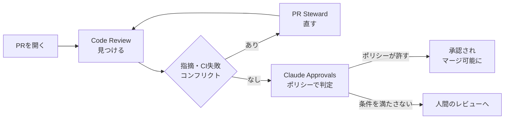
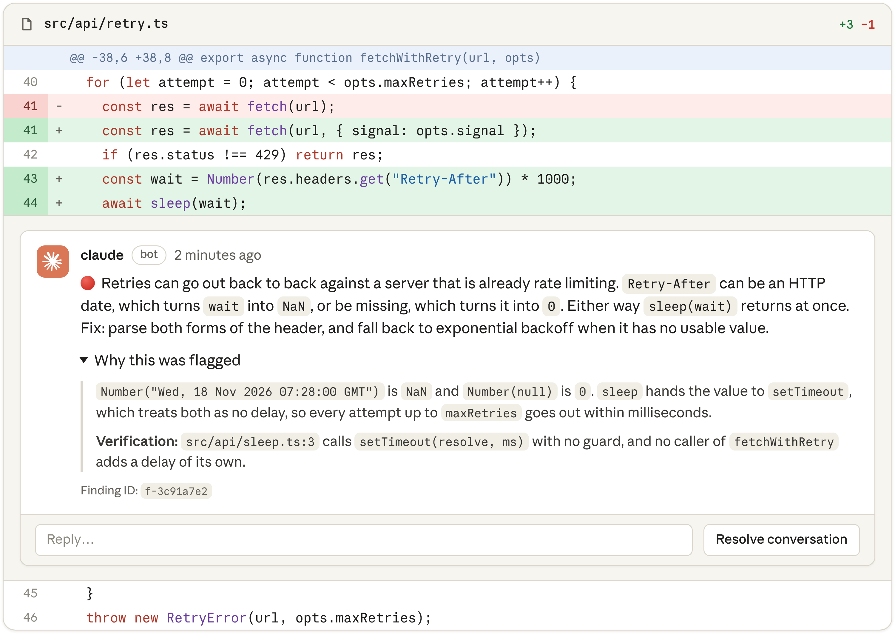
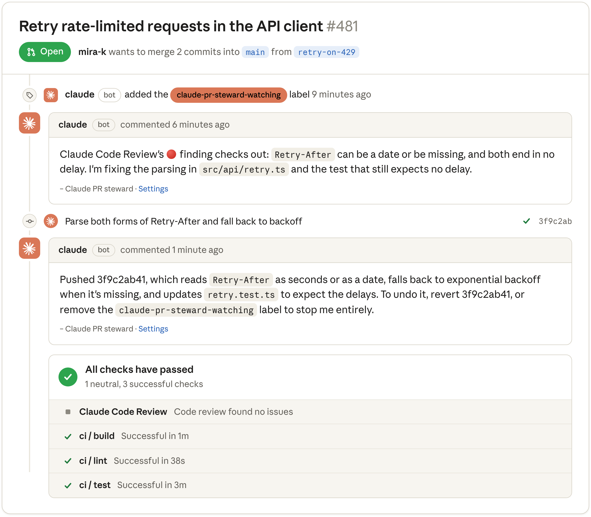
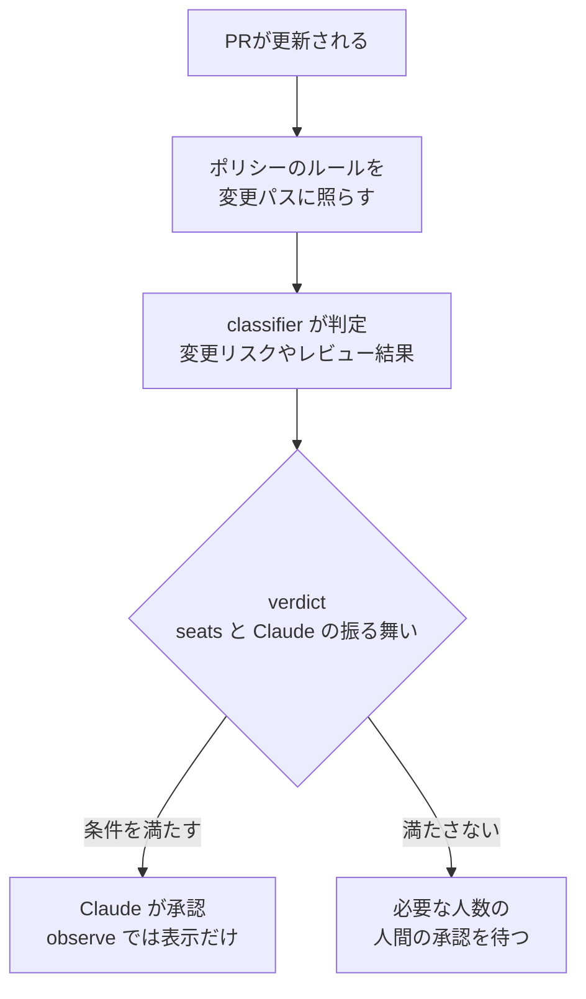
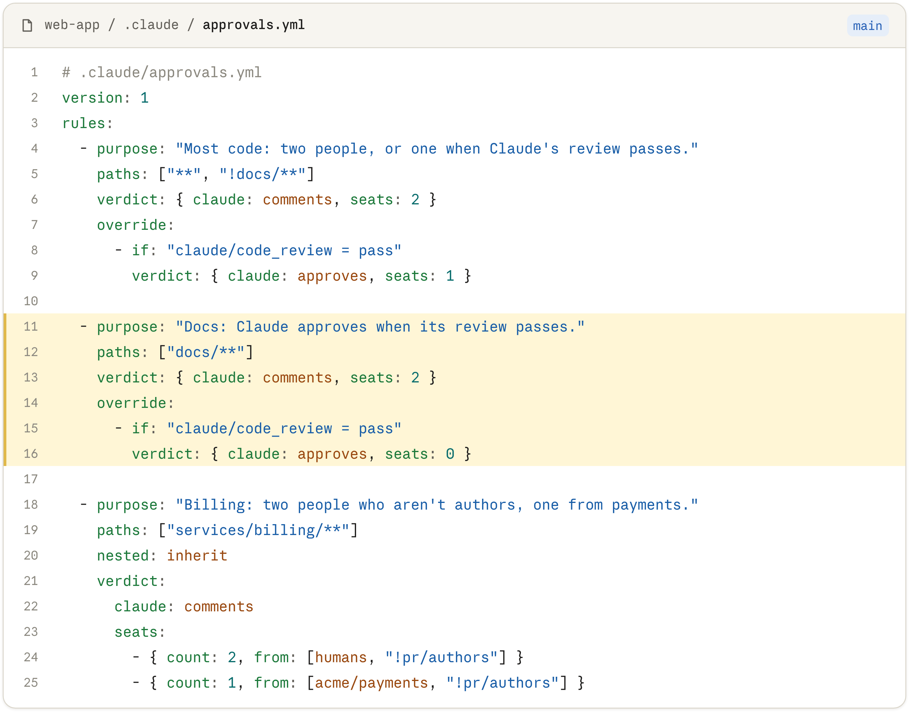
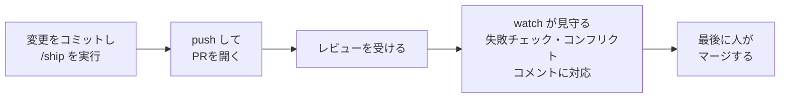
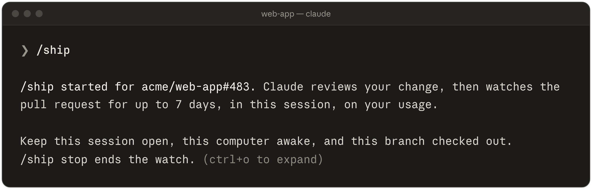

## はじめに

PRを出す側は、出したら次の作業に移りたいのに、レビューが返るたびに手を止めて、少し前に書いたコードへ頭を戻すことになります。レビューする側も同じで、私の仕事（フィンテックのプロダクト開発）では、認可まわりの変更のような「軽く見られないPR」のレビュー依頼が日常的に届き、承認待ちのPRが積まれていきます。

2026年11月23日、Anthropicが「Claude Ship」をベータで発表しました。PRをレビューし、直し、チームのポリシーに基づいて承認まで判断する仕組みです。

## 発表の中身は「見つける・直す・承認する」

Claude Shipは、1つの機能ではなく3つのエージェントの束です。分類軸は「PRのライフサイクルの、どの段階を担うか」です。

| 段階 | 担当 | 状態 | 承認できるか |
|---|---|---|---|
| 見つける | Code Review | GA（提供済み） | できない |
| 直す | PR Steward | ベータ | できない（設計上しない） |
| 承認する | Claude Approvals | ベータ | ポリシーが許せばできる |

Code Review自体は以前からある機能です。今回の実質は、残りの2つが加わって「PRを開いてからマージされるまで」の流れが閉じたことにあります。

PRが開かれてからマージされるまでの流れを図にすると、こうなります。



個人向けの入口として、Claude Codeに `/ship` というコマンドも追加されました（詳しくは「/ship - 個人の入口」で扱います）。

## なぜ今か：書く速度にレビューが追いつかない

「AIがコードを書くなら、レビューもAIでいいのでは？」と思っていませんか？

公式発表の言い分は、もう少し切実です。

エージェントがコードを書くようになると、PRの本数自体が増えます。でも、レビュー、修正の往復、承認者を探す作業は人間の速度のままなので、書く側だけが速くなると承認待ちの列が伸びるだけです。

Claude Codeチームでは Claude がコードの大部分を書いていて、Code Reviewをプロセスの一層として使った結果、2026年6月から9月にかけてマージされたPRが2倍を超え、差し戻し（revert）の割合は40%以上減ったそうです。もちろん、提供側の数字なので、そのまま受け取る必要はありません。

ZDNETの編集者は、「書く速さで出荷する」という考え方に首の後ろの毛が逆立つような感覚があると書いていました。つまり今回の発表は「レビューの自動化」ではなく、「マージまでの判断をどこまで機械に寄せるか」の話だと捉えた方が正確だと思います。


## Code Review - 見つける担当

Code Reviewは、PRの変更をコードベース全体と照らして読むレビューです。すでにGA（一般提供）になっています。

仕組みは4段階です。

1. **Find**: 複数のエージェントがdiffと周辺コードを並列に読む
2. **Verify**: 見つけた候補をコードと照合し、誤検知を落とす
3. **Rank**: 重複を取り除き、深刻度順に並べる
4. **Post**: PRにインラインコメントとサマリを投稿する

大事なのは、この段階では承認もブロックもしない点です。結果は check run として付き、問題がなければ「問題なし」と表示される、あくまで指摘を出す係です。

デフォルトで見るのは「正確性」、つまり本番を壊すバグです。フォーマットの好みやテストカバレッジの不足は見ません。


*Code ReviewがPRに付けた指摘の例。リトライ処理で `Retry-After` の解釈を誤ると間隔なしで再試行してしまう、という指摘（出典：Anthropic公式発表「Introducing Claude Ship」）*

見てほしい観点を変えたい場合は、リポジトリに `REVIEW.md` のようなガイダンスファイルを置きます。

大事なのは、読まれるのがベースブランチのものだけだという点です。PR自身の変更からは読まれないので、レビューの基準をレビューされる側が書き換えられません。この「基準は守る側に置く」考え方は、後に出てくるApprovalsにも共通します。

レビューの深さは Quick / Standard / Deep の3段階からリポジトリごとに選べます。

実行タイミングも選べます。PR作成時に1回か、pushのたびか、手動か。初期値は「pushのたび」で、一番多く走る設定です。料金のところで効いてきます。

## PR Steward - 直す担当

PR Stewardは、PRをグリーンな状態に保つためのエージェントで、今回のベータで新しく出てきました。

対象は3つです。失敗したCIチェック、マージコンフリクト、そしてレビューのフィードバックです。フィードバックは Code Review のものだけでなく、他のレビューツールや人間のコメントも含みます。

たとえば、CIが落ちたら、原因がPRのコードにある場合に修正を試みます。コンフリクトが出たら、ベースブランチを取り込んで解消を試みます。人のコメントには、小さく具体的な変更なら対応して返信し、設計に関わる大きな話ならpushせずに返信だけをします。

push のたびに「何を変更したか、どう戻せるか」をコメントに残します。止めたいときは、監視中を示すラベルを外すか、`@claude stop` とコメントします。コメントで `@claude` と指示を出して作業を寄せることもできます。


*PR Stewardが、Code Reviewの指摘を受けて修正をpushし、結果と戻し方をコメントした例（出典：Anthropic公式発表「Introducing Claude Ship」）*

**PR Stewardは承認もマージもしない**とはっきり決められています。

「自動で直してくれるなら、勝手にマージまでされそうで怖い」と思っていませんか？少なくとも Steward については「しない」が仕様で、マージの可否は branch protection と、この後の Approvals 側に寄せてあります。

個人的に一番刺さったのは、CI失敗への対応です。

私の個人開発では、CIが落ちたまま気づかず、失敗通知だけが溜まっていくことがありました。問題は落ちたこと自体より、「落ちたのに誰も見ていない時間」です。直す頃には原因の文脈が頭から抜けています。PRを開いた直後から見守り、落ちたらその場で直しに行く係は、この問題に素直に効きます。

ただし、料金面の注意が1つあります。PR Stewardには、管理者が設定するまで**自分用の spend limit が存在しません**。公式ドキュメントが明記しています。入れるなら、開始設定はまず Manual（`@claude steward` と呼ばれたときだけ動く）にします。

## Claude Approvals - 承認する担当

3つ目が、今回一番新しい部分です。Claude Approvalsは、PRに対して「あと誰の承認が要るか」を、リポジトリに置くポリシーファイルを基準に判定するチェックです。

公式はこれを「賢い CODEOWNERS ファイル」と例えています。

CODEOWNERSが「このパスはこの人が見る」を決めるのに対し、Approvalsのポリシーは「このパスは何人の承認が要るか」「Claudeが承認してよいか」「どういう条件なら人数を緩めるか」まで足せます。

判定の流れはこうです。



### ポリシーファイル `.claude/approvals.yml` の書き方

ファイルは `.claude/approvals.yml` で、デフォルトブランチにマージされると有効になります。公式のスターターポリシーはこういう形です。

```yaml
# .claude/approvals.yml
version: 1
mode: observe
rules:
  - purpose: "A change takes two people. When Claude's review passes, one is enough and Claude approves."
    paths: ["**"]
    verdict: { claude: comments, seats: 2 }
    override:
      - { if: "claude/code_review = pass", verdict: { claude: approves, seats: 1 } }
  - purpose: "A change to the review rules takes two people."
    paths: ["**/.claude/**"]
    nested: inherit
    verdict: { claude: comments, seats: 2 }
```


*公式発表に載っている `.claude/approvals.yml` の実例。ドキュメントだけの変更には `seats: 0` の override、課金まわりには著者を除いた2人の承認、という書き分けが見える（出典：Anthropic公式発表「Introducing Claude Ship」）*

1つ目は `mode: observe` です。この状態では、チェックは「ポリシーならこう判断した」と表示するだけで、Claudeは承認せず、マージもブロックしません。まず観察から始めるのが公式の推奨手順です。

2つ目は `verdict` です。そのパスに何人の承認が要るか（`seats: 2`）と、Claudeの振る舞い（`claude: comments`。承認する／コメントだけ／ブロックする）を分けて書きます。

3つ目は `override` です。「Code Reviewが pass なら、必要な人数を1人に緩めて、Claudeが承認してよい」という条件分岐を書く場所です。条件には、変更行数や対象ブランチといったPRの事実のほか、classifier と呼ばれる判定の結果も使えます。

2つ目のルールは `.claude/` 配下に緩和なしの2人を要求していて、ポリシーファイル自身も含まれます。ルールを決めるファイルの変更こそ重く見る設計です。

### classifier - 自然言語で書く判定

classifierは、「変更のリスクはどのくらいか」のような問いをモデルに判定させる仕組みです。自作の classifier は `.claude/classifiers/<名前>/def.yml` に定義します。公式の例はこうです。

```yaml
# .claude/classifiers/change_risk/def.yml
version: 1
description: "How risky is this change to ship?"
model: opus
prompt: |
  Rate how risky this change is to ship.
  high: it touches sign-in, billing or a data migration.
  medium: it changes behavior a user can see.
  low: anything else.
  When two ratings fit, pick the higher.
outputs:
  risk: { type: ordinal, values: [low, medium, high] }
```

「サインイン、課金、データ移行に触れたら high」。これは、レビュアーの頭の中にある暗黙の線引きを、そのまま文章で書く形です。この判定結果を override の条件に使えば、「リスクが low のときだけ人数を緩める」といったポリシーが書けます。

運用は、まず classifier を `advisory`（実行されるが何も決めない位置）に置いて答えの質を確認し、信頼できてから条件に使う、という順序が推奨されています。

組み込みの classifier も2つ用意されています。

`claude/code_review` はレビューが pass か fail かを、`claude/diff` は push の後に差分がどのくらい変わったかを返します。後者は「前の承認をどこまで引き継ぐか」の判定に使います。

### 承認の怖さは、設定で作れてしまう

ドキュメントを読むと、「人間が誰も見ていない変更がマージされる」構成を作れてしまいます。公式ドキュメント自身が、そのケースを列挙して注意を促しています。

- `seats: 0` のルールでは、ボットが書いたPRが誰にも見られずマージされうる
- `seats: 1` は著者が埋められるので、実質「もう誰も見なくてよい」になりうる
- `claude: approves` と書いただけのルールはレビューを開始しないため、何のレビューも受けていない変更を Claude が承認する構成がありうる
- GitHub側の必須承認が1件の場合、その1件を Claude の承認が埋めてしまうことがある

安全性はモデルの賢さではなく、ポリシーの書き方で決まります。レビューを通してから承認させたいなら、`claude/code_review = pass` のような条件と組み合わせる必要があります。

「protected files」として扱われるファイル（ポリシーファイル、classifier の定義ファイル、`REVIEW.md`、CODEOWNERS など）があり、変更には通常、人の承認が求められます。ただし `.github/` や `CLAUDE.md` は対象外で、「大事なものは自分でルールを書いてください」と明記されています。

もう1つ、条件には CI の結果が使えません。CIは GitHub の必須チェックとして別に保つ設計で、Approvalsは「人の承認」の置き換えです。CIの置き換えではありません。

## /ship - 個人の入口

組織向けの設定をしなくても、開発者個人は Claude Code の `/ship` でこの流れを試せます。

流れは4ステップです。変更をコミットして push し、PRを開けます。`/code-review` でレビューした後は、watch が失敗したチェックやコンフリクト、レビューコメントに対応して修正を push します。最後に、**マージは自分でやります**。



たとえば、金曜の夕方に小さな修正を出して週末に入る場面です。月曜に戻ってきたときには指摘やCI失敗への対応が済んでいて、マージ判断だけが残っている。そういう使い方になります。


*Claude Codeで `/ship` を実行した画面。watch がこのセッションの中で動くことがそのまま表示されている（出典：Anthropic公式発表「Introducing Claude Ship」）*

レビューなしで見守りだけ欲しい場合は `/steward` というコマンドもあります。PR Steward（組織向け）とは別物で、違いは「どこで動くか」です。

- `/ship` の watch: 自分の Claude Code セッションの中で動き、自分の利用枠を消費する
- PR Steward: 組織のクラウドセッションで動き、組織に課金される

watch の前提は、Claude Code v2.1.330 以降と GitHub CLI 2.63 以降です。watch の間は、セッションを開いたまま、PCも起こしたまま、対象ブランチをチェックアウトしたままにしておく必要があります。最長7日で終わります。

無人で動く watch 中は、いくつかの操作がブロックされます。マージ、承認、auto-merge の有効化、force-push です。ただし auto-merge が最初から有効な PR では、Claude の push が結果的にマージを引き起こすことはありえます。

## 料金はトークン課金、提供はTeam / Enterpriseのみ


- 3つのエージェントとも、組織の usage credits へのトークン課金で、プランの月額に含まれる利用量とは別枠の上乗せです
- 1レビューあたりの定額はありません。レビューレベル、変更の大きさ、push の回数（レビュー頻度の設定）で変わります。公式は「まずパイロットを回して、1レビュー平均コストを実測してから見積もれ」という手順を示しています
- Claude Approvals 自体に基本料金はありません。ただし、ポリシーが起こす classifier の実行と Code Review は課金され、**observe mode でも課金されます**。レビュー結果を条件に使う構成では、observe 中も PR のたびにレビューが走り、その分が請求されます
- PR Steward は spend limit がありません。Code Review と classifier 実行には上限を設定できます
- usage credits をオフにしても、オンになっているエージェントは動き続けて課金されます。止めるには Ship 自体をオフにする必要があります
- 対象の Enterprise 組織は、最低 $10,000 分の Claude Ship クレジットを請求できます。請求は2027年1月15日までで、30日以内に使う形です

- Claude Team / Enterprise プランのみ。個人プランでは組織向けのエージェントは使えません（`/ship` は通常の Claude Code 利用として動きます）
- リポジトリは GitHub のみです
- Zero Data Retention、HIPAA 構成、顧客管理暗号鍵（CMEK）を使っている組織は利用できません。Approvals については、FERPA や Access Transparency の設定でも開始できません

特に最後の制約は、金融や医療のようにデータ保持の要件が厳しい組織ほど引っかかり、「入れたいのに契約形態で入れられない」が普通に起こりえます。

## 私なら、まず /ship から入れる

ここからは、私の導入計画です。使う順番は公式の推奨とだいたい同じですが、線の引き方は自分の仕事に寄せます。

### まず個人のリポジトリで /ship から

最初の一歩は、組織の設定ではなく `/ship` だと思います。自分のセッションで回すだけなら、ポリシー設計も組織の承認も要りません。

私の場合、個人開発の CI 失敗の放置が一番具体的な痛みです。watch が「落ちたチェックに対応する」ところの感触と、セッションを開きっぱなしにする運用の重さを体感して、常駐の PR Steward と比べる材料にしたいです。

### チームに入れるなら、Steward は手動開始から

チームのリポジトリに入れる順番は、Code Review、PR Steward、Approvals の順です。

PR Steward は、最初は Manual 開始にします。全 PR に自動で付く前に、「呼ばれたときだけ動く」状態で直し方の癖を見て、spend limit も先に設定します。上限なしで始まる仕様なので、ここは後回しにしません。

Code Review は、初期値の「push のたび」だと push の多いリポジトリではそのまま料金に跳ねるので、まずは「PR作成時に1回」か手動で始めて、1レビューの単価を実測するのが先です。

### Approvals の本丸はポリシー設計

Approvals は、機能というより「自チームの承認ルールを、コードとして書き直す作業」だと思っています。

私の仕事では、認可まわりの変更が典型例です。OAuth のステータス表示をどう見せるか、同意画面に何を出すか、同意のバージョンをどう扱うか。行数が少なくても影響が大きく、「変更が小さいから自動で通してよい」が一番成り立たない領域です。

なので、私なら最初にこう線を引きます。

- 認可・認証、ステータスの見せ方、同意まわり、課金まわりのパスは、Claude の自動承認の対象外にする。`seats` は人を必須にし、著者を数えない形（`"!pr/authors"`）も検討する
- ドキュメントやテストのフィクスチャのような、壊れても影響の小さい変更から、observe mode の判断を観察する
- classifier を使うなら、公式例のように危険側の定義を自分たちの言葉で書き、迷ったら高い方に倒す
- observe mode の判断と、人間のレビュアーの判断がしばらく一致するか確認する。その後に、必須チェック化と緩和を進める

もう1つ、ポリシーファイル自体の扱いです。ポリシーを緩める変更は、実質的にレビューの門番を弱める変更です。公式スターターが `.claude/` 配下に緩和なしの2人ルールを置いているのはこのためで、ポリシーファイルの変更は通常のコードと同じか、それ以上に丁寧にレビューする文化が要ります。「誰が門番の設定を変えられるか」が、そのまま組織のリスクになります。

### 既存のレビューツールとの関係

すでに Devin Review のような AI レビューを使っている現場もあります。そういう現場で効くのは、Code Review との競合ではなく、PR Steward が「他のボットの指摘にも対応する」点です。Code Review の Important な指摘だけでなく、他ボットの lint 指摘やバグも対象になります。

ただし、指摘する係が増えると直す係の仕事も増えます。レビューツールの棚卸しなしに Ship だけ足すと、PR の往復は速くなる代わりに、トークンの消費も往復の回数に比例します。

## まだ分からないこと

発表から日が浅く、ドキュメントを読んでも分からないことは残ります。

- 料金の実額感です。「月いくらか」は、自組織の PR で測るまで誰にも分かりません
- 日本語のコードベースや日本語のレビューコメントに対する挙動です。ドキュメントに言及はなく、試すしかありません
- Approvals の判定が、実際のチームの暗黙知とどこまで一致するかです。classifier の prompt に線引きを書いても、「この変更は小さいけど危ない」という感覚を文章化しきれるかは、運用してみないと分かりません
- 開発者コミュニティの反応も、発表直後でまだ揃っていません。メディアの論調は「速度への期待」と「承認を機械に渡すことへの警戒」が半々、という印象です
- GitHub 以外（GitLab 等）への対応時期も未発表です

## まとめ

Claude Shipを、PRのライフサイクルで分類するとこうなります。

- **見つける**: Code Review（GA）。指摘を出す係で、承認もブロックもしない
- **直す**: PR Steward（ベータ）。CI失敗、コンフリクト、フィードバックに対応する係で、承認もマージもしない
- **承認する**: Claude Approvals（ベータ）。リポジトリ内のポリシーファイルを基準に、承認の要否を判断する係

新しいのは3つ目で、怖さも可能性もそこにあります。マージの判断は、人の頭の中から `.claude/approvals.yml` というファイルに移りました。そのファイルをどう書くかが、そのままチームの安全性になります。

最初の一歩は、個人の変更で `/ship` を試すか、小さなリポジトリにポリシーを observe mode で置いてみることです。いきなり自動承認を有効にせず、「ポリシーならどう判断したか」をしばらく眺めるところから始めるのが安全です。
