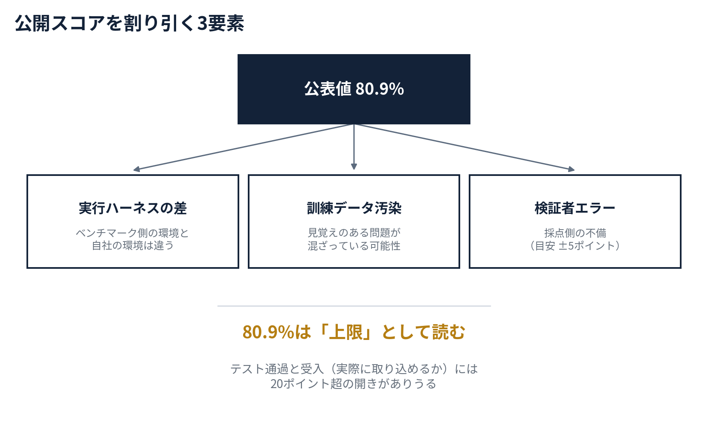

新しいモデルが出るたびに、ベンチマークのスコアが並ぶ。SWE-benchで何ポイント上がった、GAIAで何パーセントに達した、といった数字は分かりやすい。ただ、その数字を自分のプロダクトの品質にそのまま読み替えると判断を誤る。公開スコアは「あるモデルと、ベンチマーク側が用意した特定の実行環境（ハーネス）の組み合わせ」の成績である。訓練データ汚染と、合否を決めるテスト側の誤り（検証者エラー）の影響も受ける。条件が違う以上、数字は割り引いて読むしかない。

一般論はここまでにする。この記事では、実在のスコア表示を1件取り上げ、実際に割り引いて読むとどうなるかを実演する。

## 実演の題材：SWE-bench Verified「80.9%」

題材は、OpenAIが2026年2月23日に公開したSWE-bench Verifiedに関する報告である。そこでは、最先端モデルのスコアが直近6ヶ月で74.9%から80.9%へ伸びたことが示されたうえで、「このベンチマークはもう報告しない」という判断が表明された（出典：OpenAI「Why we no longer evaluate SWE-bench Verified」, 2026-02-23, https://openai.com/index/why-we-no-longer-evaluate-swe-bench-verified/?utm_source=chatgpt.com&ref=hackernoon.com ）。

リリースノート風に切り取れば「80.9%、過去最高」である。ここから割り引きを入れていく。

### 割り引き1：その59.4%は「全体の59.4%」ではない

同じ報告には「59.4%」という数字も出てくる。ここを正確に読むのが第一の割り引きである。

OpenAIが監査したのは全500タスクではない。モデルが繰り返し解けなかった138タスク、全体の27.6%にあたる難しい側のサブセットである。その138件のうち59.4%に、テスト設計または問題文の重大な不備があった。内訳は、正しい解法を落とす狭すぎるテストが35.5%、問題文にない機能を問うテストが18.8%などである。

つまり「タスクの59.4%が壊れている」ではない。「解けないタスクを集めて調べたら、その6割近くはテスト側にも問題があった」である。全体に換算すれば、不備が確認されたのは少なくとも82件、全体の16.4%が下限になる。読み方で結論が変わる。スコア表の1ポイント、2ポイントの差を順位の根拠にする前に、採点側にこの桁の誤差が入りうることを差し引く必要がある。

### 割り引き2：汚染は「疑い」ではなく確認済みとして扱う

同じ報告では、検証した全フロンティアモデルが、一部のタスクについて正解パッチ（gold patch）そのもの、または問題文の逐語的な詳細を再現できた。そう報告されている。学習時に問題と解答を見ていた証拠である。

この場合、80.9%という数字には「初見の問題を解く力」と「見覚えのある問題を思い出す力」が混ざっている。混ざる比率は外からは分からない。本番で渡されるタスクは未見のものだけなので、実務で使える側の読み方は「80.9%は上限であり、未見タスクでの実力はこれより下にある」と置くことになる。

### 割り引き3：テストを通ることと、マージされることは別である

もう1件、別の物差しを持ってくる。METRは2026年3月10日の研究ノートで、SWE-bench Verifiedの自動採点を通った296件のエージェント製パッチを、対象リポジトリのメンテナ4人にブラインドでレビューさせた結果を公表した（出典：METR「Many SWE-bench-Passing PRs Would Not Be Merged into Main」, 2026-03-10, https://metr.org/notes/2026-03-10-many-swe-bench-passing-prs-would-not-be-merged-into-main/?ref=hackernoon.com ）。

結果は次のとおりだった。メンテナのマージ判断は、自動採点より平均で約24ポイント低かった。人手の正解パッチを基準に正規化すると、採点を通ったパッチの約半分はマージされないという結果である。却下理由は、コード品質、他のコードを壊すこと、中核機能の未達である。

80.9%にこの物差しを重ねると、読みはこう変わる。「テスト通過率80.9%」は「そのまま取り込める変更の割合」ではない。通過と受入の間には、測定によっては20ポイントを超える開きがある。

### 割り引き後の判断文

3つの割り引きを入れたあと、このスコアについて書ける文は次の程度になる。

> SWE-bench Verifiedの80.9%は、特定のハーネスと汚染を含む条件下でのテスト通過率としては読める。ただし、採点側の不備と汚染の影響を除去できないため、未見の実タスクでの成功率の予測には使えない。モデル世代間の大まかな方向を見る用途に限定し、自プロダクトの出荷判断には使わない。

地味だが、これが数字の実力に合った使い方である。「高いから採用」「上がったから出荷可」まで進める根拠は、スコア表のどこにもない。

## 飽和の確認：GAIAの94%

割り引きが必要なのは不備のあるベンチマークだけではない。GAIAのように、天井に近づいたものも差を測る役目を終える。GAIAの公開リーダーボードでは自己申告ベースのテストセットスコアが94%台に達し、原論文（2023年）の人手ベースライン92%を超えた（出典：GAIAリーダーボード集計, 2026-11時点, https://theworldofai.org/benchmarks/gaia/ ）。ただし、再実行ベースの検証では最高でも74%台にとどまる報告もある。提出方法の違いで数字が大きく変わる。このこと自体が、天井付近の数字の不安定さを示している。平均点が高いことと、自分の業務の失敗すると困る部分で動くことは、別の話である。

## 持ち帰り：スコアを見るときの確認表

他のベンチマークでも使えるよう、上の実演を表にしておく。

| 確認項目 | どこを見るか | 開示がない場合の扱い |
|---|---|---|
| ハーネス条件 | ベンチマークの公式ドキュメント、再現用リポジトリ。ツール一覧、リトライ回数、制限時間、プロンプトの置き方 | 条件不明として扱い、自環境への換算はしない |
| 監査・不備の報告 | 作成者や第三者による監査記事。不備率と、その分母（全体か、サブセットか） | 「不備なし」ではなく「未監査」として読む |
| 汚染の確認方法 | 作成者の汚染チェック報告。モデルが正解を再現できるかの検証有無 | 公開タスクは汚染の可能性を前提に割り引く |
| 採点の定義 | テスト通過か、最終状態の一致か、人手レビューが入るか | 通過＝受入可能、とは読まない |
| スコアの分母と分割 | validation / test の別、自己申告か再実行か、提出日 | 異なる分割・方法の数字同士を順位付けしない |

開示されていない項目は、探し回るより「不明」と明記して判断文に残すほうが実務では使える。不明であること自体が割り引きの根拠になる。

## 出荷判断には自前評価が要る — 本書の対応章

ここまででできるのは、他人の数字を正しく割り引くことまでである。出荷判断に必要なのは別の数字、つまり自分のタスク、自分のハーネス、自分の採点基準で測った結果である。その自前評価をどう設計し、どう作るかは、この記事では扱っていない。

その部分をまとめたのが、Zenn Book『ベンチマークを信じるな — AIエージェント評価の実務』（¥2,000）である。対応は次のとおりである。

- 自分のタスクで評価セットを作る手順（本番の失敗からの「収穫」と合成データの「栽培」、属性グリッドとgolden set化）：第3章。付録Aに、ケース1件の雛形とルーブリック例がそのまま書き換えて使える形で載っている
- 答えではなく軌跡を採点する方法：第4章
- LLMジャッジを校正して計測器にする手順：第6章。付録Bに校正シートと運用チェックリストがある
- 評価をCIのゲートにするしきい値の決め方：第7章
- ツールを課金単位とデータの置き場で選ぶ比較：第8章と付録Cの選定マトリクス

まず判断材料として、第1章から第3章まで（約21,000字）は無料で公開している。ベンチマークの前提がどう崩れたか、評価の語彙と全体像、評価セット構築の基本までが1つのまとまりとして読める。続きが必要かどうかは、無料分を読んでから決めればよい。

<!-- ここに本へのリンクカードを設置 -->
