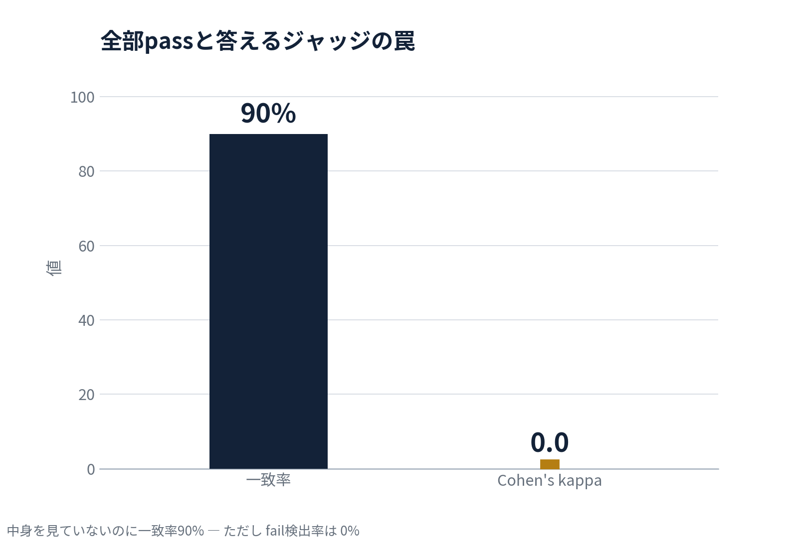

LLM-as-a-Judgeの導入は簡単である。評価対象の出力と採点基準をプロンプトに書き、別のモデルに渡せば、それらしいスコアが返ってくる。問題は、そのスコアを信じてよいかどうかを、導入した側がたいてい確認していないことだ。

校正していないジャッジが出す数字は、測定ではなくノイズである。数字の形をしているので測定に見える。本当の正解とどれだけずれているか分からない以上、「先週より改善した」「この変更で悪化した」という判断には使えない。

この記事で扱うのは2点だけである。1つは、校正していないジャッジがどれだけ簡単に「良い一致率」を出してしまうか。もう1つは、その嘘をCohen's kappaが見抜く仕組みである。補正の計算は小さな例を1つだけ実演する。校正の手順そのものは記事の範囲外とし、末尾で本の側に残したものを明示する。

## 怖さの実例：何も判定していないジャッジが90%一致する

passが9割を占める評価データを考える。100件のうち、人間ラベルはpass 90件、fail 10件である。

ここに「全部passと答えるジャッジ」を置く。このジャッジは中身を一切見ていない。それでも人間との一致率は90%になる。100件中90件で一致するからである。

この数字だけを見れば「一致率90%、十分使える」と報告できてしまう。実際には、落とすべき10件を1件も落としていない。failの検出率は0%である。passに偏ったデータでは、生の一致率は判定していないジャッジにも高得点を与える。これが校正なしの数字の怖さで、派手な事故ではなく、静かに判断を誤らせる形で効いてくる。

## kappaは偶然の一致を差し引いて嘘を見抜く

この嘘は、偶然一致する分を差し引く指標で見抜ける。代表例がCohen's kappaである。

kappaは「実際に一致した割合（観測一致率）」から「偶然でも一致する割合（期待一致率）」を引き、残りを正規化した値である。

上の例で計算する。人間はpass 90%、fail 10%。ジャッジはpass 100%、fail 0%。期待一致率は、両者が偶然同じ判定をする確率なので、0.9 × 1.0 + 0.1 × 0.0 = 0.9になる。観測一致率も0.9である。したがってkappa = (0.9 − 0.9) / (1 − 0.9) = 0になる。

一致率90%とkappa 0。この2つが並ぶと、数字の意味は一変する。「9割一致している」のではなく「passの比率だけで説明できる一致しかしていない」のである。

逆に、kappaが十分に高ければ、その判定基準は人にもモデルにも再現可能な形になっていると判断できる材料になる。報告の際は、生の一致率とkappaをセットで残す。片方だけでは、後からデータの内訳が変わったときに比較の土台が残らない。

この考え方は、Anthropicが2026年1月9日に公開したエージェント評価ガイド『Demystifying evals for AI agents』でも前提になっている。同ガイドは採点者（グレーダー）をコードベース、モデルベース、人間の3種に整理している。モデルベースの採点は人間判定との校正が必要だとも明記している（出典：Anthropic, 2026-01-09, https://www.anthropic.com/engineering/demystifying-evals-for-ai-agents ）。モデルに採点を任せること自体は標準的な選択肢だが、校正なしで使うことは想定されていない。

なお、投入可否の目安がある。人間との一致率が75〜90%程度に達した段階で本番の評価に使い始める、という水準である。Label Studioの実務ガイドで提示されている（出典：Label Studio「How to use LLM-as-judge for agent evaluation」, https://labelstud.io/learning-center/how-to-use-llm-as-judge-for-agent-evaluation/ ）。75%未満ではノイズのほうが大きく、90%を超える場合は逆にルーブリックが粗すぎないかを確認せよ、という読み方も併記されている。万能のしきい値ではないが、自チームの基準を決める際の出発点にはなる。

## 補正の実演：観測75%は、真値では約71.7%

校正で得られるのは一致率だけではない。人間がpassと言うべきものをジャッジが落とす割合と、その逆も分かる。これを使うと、ジャッジが出した報告スコア自体を補正できる。数値を全部置いて1例だけ計算する。

校正セット200件（人間ラベル：pass 100件、fail 100件）で、ジャッジの結果が次のとおりだったとする。

|  | ジャッジ pass | ジャッジ fail | 合計 |
|---|---|---|---|
| 人間 pass | 92 | 8 | 100 |
| 人間 fail | 32 | 68 | 100 |

ここから感度と特異度が分かる。感度（人間passをジャッジもpassと言う割合）は92 / 100 = 0.92である。特異度（人間failをジャッジもfailと言う割合）は68 / 100 = 0.68になる。このジャッジは、落とすべきものを32%の割合でpassと言ってしまう癖がある。

この状態で本番の評価を回し、ジャッジのpass率が75%と観測されたとする。Rogan–Gladenの補正式に当てはめると、真のpass率は次のように推定される。

真値 = (観測値 + 特異度 − 1) / (感度 + 特異度 − 1) = (0.75 + 0.68 − 1) / (0.92 + 0.68 − 1) = 0.43 / 0.60 ≒ 0.717

つまり約71.7%である。報告された75%と比べると3.3ポイント低い。「pass率75%を維持する」という目標に対しては合否が反転しうる差であり、バージョン間の改善幅が数ポイントの局面では、補正の有無が結論そのものを左右する。

大事なのは式そのものより、補正に必要な感度と特異度は校正しなければ手に入らない、という点である。校正していないジャッジの数字は、補正のしようがない。だから「割り引いて読む」ことすらできない。

## 本編第6章に残したもの — 校正セット・バイアス検査・再校正

この記事では、考え方と小さな実演までに留めた。実務で校正を回すには、少なくとも次の手順と道具が要るが、それらは記事では扱っていない。

- 校正セットの作り方：何件をどう層別して抜くか、人間ラベルを付ける際の判定指示をどう書くか
- 位置バイアス、冗長性バイアス、流暢さバイアスの検査手順と、合否の目安
- 補正値に信頼区間を付ける計算手順
- ジャッジ変更時や評価セット拡張時の、再校正トリガーの運用設計

これらはZenn Book『ベンチマークを信じるな — AIエージェント評価の実務』（¥2,000）の第6章で手順として解説している。本編第6章が手順、付録Bが道具、という分担である。付録Bには、校正1回分の全記録項目を1枚に残す校正シートを収録した。記録項目は、校正セットの構成、人間同士の一致率とkappa、混同行列、感度・特異度、補正後のスコア、判定可否である。公開前・変更時・月次という節目ごとに対応した運用チェックリストも収録した。シートがあることで、「判定が不可だった回」を破棄せず、プロンプト修正後に再校正して数値の動きを追う運用が可能になる。

まず第1章から第3章まで（約21,000字）は無料で公開しているので、評価全体の設計図はそちらで確認できる。ジャッジをすでに運用していて、自分の一致率が上の例のどちら側にあるか分からない状態であれば、第6章と付録Bが直接の対象になる。

https://zenn.dev/kazu1/books/benchmark-evals
