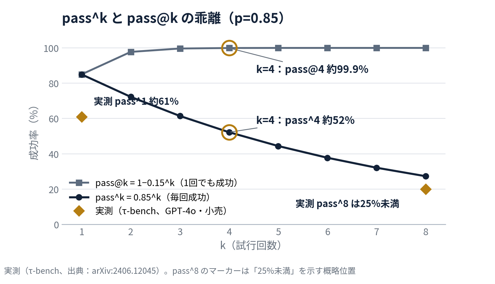

エージェントの評価結果として「成功率92%」という数字を見たとき、その数字がどう数えられたかを確認する人は意外と少ない。各タスクを1回しか走らせていないのか。複数回走らせて集計しているのか。同じタスクを何回走らせたうちの、何回成功したのか。

複数回走らせた場合、「1回でも成功すれば成功」と数えたのか、「毎回成功して初めて成功」と数えたのか。数え方が違うだけで、同じエージェントでも報告される数字は大きく変わる。本番の信頼性を議論したいのであれば、この数え方の違いは細部ではなく本題である。

この記事はpass^kに絞る。タスクの長さに対する耐性（信頼性曲線）は関連する論点だが、ここでは入口だけを示し、詳細は本の側に残す。

## pass@kが測っているのは上限である

よく使われる指標にpass@kがある。同じタスクをk回試行し、そのうち1回でも成功すれば、そのタスクは成功と数える。モデルやプロンプトにどれだけの潜在能力があるかを知りたい場面では、この指標にも意味がある。研究開発の初期に上限を見積もる用途がそれに当たる。

ただし、本番の利用者はエージェントをk回も試してくれない。問い合わせ対応であれば1回、予約変更であれば1回である。その1回の結果がそのまま利用者の体験になる。失敗すれば、そのまま事故や手戻りになる。pass@kは「k回の中の最良の1回」でタスクを代表させる指標なので、利用者が引く1回とは対応していない。デモで見た成功が本番で再現しない、という感覚の正体の一部はここにある。デモはたいてい、うまくいった1回を見ている。

代わりに本番に近いのがpass^kである。pass^kはk回すべて成功した場合にだけ成功と数える。記法は似ているが、測っているものは逆に近い。pass@kが最良のケースを見るのに対して、pass^kは毎回崩れないかを見る。

## 別の数字で見る：1回85%のエージェントを4回回す

1回あたりの成功率が85%のエージェントを考える。1回だけ見れば、実用に近い数字に見える。

同じタスクを4回走らせたとき、4回すべて成功する確率は下がる。試行が独立だと単純化すれば0.85の4乗で、0.522、およそ52%である。逆にpass@4、つまり4回のうち1回でも成功する確率は1 − 0.15の4乗で、約99.9%になる。

同じエージェント、同じ実行結果の集まりから、「99.9%」と「52%」の両方が作れる。どちらも計算は正しい。違うのは、何を品質と呼ぶかである。本番で利用者が引くのは最良の1回ではなく、任意の1回であり、失敗が事故になる用途では「毎回成功するか」のほうが実態に近い。

実測でも同じ形が報告されている。この考え方を前面に出したτ-bench（Yao et al., 2024）では、小売ドメインでGPT-4oの単回成功率（pass^1）が約61%だった。それに対し、8回すべて成功する割合（pass^8）は25%未満まで下がった（出典：τ-bench論文, arXiv:2406.12045, https://arxiv.org/html/2406.12045v1 ）。採点は、会話がそれらしく終わったかではない。最終的なデータベースの状態が期待通りかで採点する。その設計のうえで、成功の揺れ自体を品質として報告している。

## kは失敗コストと評価コストの釣り合いで決める：小さな試算

実務で全ケースを何十回も走らせる余裕はない。試行回数を増やせば評価コストはそのまま増える。そこで必要になるのが、kの決め方とコストの桁感である。小さな試算を1つ置く。

前提を置く。失敗が顧客対応の事故に直結する重要ケースが20件ある。1回の試行（trial）あたりの実行コストを、エージェントのAPI呼び出しと採点を合わせて120円と仮定する。

- 重要ケース20件 × k=5 × 120円 = 12,000円

評価1回あたり12,000円である。週1回回せば月あたり約48,000円になる。この金額を高いと見るか安いと見るかは、事故1件の対応コストとの比較で決まる。kを3に落とせば7,200円、10に上げれば24,000円と、コストはkに比例する。

kの決め方の原則は単純で、失敗コストと評価コストの釣り合いである。失敗しても再実行や人手の差し戻しで済むケースは、k=1の回帰検知で足りる。金額や権限に関わるケースは違う。失敗がそのまま事故になるため、評価コストを払ってでもkを上げる意味がある。全ケースに一律のkを付けるのではなく、ケースの重要度でkを変えるのが現実的な落としどころになる。

なお、pass^kと単回成功率が乖離したときに、どちらの数字で出荷ゲートを止めるかというしきい値の設計は、この記事では扱わない。第7章のテーマである。

## 長さで層別すると平均の裏が見える：層別表の見本

もう一つ、平均スコアにはタスクの長さが隠れるという問題がある。短いタスクと長いタスクを混ぜて平均すると、長いタスクでの崩れが見えなくなる。

ここでは詳細には踏み込まず、層別した集計がどういう形になるか、架空の集計例を1表だけ置く。各ケースを3回試行した結果である。

| タスク長（人手の作業時間） | ケース数 | 試行数 | 単回成功率 | pass^3 |
|---|---|---|---|---|
| 15分未満 | 40 | 120 | 90.8%（109/120） | 80.0%（32/40） |
| 15分〜1時間 | 30 | 90 | 77.8%（70/90） | 56.7%（17/30） |
| 1時間〜4時間 | 20 | 60 | 61.7%（37/60） | 35.0%（7/20） |
| 4時間超 | 10 | 30 | 46.7%（14/30） | 20.0%（2/10） |

全体を平均すれば、成功率は76%前後と報告できる。層別すると話は変わる。4時間超の層では単回でも半分を切り、3回連続成功は2割しかない。次に直すべき場所は平均からは見えず、この表からなら見える。長さを「時間」で測る発想自体は、METRのタイムホライズン研究（Kwa et al., 2025）で知られるものである（出典：METR「Measuring AI Ability to Complete Long Software Tasks」, https://pdfs.assets.alphaxiv.org/2503.14499v4.pdf ）。

急落する層をどう切り分けるか、層の刻み方をどう決めるか、マルチエージェント構成でどのエージェントの失敗かをどう割り当てるかは、第9章で扱う。この記事では「平均の裏で長さ方向にもう一段落ちる」という予告に留める。

## この記事で意図的に残した問い

pass^kで数え直すこと自体は、今日からでもできる。ただし実務に落とす段階では、次の問いが残る。

- どのケースを重要ケースとして複数回試行の対象にするか、その選定基準：第5章（abstention評価、つまり答えない・止まるべき場面の評価も含む）
- pass^kと単回成功率が乖離したとき、どちらのしきい値でゲートを止めるか：第7章
- タスク長で層別した信頼性曲線の読み方と、急落層の切り分け：第9章
- 複数回試行の評価コストを、全体の評価予算の中でどう配分するか：第11章

これらを一つの流れとして扱ったのが、Zenn Book『ベンチマークを信じるな — AIエージェント評価の実務』（¥2,000）である。第1章から第3章まで（約21,000字）は無料で公開しているので、評価セットの設計までは無料分で確認できる。pass^kの報告形式を自分の評価に持ち込む際の物差しとして使える構成にしてある。

<!-- ここに本へのリンクカードを設置 -->
