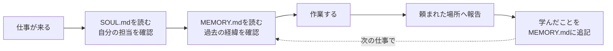
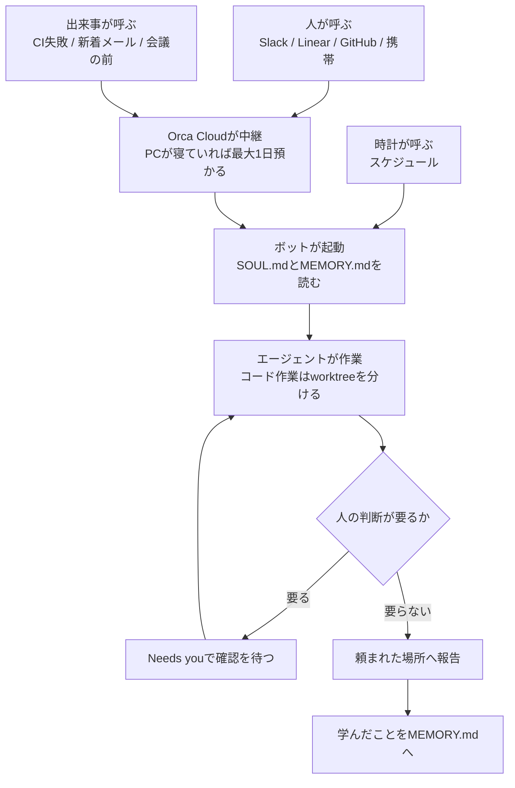
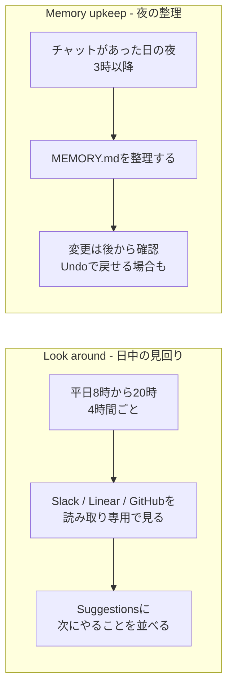
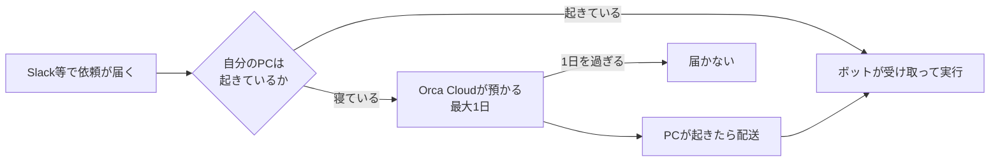

## はじめに

Claude CodeやCodexを使っていると、「エージェントに任せられる仕事が増えたな」と感じます。一方で、任せ方はまだ「自分がターミナルに向かって指示を出す」が基本です。毎朝のCI確認も、たまったIssueの整理も、結局は自分が思い出して、自分が起動しています。

そこに、Orcaというエージェント向けの開発環境に「Bots」という機能が増えました。名前・目的・記憶を持ち、決まった仕事を受け持ち続けるボットです。

「それって、チャットボットと何が違うの？」

私も最初はここが分かりませんでした。この記事では、その違いと、なぜ「ボット」という形なのか、入れる前に何を決めるべきかを整理します。OpenAIのdotsやDevin Botsなど、他のボットとの違いも比べます。

対象は、Claude CodeやCodexを毎日使い、定型の見回りを自分で起動している人です。Orca自体は2026年3月公開のオープンソースで、GitHubのスターは12万を超えています（2026年11月時点、GitHub APIで確認）。

正直に書くと、私はOrca Botsを常用していません。この記事は、未使用者が公式ドキュメントと実践報告から判断材料を集約したものです。

入れる前に決めるのは、権限・動く場所・利用枠の3つです。実機で試した報告では、短い依頼でも読み込みが約95万トークンに達しており、利用枠は先に見積もる必要があります。

※Orca本体の並列実行やワークツリーの話はしません。名前の似た別製品「OrcaBot」は、比較の節で取り上げます。

## Orca Bots - 「担当」を作る機能

まず公式の定義から入ります。Orcaのドキュメントには、こう書かれています。

> Each bot has a name, a purpose, a memory and automations, and lives in a folder on one computer.
> （各ボットは名前・目的・記憶・自動化を持ち、1台のコンピュータ上のフォルダに住む）

短い文ですが、要素は4つあります。**名前**、**目的**、**記憶**、そして**自動化**です。

このうち記憶と人格は、プレーンなMarkdownファイルとしてフォルダに置かれます。

```
bot-folder/
  SOUL.md    … そのボットが何者で、何を担当するか
  MEMORY.md  … 覚えたことのメモ
```

ここで見るべきは、記憶が「モデルの中」でも「サービスのデータベースの中」でもなく、自分のコンピュータ上のただのファイルだという点です。読めますし、編集もできます。

ボットの1回の仕事は、このファイルの読み書きとして図にできます。



つまり、記憶は「会話の空気」ではなく、仕事の前後に読み書きするファイルです。ここが、後で出てくる他のボットとの違いにも効いてきます。

作り方はシンプルで、Orcaのサイドバーから「New bot」を選び、名前と担当を書くだけです。仕事の種類ごとにテンプレートも24種類用意されています（CI失敗の調査、PRレビュー、会議の準備など）。

公開されたのは2026年11月19日、Orca v1.4.265です。GitHubのリリースでは「Beta」と表記されていました。この記事の執筆時点（2026年11月22日）の最新版は v1.4.269 です。

対応するエージェントも、当初はClaude CodeとCodexが中心でした。しかし公開から2日のうちに、Cursor、GitHub Copilot、Hermes、Kiro、Gemini CLIなどにも広がっています（v1.4.268 / v1.4.269）。出たばかりで、仕様自体が速く動いている段階だということです。

たとえば、こんなボットをイメージしてください。

「このボットはCI担当。CIが落ちたら一次調査をして、原因の当たりを付けて報告する」

通常のチャットとの違いは、この「担当」が先に決まっていることです。では、具体的に何が違うのかを整理します。

## チャットボットと何が違うのか

違いは、モデルの性能ではありません。整理する軸は3つあるかと思います。

- 誰が・いつ動き始めるか
- 記憶がどこに残るか
- 仕事の単位が何か

**通常のチャット（Claude Codeのセッション）**

人が話しかけたときに動き始めます。記憶はその会話の中だけにあり、セッションが終われば基本的にリセットされます。仕事の単位は「今回の依頼」です。

**Orca Bots**

担当と記憶を持ったまま存在し続けます。動き始めるのは、人の呼びかけだけではありません。スケジュールや外部の出来事でも起動します。

仕事の単位は「今回の依頼」ではなく「担当業務」です。

たとえば、先週「このIssueは様子見」と判断した経緯がMEMORY.mdに残っていれば、次の見回りで同じIssueを蒸し返さずに済みます。

表にするとこうなります。

| | チャット | Orca Bots |
|---|---|---|
| 動き始めるきっかけ | 人の入力 | 入力＋スケジュール＋出来事 |
| 記憶 | 会話の中だけ | MEMORY.mdに残り続ける |
| 仕事の単位 | 1回の依頼 | 担当業務 |
| 存在 | セッション中だけ | フォルダとして常駐 |

たとえば、同じ「CIが落ちた原因を調べて」という仕事でも、チャットでは毎回自分が気づいて、毎回頼む必要があります。ボットに担当させると、CIの失敗そのものが起動のきっかけになります。

つまり、チャットボットは「窓口にいる相談相手」で、Orca Botsは「担当業務を持った同僚」に近い。この違いが、以降の話すべての前提になります。

## なぜ「ボット」という形なのか

「セッションに名前と記憶を持たせただけでは？」と思いませんか。

半分はその通りです。ただ、セッション型のままだと困ることが3つあります。

1つ目は、毎回ゼロから説明することです。「このリポジトリではCIが落ちたらまずこれを見て」という前提は、セッションが切れるたびに消えます。

2つ目は、定型の見回りが「覚えている人」に依存することです。毎朝のCI確認や未返信の洗い出しは、やること自体は決まっています。でも、起動するのは人間なので、忙しい日には飛びます。

たとえば、出社して最初にやる「CIの状態確認、未レビューPRの確認、今日の会議の確認」は、内容がほぼ固定された見回りです。判断ではなく確認の仕事は、担当を決めて任せる候補になります。

3つ目は、仕事の発生場所と作業場所が離れていることです。依頼はSlackやGitHubに来るのに、作業はターミナルの中。この往復を人間がやっています。

ボットという単位は、この3つへの回答です。担当を決めて記憶をファイルに固定すれば、前提は消えません。

出来事で起動すれば、見回りは人間の記憶力に依存しません。入口をSlackやGitHubに置けば、往復も減ります。

公式の説明でも、ボットは仕事を受け持つ「チームメイト」のような存在として紹介されています。道具というより、担当者として設計されているわけです。

## どうやって仕事が来るのか - 入口とトリガー

ボットへの仕事の渡し方は、公式にこう列挙されています。

- Slack（チャンネルでのメンション、DM。ボット専用のSlack appが作られます）
- Linear（Issueで `@Orca` とボット名をメンション、またはラベルを付ける）
- GitHub（Issue / PRでのメンション。CIの失敗やレビュー依頼でも起動できます）
- Gmail（新着メール）
- Google Calendar（会議が始まる前）
- Webhook（1回のWebリクエスト）
- スケジュール（hourly / daily / weekdays / weekly / cron / RRULE）
- 携帯電話（iOS / Androidのアプリから）

先ほどの軸で分類すると、入口は3種類です。

**人が呼ぶ**（Slack、Linear、GitHubのメンション、携帯）
**出来事が呼ぶ**（CIの失敗、新着メール、会議の前）
**時計が呼ぶ**（スケジュール）

仕事が来てから報告までの全体の流れを、図にするとこうなります。



ここで見るべきは2点あります。

1つは、どの入口から来ても、行き先は「自分のコンピュータ上のボット」にそろっていることです。入口の多さは、ボットの置き場所を変えません。

もう1つは、仕事の途中に「人の判断が要る場所」が組み込まれていることです。公式の使い方の説明でも、共通の形は「頼む → ボットが自分のコンピュータで働く → 頼まれた場所に報告する → 人が決めるべき場所では待つ」となっています。

細かい点ですが、GitHubでは自分自身のコメントやpushでは起動しません。ボットが「自分として」動くためです（自分のPRを対象にするようなルールは、例外として作れます）。

ただし例外もあります。自分の行動が原因でも、CI結果やマージ競合など、GitHub側が報告する変化では起動しうる、と公式に書かれています。

さらに、誰にも頼まれていないのにボットが自分でやる仕事が2つ、最初から入っています。次の節で見ます。

## 誰にも頼まれていない仕事 - Look aroundとMemory upkeep

ボットには、依頼がなくても動く仕事が2つあります。

**Look around** は、Slack・Linear・GitHub・プロジェクトを読み取り専用で見回る機能です。平日の8時から20時のあいだ、4時間ごとに動き、「次にやること」をSuggestionsに並べます。

**Memory upkeep** は、その日のチャットがあった日の夜、3時以降に記憶を整理する機能です。MEMORY.mdの変更は後から確認でき、Undoで戻せる場合もあります。



この2つは、ボットが「担当」であるための両輪です。日中は外を見回って仕事を見つけ、夜は自分の記憶を整える。人間の担当者の動きに寄せてあります。

強制のされ方にも差があります。Look aroundは読み取り専用であることが仕組みとして決まっています。Memory upkeepも、ツールを使わず返信だけで実行されることが、Orca側で強制されます。

ただし、どちらも後で述べる「利用枠」を消費します。公式ドキュメントにも「Both use your agent's plan（どちらも、あなたのエージェントの契約枠を使います）」と明記されています。

## 「常駐」の実態 - 動く場所とスリープ

「クラウドに常駐して、24時間働いてくれるんでしょ？」と思っていませんか。実は、ここが一番の誤解ポイントです。

ボットが動くのは、自分のコンピュータ（または、自分で用意してペアリングしたサーバ）の上です。Orca Cloudの役割は、SlackやGitHubからの依頼を中継することだけです。自分のPCに受信用のポートを開けなくて済むのは、この中継のおかげです。

では、コンピュータが寝ているあいだに依頼が来たらどうなるか。



Orca Cloudがリクエストを預かり、起きたときに渡します。預かりは最大で1日です。それを超えると届きません。

なお、Webhookの本文は最大7日保持されます。

スケジュール実行も、「コンピュータが起きている間だけ」動きます。夜中の3時に記憶整理が走るのも、コンピュータが起きていればの話です。寝ていて逃した分は、起きたときに1回だけキャッチアップされます。

つまり「常駐」の正体は、「起き続けているマシンに置けば常駐する」です。ノートPCを閉じれば、ボットも止まります。この前提が、次の「決めること」に直結します。

## 1体目の作り方

作り方自体は難しくありません。公式の手順はこうです。

1. OrcaのサイドバーのBotsから「New bot」を選ぶ（24種類のテンプレートから始めることもできます）
2. 名前と画像を付ける
3. 「Who it is and what it does」の欄に、担当を一文で書く
4. 実行場所（どのコンピュータか、どのエージェントか）を確認する
5. Createを押す

ここで見るべきは2点あります。

1つは、**Createを押すまで何も作られない**ことです。作りかけのボットが勝手に動き出すことはありません。これは、公式が「強制できる」としている側の設計です。

もう1つは、テンプレートに付いてくるスケジュールは、初期状態ではオフだという点です。対象のリポジトリやチャンネルを指定して、ボットの画面でオンにして初めて動き出します。

「A bot stays on the computer you pick（ボットは、選んだコンピュータに留まる）」という公式の注意書きもあります。作るときに選んだコンピュータが、そのボットの住所になります。

※他アプリで育てたボットがいれば、persona / memory / abilities / schedules を読み取って移行するImport機能もあります。移行した自動化は、止まった状態で入ります。

## 使い方を徹底的に見る - テンプレートと担当の置き方

「で、結局、何を任せられるの？」というのが次に気になるところかと思います。

公式のUse casesで詳しく書かれた仕事は8つ、テンプレートは全部で24種類あります。

### 公式が詳しく説明する仕事

**CI失敗の調査（CI failures）**

指定したリポジトリでチェックが失敗したときに起動します。失敗を読み、flaky（不安定なだけの失敗）か本物かを判定して、根拠と一緒に説明します。

本物を直し始める前には、Needs youで確認が入ります。承認されれば、別のworktreeで修正してPRで返します。flakyの一覧は保持し続け、月曜9時に定期投稿までされます。

**PRレビュー（Pull request review）**

自分のレビューがリクエストされたときに起動します。リスクの高い変更と不足しているテストを、ファイルと行の番号付きで列挙します。結果はまずボットのチャットにだけ届き、GitHubへは許可するまでコメントしません。

**バグ調査（Bug investigation）**

Slackでメンション付きで報告されたバグが対象です。workerに別worktreeで再現させ、原因の箇所を特定します。

修正に着手する前と、出荷の方法（フラグを付けるか、全員に出すか）は、Needs youで人が決めます。合意が取れれば、修正・テスト・PRまで進みます。

**LinearのIssueトリアージ**

新しいIssueが来たら、再現手順があるかを確認し、重複を探し、ラベルと担当者を提案します。クローズは、承認なしにはしません。

この仕事だけはテンプレートがなく、チャットで定義して自動化として作る形です。

**その他の詳述された仕事**

- スタンドアップノート（Daily standup notes）: 平日9時に、workspace・PR・Issueから「昨日やったこと／次にやること」を書く
- リリースノート（Release notes）: 頼まれたときに、前回リリース以降にマージされたPRから下書きを作る
- ドキュメントの同期（Docs upkeep）: 水曜10時に、マージされたPRとドキュメントを突き合わせ、合わなくなったページを列挙する
- デプロイの見張り（Deploy watch）: デプロイツールがWebhookを呼ぶたびに、出荷されたPRから内容を要約し、失敗したデプロイに旗を立てる

### 残りのテンプレートは「型」で読む

**見回り型**（時刻や出来事で起きて、列挙して終わる）

- Support triage: 平日9時から17時、2時間ごとに、指定チャンネルの未回答の質問を列挙する
- Release readiness: 平日の朝に、失敗中のチェック・レビュー待ちPR・ブロッカーの短い一覧を保つ
- Unreviewed agent work: 平日9時に、終わったのにレビューもPRもまだないエージェントの作業を列挙する
- Replies you owe: 毎日16時に、自分宛てで未返信の質問と「やると言ったこと」を拾う

**下書き型**（材料を集めて、人が送る・決める手前で止まる）

- Email digest: 平日9時と14時に、返信すべきメールを列挙する。公式に「never sends email（メールは決して送信しない）」と書かれたテンプレートです
- Meeting prep: 各会議の15分前に、対象のIssue・PR・ドキュメントを列挙する
- Project briefing: 金曜15時に、何が変わり、何が止まり、何に判断が要るかを書く

**チェック型**（定期的に点検して、直すかどうかは人が選ぶ）

- Security check: 月曜9時とPRのマージ時に、秘密情報の漏洩・インジェクション・認証の欠落・危険な初期設定をチェックする
- Dependency updates: 月曜9時に古い／脆弱なパッケージを緊急度順に列挙し、合意が取れたらグループ単位で1つずつPRを作る
- Workspace cleanup: 金曜16時に完了済み・放棄されたworkspaceを列挙し、選んだものだけを削除する

顔ぶれを通して見ると、公式の型は一貫しています。**列挙と下書きまでがボット、送信・削除・マージは人が決める**。新しい使い方を考えるにしても、この型の内側で考えるのが現実的かと思います。

### 複数ボットで分担する

「ボットは1体だけ置くものなの？」と思いませんか。実は、複数置くことが公式の前提になっています。

作成は「New bot or group」から繰り返せます。ボットごとにフォルダが分かれ、記憶・自動化・使うエージェントを別々に持てます。連携はgroup chatの中だけです。v1.4.269で、他のメンバーにメンションしてターンを渡せるようになりました。公式デモ「Launch crew」では、Release・Review・Docsの3ボットが分担し、1つの回答と1つのPRで返していました（公式デモの構図で、利用者の継続運用の報告ではありません）。

注意点も2つあります。記憶の共有は公式に記載がなく、ボットが別のボットを勝手に作ることもありません。作成は人がCreateを押すまで起きません。

### 記憶を育てる運用

ボットは最初の仕事の後に自分の役割を書き留め、以後は学んだことを記憶に保ちます。新しいチャットでも、前提を繰り返さなくてよくなります。

たとえばスタンドアップでは、前日の訂正が翌日のノートに引き継がれます。記憶は夜のMemory upkeepが整理し、変更は後から確認できます。「勝手に育つ」のではなく、「育ち方を検分できる」設計です。

i-Style社の報告には、興味深い観察がありました。ボットが、頼まれていないのに自分のSOUL.mdに「見る場所」と「報告先」を書き足していたそうです。

人格ファイルはボット自身も書き換えます。だからこそ、定期的に目視で見返すことが運用の前提になるかと思います。

なお、数週間以上にわたって記憶を育て続けた運用の報告はまだありません。この点は「まだ分からないこと」の節にまとめます。

### アイデア段階の組み合わせ

ここからは、公式にそのままの形の記述がない組み合わせです。アイデアとして書きます。

たとえば、Sentryの新しいアラートをWebhookで受けてバグ調査に直結させる運用です。起動と調査は個別には公式の機能ですが、直結した構成の説明や実践報告は確認できていません。

ボスボットが複数ボットの記憶を横断して週次ブリーフィングを書く運用も考えられます。ただし、記憶を読み合う仕組みの記述はないため、アイデア段階です。

## 他のボットと何が違うのか

「dotsやDevinでも、同じようなことができるのでは？」

「cronでClaude Codeを回せば、自分でも作れるのでは？」

どちらも、もっともな疑問です。ここでは、似た名前・似た役割の製品を並べて、Orca Botsの立ち位置を確かめます。

この秋は、各社が「常駐するエージェント」を一斉に出した時期でもありました。顔ぶれ自体が、数か月前とは変わっています。

比較の軸は、この記事のここまでの話から3つ取ります。

- **どこで動くか**（自分のマシンか、ベンダーのクラウドか）
- **記憶はどこに残るか**（手元のファイルか、サービスの中か、そもそも残らないか）
- **何の枠で動くか**（今の契約か、専用の課金か）

チャットとの違いを整理した3軸のうち「記憶がどこに残るか」はそのまま使い、残りの2軸を、製品同士で比べられる「どこで動くか」「何の枠で動くか」に置き換えた形です。

| 製品 | 動く場所 | 記憶 | 費用 | 常駐性 |
|---|---|---|---|---|
| Orca Bots | 自分のPC | SOUL.md / MEMORY.md（手元のファイル） | Bots専用の料金は公式に見当たらない（今のエージェント契約の枠を使う） | PCが起きている間だけ |
| dots（OpenAI） | OpenAIのクラウド（専用のクラウドコンピュータ） | ChatGPTのメモリと共有。サービスの中 | Pro（月100ドル〜）などに1体込み。Enterpriseは別料金 | PCを閉じても24時間 |
| Claude Duet | Anthropicのクラウド | Claudeのメモリ等を引き継ぐ。サービスの中 | Pro / Max / Ultraに含まれる。利用枠はClaude全体と共有 | PCを閉じても回る |
| Perplexity Teammates | Perplexityのクラウド（1体ごとに隔離されたコンピュータ） | 会話をまたいで保持。サービスの中 | Maxのみ。Computerと同じクレジットを消費 | 常駐する |
| Devin Bots | Cognitionのクラウド | Devinの中（InstructionsとMemory） | 専用課金（Max 200ドル/月〜。Teamsは80ドル/月の共有プール） | 24時間 |
| ChatGPT Tasks | OpenAIのクラウド | ChatGPTのMemory（ファイルではない） | ChatGPTプランの枠。タスク数に上限（Free / Goで各3件、Plusで5件） | PCを閉じても回る |
| ChatGPT GPTs | OpenAIのクラウド | なし（毎回まっさら） | プランに含まれる | 常駐しない |
| OpenClaw | 自分のマシン／サーバ | SOUL.md / MEMORY.md等（手元のファイル） | 無料（MIT）。払うのはモデル費用のみ | マシンが起きていれば |
| OrcaBot（別製品） | ベンダーのクラウドVM | 作業ファイルは残る。記憶の仕組みは公式に明記なし | 公式に明記なし。APIキーは自前 | タブを閉じても回る |
| Copilot coding agent | GitHubのクラウド | Copilot Memory（サービスの中。ファイルではない） | Copilotプラン＋計算資源の月次枠とAI credits | 常駐しない（Actionsのセッションは最大59分） |

（料金と仕様は、2026年11月22日に各社の公式ページで確認したものです）

製品ごとに、読み解きを短く付けます。

### dots - 専用クラウドコンピュータを持つ「常駐エージェント」

まず、OpenAIのdotsです。公式の定義は「always-on agents（常時稼働エージェント）」で、目標に向けて24時間働き続けます。

構成要素は、Orca Botsとよく似ています。名前を持ち、目標を持ち、記憶を持ち、頼まれなくても先回りして調べます。

実は、違いは要素の有無ではありません。置き場所が、ほぼ正反対なのです。

**動く場所**

各dotには、専用のクラウドコンピュータと専用ブラウザが割り当てられます。会話の合間にも作業は進むので、自分のPCを閉じても止まりません。

自分のコンピュータへの接続は任意で、初期状態はオフです。つないだ場合だけ、そのコンピュータがオンラインで、ChatGPTアプリが開いている必要があります。

Orca Botsが「起きているマシンに置けば常駐する」のに対し、dotsは「クラウドにあるので常駐する」です。ここが最初の分かれ目です。

**仕事の中心**

dotの仕事は、開発に限られません。資料の準備や更新、コンテンツ作成、フォロースルーといった、汎用の仕事全般が中心です。

必要に応じて、ChatGPT WorkやCodexのスレッドを開始して任せることもできます。その場合、そのスレッドの作業は通常どおり利用枠を消費します。

一方、dotとの会話自体は、ChatGPTの利用枠を消費しません。Orca Botsの仕事が「IDEと開発作業」に寄っているのとは、守備範囲が違います。

**記憶**

dotは、ChatGPTのメモリから文脈を受け取り、独自のメモリも作ります。dotとChatGPTの間で、メモリは共有され続けます。

ただし、dot独自のメモリは、個別に閲覧・編集・削除ができません。消すには、dot自体を削除する必要があります。

Orca BotsのMEMORY.mdが「読めて、直せる、ただのファイル」であることと比べると、対照的です。記憶が育つ点は同じでも、人が手を入れられるかどうかが違います。

**権限ルール**

権限の付け方にも、dotsならではの形があります。操作ごとに、**Custom Rules** で次の4つから1つを選んで保存できます。

- 確認せず実行する
- 事前承認済みなら実行する（依頼の中で明示的に頼んだ場合）
- 実行前に確認する
- 本人に引き継ぐ

パスワード変更のような機微な操作は、ルールで上書きできません。本人が引き継いで行う決まりです。

背景で自律的に行う先回り調査は、読み取り専用に制限されています。送信や変更は、その範囲ではできません。

**料金と提供範囲**

料金はプランに組み込まれる形です。Pro（月100ドル〜）などのプランでは、最初の1体がプランに含まれます。

Enterpriseでは、2027年1月14日から課金が始まります。1体あたり月50ドルから500ドルの段階制です。

提供はまだ段階的です。Plusでは、選ばれた利用者への段階的ロールアウト中と案内されています。

対象外とされているのは、EEA・スイス・英国です。この対象外リストに、日本は含まれていません。

### Claude Duet - 朝のブリーフから始まる「先回り型」

AnthropicのClaude Duetは、「proactive agent（先回りするエージェント）」を名乗る別アプリで、research previewとして公開されています。

毎朝、接続したアプリを横断して短いブリーフを送ります。日中は数時間ごとに接続アカウントを見回り、必要なときだけ声をかけます。

動く場所はAnthropicのクラウドで、記憶やスキル、接続はClaudeアカウントのものを引き継ぎます。

料金は、Pro / Max / Ultraに追加料金なしで含まれます。ただし利用枠はClaude全体と共有です。

送信・支払い・署名・削除の前には、内容を示して承認を待ちます。証券取引と口座間送金は、承認があっても対象外です。

現在はwaitlist制で、米国から始まっています。

### Perplexity Teammates - 「進行中の仕事」を持つチームメイト

Perplexity Teammatesは、「ongoing work（進行中の仕事）を担う」エージェントです。目標を渡すと、タスクに分解し、複数のエージェントを並行して走らせます。

1体ごとに、隔離されたコンピュータが割り当てられます。SlackやGitHubなどを見張り、出来事をきっかけに動くこともできます。

記憶は会話をまたいで保持されますが、置き場所はPerplexityの中です。

提供はresearch previewで、個人向けはMaxのみです。仕事はPerplexity Computerと同じクレジットを消費します。

### 大手の「常駐エージェント」も一斉に出てきた

**Meta Muse** は「personal AI agent」として発表されました。専用のクラウドコンピュータ（Muse Secure VM）で動き、アプリを閉じても作業を続けます。無料枠と有料サブスクリプションの二層とされています。

**Microsoft Copilot Autopilot** は、Microsoft 365のテナント内に住む常駐エージェントです。独自のID・記憶・ツールを持ちます。2026年11月17日から、Frontier顧客向けにロールアウトが始まりました。

**Google Tasks in Gemini**（旧Gemini Spark）は、アカウント専用の隔離された仮想マシンで動きます。2026年11月17日から、米国・日本・韓国などでは無料で展開が始まりました。

3社に共通するのは、「自分のクラウドコンピュータ」と「サービス内に残る記憶」という設計です。この収束が、後のケース別判断で効いてきます。

### Devin Bots - 開発に絞った正面の競合

Devin Botsは、Cognitionの製品です。目標を持ったボットが、クラウドで24時間働き続けます。ボットが複数のDevinセッションを起動して、並行して進める形です。

常駐の強さでは、こちらが上です。自分のPCの電源は無関係で、記憶もDevinの中で継続します。

引き換えに、記憶も実行もCognitionの中にあります。人が書くInstructionsと、ボット自身が書くMemoryという形で、Devinの管理画面から扱うものです。

実績の数字もあります。Cognitionの発表によれば、Android Botは44日で1,134件のPRをマージし、1,217件のチケットをクローズしました。その間、人間のownerからのメッセージは183件だったそうです。

費用も専用です。Botsが使えるのはMax（200ドル/月）やTeams（80ドル/月）などのプランで、Pro（20ドル/月）には含まれません。

なお、Teamsの80ドルはシート課金ではありません。オンデマンドクレジットとして課金され、チーム全体で共有するプールになります。使用量は、プランの枠を通常のセッションと同じように消費します。

### ChatGPT Tasks - クラウドで回る「タスク」

ChatGPTのタスクは、スケジュールや出来事でChatGPTを動かす仕組みです。

FreeとGoで各3件、Plusは5件、Proは15件までタスクを持てます。

ただし、イベント駆動のタスクはChatGPT Workの中で動き、有料プラン限定で、実行回数にも上限があります。

Orca Botsとの一番の違いは、仕事の実体がOpenAIの中にあることです。PCを閉じても回る代わりに、手元に残る人格や記憶のファイルはありません。

### ChatGPT GPTs - 記憶を持たない「設定済みチャット」

GPTsは、目的に合わせて設定したChatGPTです。ただし公式に、「保存されたメモリも過去の会話も使わない。各会話はまっさらから始まる」と明記されています。自分から動く仕組みもなく、「担当」とは最も遠い存在です。

今は移行期でもあります。個人アカウントでは新規作成はすでにできず、標準の廃止は2026年12月11日です（一部の延期対象は2027年2月28日まで）。移行先として公式が案内するのはpluginsで、継続作業の受け皿としてProjectsも案内されています。

なお、dotsがGPTsの後継だという公式の表現はありません。dotsは別に発表された常駐エージェントとして、分けて考える必要があります。

### OpenClaw - 最も近い先行者

OpenClawは、自分のコンピュータやサーバで動かす、個人用のエージェント基盤です。Orca BotsのImport機能の移行元として、名前が挙がることもあります。ただ、公式のImportページは移行元を「another app」としか書いておらず、OpenClawだと明言はされていません。

思想と記憶の形は、Orca Botsに最も近いものです。公式ドキュメントでも、ワークスペースにSOUL.mdやMEMORY.mdといったMarkdownを置く形が確認できます。

定期的な見回り（Heartbeat、既定は30分）と、時刻指定のジョブ（Cron）で動きます。

記憶の整理にも、公式の仕組みがあります。**Dreaming** は、夜間に短期の素材を整理し、残すべき事実をMEMORY.mdへ昇格させる仕組みです。

Orca BotsのMemory upkeepと、役割が重なります。「夜に記憶を整える」こと自体は、珍しい発想ではなくなってきているわけです。

違いは、製品化の範囲です。OpenClawは「自分で立てて運用する基盤」で、Orca Botsは「IDEの中の機能」です。

worktreeの分離、承認の置き場、24種のテンプレートといった運用の部品まで、最初からそろっているかどうかが分かれ目になります。

### OrcaBot - 名前は似て、方向は逆

冒頭で触れた別製品です。ベンダーのクラウド上にあるサンドボックスなLinux VMの中でエージェントを動かす、ブラウザから使う製品です。

守り方も逆です。Orca Botsが「自分のPCで、自分として動く」ことを承認で守るのに対し、OrcaBotは「自分のPCに触らせない」ことで守ります。VMの隔離や、APIキーを見せない仕組み（Secrets Broker）といった構造です。料金は、公式ページの範囲では明記されていませんでした。

### GitHub Copilot coding agent - クラウドで続くセッションへ

Copilotのcoding agentは、Issueを割り当てると、GitHubのクラウド上で作業してドラフトのPRを返す仕組みです。

2026年10月28日からは、有料プラン向けに「Copilot in the cloud」が始まり、Webやモバイルとローカル側で同じセッションを続けられるようになりました。59分の上限は、現行ではGitHub Actions上で動くセッションの上限として書かれています。

人格や記憶のファイルはありませんが、**Copilot Memory** という公式の概念はあります。リポジトリや好みについて、セッションをまたぐ長期的な理解をサービス側に持つ仕組みで、手元で読んで編集できるファイルではありません。

その代わり、隔離と最小権限はプラットフォームが強制します。pushできるのは専用ブランチだけ、自PRの承認やマージはできない、といった具合です。GitHubの外の仕事には出られません。

### 素のClaude Code＋自動化 - 部品は全部ある

最後に、ボット基盤を使わない場合です。実は、必要な部品は公式にそろっています。

Claude Codeのスケジュール実行は3層あります。Anthropicのクラウドで回る **cloud scheduled tasks**（旧称routines）が1つ目です。

自分のマシンで回るDesktopのscheduled tasks、セッション内で繰り返す `/loop` が続きます。GitHub Actionsからイベントで起動することもできます。

`/loop` には、恒常運用には響く制限があります。繰り返しタスクは、作成から7日で自動的に失効します。1セッションで持てるタスクは最大50件です。

では何が足りないか。部品ではなく、「ボット」という単位です。

人格と記憶を育てるファイルの運用、Slackなどから依頼を受ける常設の入口、承認待ちを並べる場所。この3つは、基盤なしでは全部自分で組み立てることになります。

Orca Botsの新規性は、モデルの賢さではありません。この「単位と置き場」を製品として用意した点にあります。

### ケース別に選ぶなら

この秋の顔ぶれを通して見ると、設計はかなり収束しています。各社とも、「自分のクラウドコンピュータを持ち、記憶はサービス内に残る」という形に寄せてきました。

dots、Claude Duet、Perplexity Teammates、大手3社の常駐エージェントは、いずれもこの形です。PCを閉じても動く代わりに、実行も記憶もベンダーの中にあります。

その中で、Orca Botsの3軸はむしろ際立ちます。**自分のマシンで動く**、**記憶は手元のファイルにある**、**今のエージェント契約の枠で動く**。この組み合わせは、他の顔ぶれには見当たりません。

ケース別に整理すると、こうなります。

- **PCを閉じても回したい、仕事は汎用寄り** → dots、Claude Duet、Perplexity Teammatesなどのクラウド常駐型。ただし記憶と実行はベンダーの中にある
- **PCを閉じても回したい、仕事は開発寄り** → Devin Bots。記憶も実行もCognitionの中にあり、費用は専用プランになる
- **決まった時刻・出来事で軽く回したい** → ChatGPT Tasks。Free / Goでも各3件まで持てる
- **記憶と実行を手元に残し、今の契約のまま使いたい** → Orca Bots
- **GitHubの中だけで完結するコード作業を任せたい** → Copilot coding agent。隔離はプラットフォーム任せにできる
- **仕組み全体を自分で握りたい** → OpenClaw、またはClaude Code＋自動化の自作

どれが優れているかではなく、「どこで動いて、記憶がどこに残るか」で選ぶ話だと思います。


## 入れる前に決める3つ

この3つは、実機で1体作って試したi-Style社の記事が挙げている3点（権限・動く場所・利用枠）と同じです。先行する実践報告として、まずその点に触れておきます。

本記事では、そこに公式ドキュメントの読み解きを加えます。権限4モードの意味、Who can ask、Webhookの署名、止め方まで含めて並べる形です。

要点だけ、先に置きます。

- **権限**: 初期設定はFull access。他人からも呼べるボットはAsk for approvalに切り替える
- **動く場所**: ボットは、置いたマシンが起きている間だけ働く。どのマシンに住まわせるかを先に決める
- **利用枠**: 仕事はすべて今のエージェント契約の枠を消費する。短い依頼でも読み込みは大きい

### 権限 - 初期設定はFull access

Orcaの権限モードは4段階あります。

- Ask for approval（実行前に承認を求める）
- Accept edits
- Approve for me
- Full access（確認なしで実行する）

注意したいのは、初期設定が **Full access** だという点です。新しいボットも、ここから始まります。

公式のセキュリティ文書は、この点についてかなり正直です。「None of these settings is a guarantee（これらの設定は、どれも保証にはならない）」と明記されています。「モデルは騙されうる」とも書かれています。

そのうえで、他人からも呼べるボットや、メールなど外部のメッセージを読むボットは **Ask for approval** に切り替えるよう勧めています。

もう1つ、**Who can ask**（誰がボットに頼めるか）の設定があります。初期設定は自分だけです。

他人を追加すると、その人の依頼は「自分のアクセス」で、自分のコンピュータ上で実行されます。公式の表現を借りれば、「自分のキーボードの前に座らせてもいい人だけを追加してください」ということです。

ボットが「誰の名前で動くか」も決まっています。Slackではボット専用のアプリとして発言します。GitHubやLinearでは、返信はOrcaのアプリ名義ですが、その他の作業は自分のログインで行われます。

そして他人からの依頼で動いたときは、LinearのコメントやGmailの下書きに「asked by 〜（誰々）via 〜（ボット名）」という行が付きます。誰の依頼で動いたかが、後から追えるわけです。

隔離のされ方も知っておくべきかと思います。ボット専用のサンドボックスがあるわけではなく、コード作業はgit worktreeを分けることで分けられています。コンピュータ自体への到達範囲は、権限が許す範囲で「自分として」です。

入口側の注意もあります。Webhookは、URLを知っている人なら誰でも自動化を起動できます。署名シークレットを追加する対策はありますが、公式は「URLはパスワードのように扱ってください」と書いています。

なお、やめ方も用意されています。自動化の一時停止や、Settings → Botsでのボット全体のオフです。オフにしてもフォルダ・記憶・チャットは残ります。

### 動く場所 - どのマシンの担当にするか

仕組みは「『常駐』の実態」の節で見た通りです。ボットは、置いたマシンが起きている間だけ働きます。

判断として決めるのは1点です。「どの仕事を任せるか」の前に、「どのマシンに住まわせるか」を決める。

夜に閉じるノートPCに、夜間の見回り担当は置けません。常時起動のデスクトップやサーバがあるなら、そちらに住まわせる選択肢があります。

### 利用枠 - 思ったより食う

料金の構造はシンプルです。Orca自体は無料のオープンソース（MIT）で、Bots専用の料金も公式ページには見当たりません。「Nothing new to buy（新しく買うものはない）」と書かれています。

ただし、ボットの仕事はすべて、自分のClaude CodeやCodexの契約枠を消費します。ここが実質のコストです。

実際に1体作って試したi-Style社の報告では、数字がかなり具体的でした。

- 作った直後の「頼んでいないあいさつ」だけで、AIへの問い合わせ4回、読み込み約38万トークン
- 「記事ファイルを数える」という短い依頼で、問い合わせ9回。出力は約3,400トークンでしたが、読み込みは約95万トークン

読み込みが膨らむ主因は、ボットが持ち主のClaude Code設定（CLAUDE.mdやスキルなど）を毎回読み込むためだそうです。

留保も書いておきます。これは1社の1環境での実測です。

「契約枠全体の何%にあたるか」は、報告した方自身も「測れていない」と書いています。それでも、「短い依頼でも読み込みは大きい」という傾向自体は、設計から見てもうなずける話です。

そして先ほどのLook aroundとMemory upkeepも、同じ枠を食べます。ボットを増やせば、見回りも増えます。枠の配分を決めずに台数を増やすと、本来の開発作業の枠を圧迫しかねません。

対策はあります。Look aroundは頻度を変えたりオフにしたりできますし、Memory upkeepも週1回への変更やオフができます。最初から全部入りで始めず、見回りの頻度を落として始めるのが現実的かと思います。

## どういう仕事から任せるか

ケース別に整理します。

**向いている仕事**

- CI失敗の一次調査、未レビューのPRの洗い出しなど、読み取り中心の見回り
- 会議前の資料集め、メール返信の下書きなど、「下書きまでで止まる」仕事
- リリースノートや定例のメモ作成など、形式が決まっている仕事

公式テンプレートの顔ぶれ（CI failures、Meeting prep、Email digestなど）を見ても、最初はこのあたりが想定されていることが分かります。

**慎重に始めたい仕事**

- 外部への送信や公開を伴う仕事。権限をAsk for approvalに絞ってからにすべきかと思います
- 夜間に無人で回す仕事。マシンが起きている前提と、利用枠の消費を先に見積もってから

**まずはここから**

読み取り専用の見回り担当を1体だけ作ります。権限はAsk for approval、見回りの頻度も落とした状態で、1週間だけ枠の減り方を観察する。これくらい小さい始め方が良いかと思います。

## まだ分からないこと

最後に、現時点で誰も書けていないことを書いておきます。

Orca Botsは公開からまだ数日です。英語圏も含めて、一次の実践報告はほとんどありません。たとえば、次の問いに答える記事は、まだ見当たりません。

- 記憶が数週間育ったボットは、実際に賢くなるのか
- チームで1体のボットを共有すると、権限や依頼の交通整理はどうなるのか
- 契約枠の消費は、結局ひと月あたりどれくらいが目安なのか

仕様の側にも、公式に書かれていないことがあります。

- ボット同士が記憶を共有・参照し合う仕組みは、公式ドキュメントに記載がない
- 1台に置けるボットの上限や、台数に応じた利用枠の目安も、公式には書かれていない
- MEMORY.mdのサイズの上限や、古い記憶を捨てる基準の詳細も、公式には書かれていない

この記事で書いた判断材料も、公式ドキュメントと初期の報告に基づくものです。長期運用の知見が溜まれば、「決める3つ」の中身も変わってくるかと思います。

## まとめ

Orca Botsとチャットボットの違いは、性能ではありませんでした。

- チャットは「呼ばれて動く」。仕事の単位は1回の依頼で、記憶は会話の中だけ
- ボットは「担当として存在し続ける」。仕事の単位は担当業務で、記憶はファイルに残る

他のボットと並べても、違いは同じ軸で見えました。どこで動くか、記憶がどこに残るか、何の枠で動くか。Orca Botsはその3つともが「自分の側」に寄っています。

この違いを踏まえると、導入の判断は「便利そうか」ではなく、「権限・動く場所・利用枠の3つを決められるか」にかかってきます。

まずは読み取り中心の1体から始めて、枠の減り方と自分の仕事への合い方を見てみてください。

## 参考

- Orca公式「Bots」紹介ページ: https://orca.dev/bots
- Orca公式ドキュメント「Bots」quickstart: https://orca.dev/docs/bots
- Orca公式ドキュメント「Bot use cases」: https://orca.dev/docs/bots/use-cases
- Orca公式ドキュメント「Bots Security」: https://orca.dev/docs/bots/security
- Orca公式 changelog: https://api.onorca.dev/changelog
- i-Style社の実践記事「Orca Botsとは？できること・使い方と、入れる前に決める3つ」: https://i-styleinc.com/blog/orca-bots-setup-checkpoints
- AgentSignal「Orca Botsのユースケース」: https://agent-signal.ai/blog/orca-bots-use-cases
- 個人開発の実践記録（YouTube）「AIのBotにアプリのリリースを任せてみた」: https://www.youtube.com/watch?v=x6_E9jmk8Wk
- Devin Bots公式ドキュメント: https://docs.devin.ai/work-with-devin/bots
- ChatGPT「Scheduled tasks」公式ヘルプ: https://help.openai.com/en/articles/10291617-scheduled-tasks-in-chatgpt
- ChatGPT「GPTs」公式ヘルプ: https://help.openai.com/en/articles/8554407-gpts-in-chatgpt
- OpenClaw公式ドキュメント: https://docs.openclaw.ai
- OrcaBot公式ドキュメント: https://dev.orcabot.com/docs
- GitHub Copilot cloud agent公式ドキュメント: https://docs.github.com/en/copilot/concepts/agents/cloud-agent/about-cloud-agent
- Claude Code「Run prompts on a schedule」公式ドキュメント: https://code.claude.com/docs/en/scheduled-tasks
- OpenAI「Introducing dots」: https://openai.com/index/introducing-dots/
- OpenAI「Getting started with your dot」公式ヘルプ: https://help.openai.com/en/articles/20001530-getting-started-with-your-dot
- OpenAI「Dots privacy, security, and safety FAQs」公式ヘルプ: https://help.openai.com/en/articles/20001529-dots-privacy-security-and-safety-faqs
- OpenAI「Pricing and billing for dots in ChatGPT Enterprise」公式ヘルプ: https://help.openai.com/en/articles/20001641-pricing-and-billing-for-dots-in-chatgpt-enterprise
- OpenAI「Custom GPT retirement and migration FAQ」公式ヘルプ: https://help.openai.com/en/articles/20001519-custom-gpt-retirement-and-migration-faq
- Anthropic「Claude Duet」公式記事: https://claude.com/resources/articles/claude-duet
- Perplexity「Teammates」公式ヘルプ: https://www.perplexity.ai/help-center/en/articles/2026102601-perplexity-teammates
- Meta「Introducing Muse」公式発表: https://about.fb.com/news/2026/09/introducing-muse-personal-ai-agent/
- Microsoft「Copilot at Microsoft Ignite（Autopilot）」公式ブログ: https://www.microsoft.com/en-us/copilot/blog/2026/11/17/copilot-at-microsoft-ignite-expanding-whats-possible-with-intelligence-built-for-work/
- Google「Tasks in Gemini」公式ブログ: https://blog.google/innovation-and-ai/products/gemini-app/tasks-in-gemini-free-new-features/
