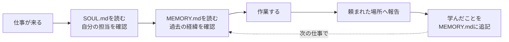
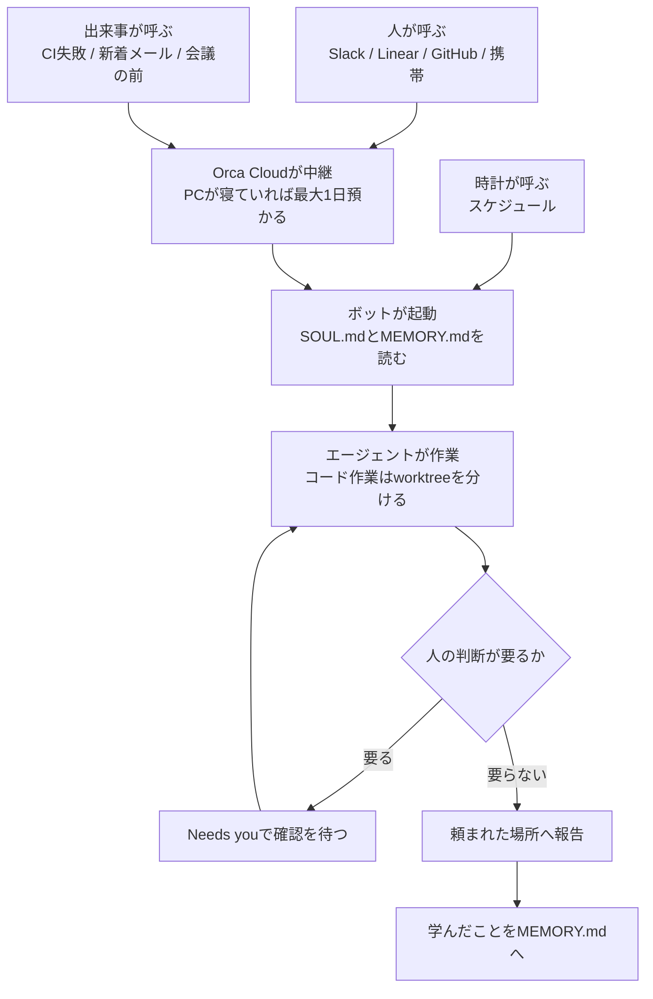
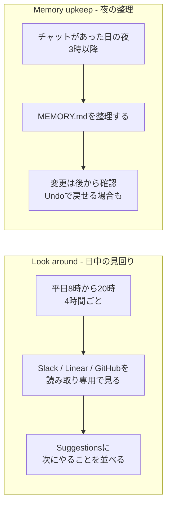
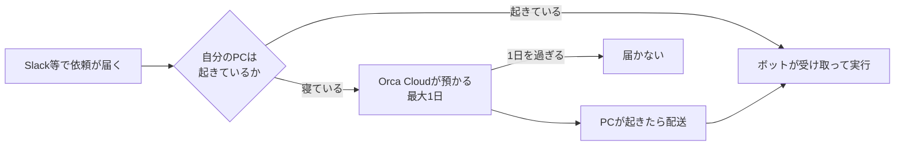

## はじめに

Claude Codeを毎日使っていると、任せられる仕事はだいぶ増えたなと思うのですが、任せ方自体はあまり変わっていなくて、結局は自分がターミナルに向かって「やって」と言うところから始まるんですよね。

毎朝のCI確認も、たまったIssueの整理も、自分が思い出して自分で起動している。Skillsもスラッシュコマンドも、結局は私が呼ぶものです。

そこに、Orcaというエージェント向けの開発環境へ「Bots」という機能が増えました。Orca自体は2026年3月公開のオープンソースで、GitHubのスターは12万を超えているのですが、そのOrcaに、名前と担当と記憶を持って決まった仕事を受け持ち続けるボットが増えた、という話です（僕はまだ常用まではしていないです）。

※Orca本体の並列実行やワークツリーの話はしません。名前の似た別製品「OrcaBot」は後ろの方で少し触れます。

## Orca Bots

公式のドキュメントにはこうあります。

> Each bot has a name, a purpose, a memory and automations, and lives in a folder on one computer.
> （各ボットは名前・目的・記憶・自動化を持ち、1台のコンピュータ上のフォルダに住む）

この中で私が引っかかったのは記憶の置き場所で、これはプレーンなMarkdownファイルとしてフォルダに置かれます。

```
bot-folder/
  SOUL.md    … そのボットが何者で、何を担当するか
  MEMORY.md  … 覚えたことのメモ
```

モデルの中でも、サービスのデータベースの中でもない。自分のコンピュータにある、ただのファイルです。読めるし、編集もできる。CLAUDE.mdを書いている感覚に近いですかね。

ボットの1回の仕事は、このファイルの読み書きとして描けます。



作り方は簡単で、Orcaのサイドバーから「New bot」を選んで、名前と担当を書くだけです。仕事の種類ごとにテンプレートも24種類あります。

公開は2026年11月19日、Orca v1.4.265でした。GitHubのリリースでは「Beta」の表記つきです。この記事を書いている時点（2026年11月22日）の最新版は v1.4.269 です。

対応エージェントも速いペースで広がっています。当初はClaude CodeとCodexが中心でしたが、公開から2日でCursor、GitHub Copilot、Hermes、Kiro、Gemini CLIなどにも広がりました（v1.4.268 / v1.4.269）。出たばかりで、仕様自体がまだ速く動いている段階だと思っておいた方がいいです。

たとえば、こんなボットです。

「このボットはCI担当。CIが落ちたら一次調査をして、原因の当たりを付けて報告する」

普通のチャットと違うのは、この担当が先に決まっていることです。

## チャットと何が違うのか

Claude Codeのセッションは、人が話しかけたときに動き始めます。記憶はその会話の中だけで、セッションが終われば基本リセット。仕事の単位は「今回の依頼」です。

Orca Botsは、担当と記憶を持ったまま存在し続けます。動き始めるきっかけも人の呼びかけだけではなくて、スケジュールや外部の出来事でも起動します。

たとえば、先週「このIssueは様子見」と判断した経緯がMEMORY.mdに残っていれば、次の見回りで同じIssueを蒸し返さずに済みます。

表にするとこうです。

| | チャット | Orca Bots |
|---|---|---|
| 動き始めるきっかけ | 人の入力 | 入力＋スケジュール＋出来事 |
| 記憶 | 会話の中だけ | MEMORY.mdに残り続ける |
| 仕事の単位 | 1回の依頼 | 担当業務 |
| 存在 | セッション中だけ | フォルダとして常駐 |

たとえばCIが落ちれば、その失敗自体が起動のきっかけになります。

## なぜわざわざボットなのか

セッションのままでも困らない場面は多いと思います。ただ、困ることもあります。

毎回ゼロから説明すること。「このリポジトリではCIが落ちたらまずこれを見て」という前提は、セッションが切れるたびに消えます。CLAUDE.mdに書く手はあります。ただ、CLAUDE.mdはプロジェクト全体の前提を書く場所で、担当ごとの前提までは書き分けないことが多いです。CI担当なら「落ちたらまず見る場所」、レビュー担当なら「見るときの観点」というように、前提は担当ごとに違うのに、置き場所が分かれていない。僕も担当ごとの前提までは書いていないです。ボットのSOUL.mdは、その担当専用の前提を置く場所として分かれています。

次に、定型の見回りが「覚えている人」に依存すること。毎朝のCI確認や未返信の洗い出しは、やること自体は決まっています。でも起動するのは人間なので、忙しい日には飛びます。

たとえば出社して最初にやる「CIの状態確認、未レビューPRの確認、今日の会議の確認」は、内容がほぼ固定された見回りです。判断というより確認の仕事で、これは担当を決めて任せる候補になるかなと思います。

あと、依頼はSlackやGitHubに来るのに作業はターミナルの中、というずれもあります。その往復を人間がやっています。

公式の説明でも、ボットは仕事を受け持つ「チームメイト」のような存在として紹介されています。

## 仕事はどこから来るのか

入口で一番使うことになりそうなのはGitHubとSlackとスケジュールかなと思います。

GitHubは、IssueやPRでのメンションで起動します。CIの失敗やレビュー依頼でも起動できます。SlackはチャンネルでのメンションやDMで、ボット専用のSlack appが作られます。スケジュールはhourly / daily / weekdays / weekly / cron / RRULEで指定できます。

他にもGmail、カレンダー、Webhook、Linear、携帯電話のアプリといった入口があります。

仕事が来てから報告までの流れは、図にするとこうなります。



あと、仕事の途中に人の判断が要る場所が組み込まれています。公式の使い方の説明でも、共通の形は「頼む → ボットが自分のコンピュータで働く → 頼まれた場所に報告する → 人が決めるべき場所では待つ」になっています。

細かい点ですが、GitHubでは自分自身のコメントやpushでは起動しません。ボットが「自分として」動くからです（自分のPRを対象にするようなルールは、例外として作れます）。例外もあって、自分の行動が原因でも、CI結果やマージ競合などGitHub側が報告する変化では起動しうる、と公式に書かれています。

## 誰にも頼まれていない仕事

ボットには、依頼がなくても動く仕事が2つあります。Look aroundとMemory upkeepです。

Look aroundは、Slack・Linear・GitHub・プロジェクトを読み取り専用で見回る機能です。平日の8時から20時のあいだ、4時間ごとに動いて、「次にやること」をSuggestionsに並べます。読み取り専用であることは仕組みとして決まっています。

Memory upkeepの方が私は気になっています。CLAUDE.mdもそうですが、記憶のファイルは放っておくとだらだら長くなって、古い前提が残ったままになる。手で整理するのは面倒で、結局やらないことが多いです。

Memory upkeepは、その日のチャットがあった日の夜、3時以降にMEMORY.mdを整理する機能です。ツールを使わず返信だけで実行されることがOrca側で強制されます。変更は後から確認できて、Undoで戻せる場合もあります。

たとえば、前日に「このIssueは様子見」と書いたメモと、今日の判断が食い違っていたら、そういうのを夜のうちに寄せておいてくれる、という理解です。実際に数週間育てたらどうなるかは、まだ分かりません。



ただし、どちらも利用枠を消費します。公式ドキュメントにも、その旨が明記されていました。

## 「常駐」の実態

私も最初はクラウド側でずっと動くものだと思っていました。実際は違います。

ボットが動くのは自分のコンピュータ（または、自分で用意してペアリングしたサーバ）の上です。Orca Cloudの役割は、SlackやGitHubからの依頼を中継することだけ。自分のPCに受信用のポートを開けなくて済むのは、この中継のおかげです。

では、コンピュータが寝ているあいだに依頼が来たらどうなるか。



Orca Cloudがリクエストを預かって、起きたときに渡します。預かりは最大1日で、それを超えると届きません。なお、Webhookの本文だけは最大7日保持されます。

スケジュール実行も「コンピュータが起きている間だけ」です。夜中の3時に記憶整理が走るのも、コンピュータが起きていればの話。寝ていて逃した分は、起きたときに1回だけキャッチアップされます。

## 1体目の作り方

作り方自体は難しくありません。公式の手順はこうです。

1. OrcaのサイドバーのBotsから「New bot」を選ぶ（24種類のテンプレートから始めることもできます）
2. 名前と画像を付ける
3. 「Who it is and what it does」の欄に、担当を一文で書く
4. 実行場所（どのコンピュータか、どのエージェントか）を確認する
5. Createを押す

Createを押すまで何も作られません。作りかけのボットが勝手に動き出すことはないです。

もう1つ、テンプレートに付いてくるスケジュールは初期状態ではオフだという点。対象のリポジトリやチャンネルを指定して、ボットの画面でオンにして初めて動き出します。

ボットは作るときに選んだコンピュータに留まる、という注意書きも公式にあります。置くコンピュータは先に決めておく必要があります。

## テンプレート

公式のUse casesで詳しく書かれた仕事は8つ、テンプレートは全部で24種類あります。全部は追わないです。私が気になったのはCI失敗の調査です。

CI失敗の調査は、指定したリポジトリでチェックが失敗したときに起動します。失敗を読んで、flaky（不安定なだけの失敗）か本物かを判定し、根拠と一緒に説明してくれる。

本物を直し始める前にはNeeds youで確認が入ります。承認されれば、別のworktreeで修正してPRで返します。flakyの一覧は保持し続けていて、月曜9時に定期投稿までされます。

たとえば、夜のうちに落ちたCIを朝見に行くのが私の普段の動きなのですが、あれを先に読んで「これはflakyっぽい」「これは本物で、たぶんこの変更」と当たりを付けた状態で渡してくれるなら、それだけでだいぶ違います。直すかどうかは自分で決めたいですが、読むところまでは任せたい。

PRレビューは、自分のレビューがリクエストされたときに起動して、リスクの高い変更と不足しているテストを、ファイルと行の番号付きで列挙します。結果はまずボットのチャットにだけ届いて、GitHubへは許可するまでコメントしません。

バグ調査は、Slackでメンション付きで報告されたバグが対象です。workerに別worktreeで再現させ、原因の箇所を特定します。修正に着手する前と、出荷の方法（フラグを付けるか、全員に出すか）はNeeds youで人が決める。合意が取れれば、修正・テスト・PRまで進みます。

LinearのIssueトリアージは、新しいIssueが来たら再現手順があるかを確認し、重複を探し、ラベルと担当者を提案するものです。クローズは承認なしにはしません。この仕事だけはテンプレートがなく、チャットで定義して自動化として作る形です。

他に詳しく書かれているのはこのあたりです。

- スタンドアップノート: 平日9時に、workspace・PR・Issueから「昨日やったこと／次にやること」を書く
- リリースノート: 頼まれたときに、前回リリース以降にマージされたPRから下書きを作る
- ドキュメントの同期: 水曜10時に、マージされたPRとドキュメントを突き合わせ、合わなくなったページを列挙する
- デプロイの見張り: デプロイツールがWebhookを呼ぶたびに、出荷されたPRから内容を要約し、失敗したデプロイに旗を立てる

残りのテンプレートも名前だけ並べておきます。Support triage（未回答の質問の列挙）、Replies you owe（未返信の洗い出し）、Email digest（返信すべきメールの列挙で、メール自体は送信しない決まりです）、Meeting prep（会議前の資料列挙）、Workspace cleanupなど、全部で24種あります。

どれも、送ったり消したりする手前で一度止まるものが多いです。

### 複数置く場合

ボットは複数置くことが公式の前提になっています。作成は「New bot or group」から繰り返せます。ボットごとにフォルダが分かれ、記憶・自動化・使うエージェントを別々に持てる。連携はgroup chatの中だけです。

v1.4.269で、他のメンバーにメンションしてターンを渡せるようになりました。公式デモ「Launch crew」では、Release・Review・Docsの3ボットが分担し、1つの回答と1つのPRで返していました。

記憶の共有は公式に記載がなく、ボットが別のボットを勝手に作ることもありません。

### 記憶は育つのか

ボットは最初の仕事の後に自分の役割を書き留め、以後は学んだことを記憶に保ちます。新しいチャットでも前提を繰り返さなくてよくなる。

たとえばスタンドアップでは、前日の訂正が翌日のノートに引き継がれます。記憶は夜のMemory upkeepが整理し、変更は後から確認できる。

i-Style社の報告には面白い観察がありました。ボットが、頼まれていないのに自分のSOUL.mdに「見る場所」と「報告先」を書き足していたそうです。人格ファイルはボット自身も書き換えるので、定期的に目視で見返すことにはなりそうです。

なお、数週間以上にわたって記憶を育て続けた運用の報告はまだありません。

たとえば、Sentryの新しいアラートをWebhookで受けて、そのままバグ調査につなげる、みたいなこともできそうです。やれるかは分からないですが。

## 他のボット

似た名前・似た役割の製品がいくつかあります。この秋は、各社が常駐するエージェントを一斉に出した時期でもありました。

| 製品 | 動く場所 | 記憶 | 費用 | 常駐性 |
|---|---|---|---|---|
| Orca Bots | 自分のPC | SOUL.md / MEMORY.md（手元のファイル） | Bots専用の料金は公式に見当たらない（今のエージェント契約の枠を使う） | PCが起きている間だけ |
| dots（OpenAI） | OpenAIのクラウド（専用のクラウドコンピュータ） | ChatGPTのメモリと共有。サービスの中 | Pro（月100ドル〜）などに1体込み。Enterpriseは別料金 | PCを閉じても24時間 |
| Claude Duet | Anthropicのクラウド | Claudeのメモリ等を引き継ぐ。サービスの中 | Pro / Max / Ultraに含まれる。利用枠はClaude全体と共有 | PCを閉じても回る |
| Perplexity Teammates | Perplexityのクラウド（1体ごとに隔離されたコンピュータ） | 会話をまたいで保持。サービスの中 | Maxのみ。Computerと同じクレジットを消費 | 常駐する |
| Devin Bots | Cognitionのクラウド | Devinの中（InstructionsとMemory） | 専用課金（Max 200ドル/月〜。Teamsは80ドル/月の共有プール） | 24時間 |
| ChatGPT Tasks | OpenAIのクラウド | ChatGPTのMemory（ファイルではない） | ChatGPTプランの枠。タスク数に上限（Free / Goで各3件、Plusで5件） | PCを閉じても回る |
| ChatGPT GPTs | OpenAIのクラウド | なし（毎回まっさら） | プランに含まれる | 常駐しない |
| OpenClaw | 自分のマシン／サーバ | SOUL.md / MEMORY.md等（手元のファイル） | 無料（MIT）。払うのはモデル費用のみ | マシンが起きていれば |
| OrcaBot（別製品） | ベンダーのクラウドVM | 作業ファイルは残る。記憶の仕組みは公式に明記なし | 公式に明記なし。APIキーは自前 | タブを閉じても回る |
| Copilot coding agent | GitHubのクラウド | Copilot Memory（サービスの中。ファイルではない） | Copilotプラン＋計算資源の月次枠とAI credits | 常駐しない（Actionsのセッションは最大59分） |

（料金と仕様は、2026年11月22日に各社の公式ページで確認したものです）

### dots

まずOpenAIのdotsです。公式の定義は常時稼働エージェントで、目標に向けて24時間働き続けます。

構成要素はOrca Botsとよく似ています。名前を持ち、目標を持ち、記憶を持ち、頼まれなくても先回りして調べる。違うのは置き場所で、各dotには専用のクラウドコンピュータと専用ブラウザが割り当てられます。会話の合間にも作業は進むので、自分のPCを閉じても止まりません。自分のコンピュータへの接続は任意で、初期状態はオフです。つないだ場合だけ、そのコンピュータがオンラインで、ChatGPTアプリが開いている必要があります。

仕事は開発に限られません。資料の準備や更新、コンテンツ作成、フォロースルーといった汎用の仕事全般が中心です。必要に応じて、ChatGPT WorkやCodexのスレッドを開始して任せることもできます。その場合、そのスレッドの作業は通常どおり利用枠を消費します。一方で、dotとの会話自体はChatGPTの利用枠を消費しません。

記憶はChatGPTのメモリから文脈を受け取り、独自のメモリも作ります。dotとChatGPTの間でメモリは共有され続けます。ただし、dot独自のメモリは個別に閲覧・編集・削除ができません。消すにはdot自体を削除する必要がある。MEMORY.mdがただのファイルであることとは、ここがだいぶ違います。

権限の付け方にも形があります。操作ごとに、Custom Rulesで「確認せず実行する」「事前承認済みなら実行する（依頼の中で明示的に頼んだ場合）」「実行前に確認する」「本人に引き継ぐ」の4つから1つを選んで保存できます。パスワード変更のような機微な操作は、ルールで上書きできません。本人が引き継いで行う決まりです。背景で自律的に行う先回り調査は読み取り専用に制限されていて、送信や変更はその範囲ではできません。

料金はプランに組み込まれる形です。Pro（月100ドル〜）などのプランでは、最初の1体がプランに含まれます。Enterpriseの課金は2027年1月14日からで、1体あたり月50ドルから500ドルの段階制です。提供はまだ段階的で、Plusでは選ばれた利用者への段階的ロールアウト中と案内されています。EEAやスイス、英国は対象外で、日本はそのリストには入っていないです。

### Devin Bots

Devin BotsはCognitionの製品です。目標を持ったボットがクラウドで24時間働き続けます。ボットが複数のDevinセッションを起動して、並行して進める形です。

常駐の強さではこちらが上です。自分のPCの電源は無関係で、記憶もDevinの中で継続します。人が書くInstructionsと、ボット自身が書くMemoryという形で、Devinの管理画面から扱うものです。

実績の数字もあります。Cognitionの発表によれば、Android Botは44日で1,134件のPRをマージし、1,217件のチケットをクローズしました。その間、人間のownerからのメッセージは183件だったそうです。

費用も専用です。Botsが使えるのはMax（200ドル/月）やTeams（80ドル/月）などのプランで、Pro（20ドル/月）には含まれません。なお、Teamsの80ドルはシート課金ではありません。オンデマンドクレジットとして課金され、チーム全体で共有するプールになります。使用量はプランの枠を通常のセッションと同じように消費します。

### OpenClaw

OpenClawは、自分のコンピュータやサーバで動かす個人用のエージェント基盤です。Orca BotsのImport機能の移行元として名前が挙がることもあります。ただ、公式のImportページは移行元を「another app」としか書いておらず、OpenClawだと明言はされていません。

ワークスペースにSOUL.mdやMEMORY.mdといったMarkdownを置く形は、公式ドキュメントでも確認できます。定期的な見回り（Heartbeat、既定は30分）と、時刻指定のジョブ（Cron）で動きます。

記憶の整理にも公式の仕組みがあります。Dreamingは、夜間に短期の素材を整理し、残すべき事実をMEMORY.mdへ昇格させる仕組みです。Memory upkeepと役割が重なります。

違いは、OpenClawは自分で立てて運用する基盤で、Orca BotsはIDEの中の機能だという点です。worktreeの分離や承認の置き場、24種のテンプレートが最初からそろっているかどうかが分かれ目になります。

### 素のClaude Code＋自動化

ボット基盤を使わない場合、必要な部品は公式にそろっています。

Claude Codeのスケジュール実行は3層あります。Anthropicのクラウドで回るcloud scheduled tasks（旧称routines）、自分のマシンで回るDesktopのscheduled tasks、セッション内で繰り返す `/loop` です。GitHub Actionsからイベントで起動することもできます。

`/loop` には制限があります。繰り返しタスクは作成から7日で自動的に失効します。1セッションで持てるタスクは最大50件です。

では何が足りないかというと、人格と記憶を育てるファイルの運用、Slackなどから依頼を受ける常設の入口、承認待ちを並べる場所です。この3つは、基盤なしでは全部自分で組み立てることになります。私も定型の見回りは自分で起動しているので、ここは他人事ではないです。

### 短く触れておくもの

Claude DuetはAnthropicの先回りするエージェントを名乗る別アプリで、research previewとして公開されています。毎朝、接続したアプリを横断して短いブリーフを送り、日中も接続アカウントを見回ります。料金はPro / Max / Ultraに含まれますが利用枠はClaude全体と共有で、現在はwaitlist制で米国から始まっています。

Perplexity Teammatesは進行中の仕事を担うエージェントで、目標を渡すとタスクに分解し、複数のエージェントを並行して走らせます。1体ごとに隔離されたコンピュータが割り当てられ、提供はresearch previewで個人向けはMaxのみです。

大手3社も似たものを出しています。Meta Museは専用のクラウドコンピュータ（Muse Secure VM）で動く「personal AI agent」で、無料枠と有料サブスクリプションの二層とされています。Microsoft Copilot AutopilotはMicrosoft 365のテナント内に住む常駐エージェントで、2026年11月17日からFrontier顧客向けにロールアウトが始まりました。Google Tasks in Gemini（旧Gemini Spark）はアカウント専用の隔離された仮想マシンで動き、2026年11月17日から、米国・日本・韓国などでは無料で展開が始まりました。

ChatGPT Tasksは、スケジュールや出来事でChatGPTを動かす仕組みです。FreeとGoで各3件、Plusは5件、Proは15件までタスクを持てます。ただしイベント駆動のタスクはChatGPT Workの中で動き、有料プラン限定で、実行回数にも上限があります。

ChatGPT GPTsは目的に合わせて設定したChatGPTですが、公式に「保存されたメモリも過去の会話も使わない。各会話はまっさらから始まる」と明記されています。個人アカウントでは新規作成はすでにできず、標準の廃止は2026年12月11日です（一部の延期対象は2027年2月28日まで）。移行先として公式が案内するのはpluginsで、継続作業の受け皿としてProjectsも案内されています。

OrcaBotは冒頭で触れた別製品です。ベンダーのクラウド上にあるサンドボックスなLinux VMの中でエージェントを動かす、ブラウザから使う製品です。Orca Botsが自分のPCで自分として動くのに対し、こちらは自分のPCに触らせないことで守る形で、料金は公式ページの範囲では明記されていませんでした。

Copilot coding agentは、Issueを割り当てるとGitHubのクラウド上で作業してドラフトのPRを返す仕組みです。59分の上限はGitHub Actions上で動くセッションの上限で、記憶にあたるCopilot Memoryもサービス側に持つ仕組みなので、手元で読んで編集できるファイルではありません。pushできるのは専用ブランチだけなど、隔離はプラットフォームが強制します。

### 選ぶなら

私が気になっているのはOrca Botsの方です。記憶と実行が手元に残って、今の契約の枠で使えるという組み合わせは、他にはあまりないので。

PCを閉じても回すことが最優先なら、dotsやDevin Botsのようなクラウド側のものを選ぶことになります。決まった時刻に軽く回すだけならChatGPT Tasksでも足りますし、GitHubの中だけで完結するならCopilot coding agent、仕組み全体を自分で握りたいならOpenClawか自作、という感じです。

## 入れる前に決めること

決めるのは権限・動く場所・利用枠の3点で、これは実機で試したi-Style社の記事が挙げているものでもあります。

### 権限

Orcaの権限モードは4段階あります。

- Ask for approval（実行前に承認を求める）
- Accept edits
- Approve for me
- Full access（確認なしで実行する）

注意したいのは、初期設定がFull accessだという点です。新しいボットもここから始まります。

公式のセキュリティ文書はこの点についてかなり正直で、公式も「どれも保証にはならない」と書いていて、「モデルは騙されうる」とも書かれています。

そのうえで、他人からも呼べるボットや、メールなど外部のメッセージを読むボットはAsk for approvalに切り替えるよう勧めています。

誰がボットに頼めるかの初期設定は自分だけです。他人を追加すると、その人の依頼は自分のアクセスで、自分のコンピュータ上で実行されます。公式の表現を借りれば、「自分のキーボードの前に座らせてもいい人だけを追加してください」ということです。

ボットが誰の名前で動くかも決まっています。Slackではボット専用のアプリとして発言します。GitHubやLinearでは返信はOrcaのアプリ名義ですが、その他の作業は自分のログインで行われます。他人からの依頼で動いたときは、LinearのコメントやGmailの下書きに、誰の依頼で、どのボット経由で動いたかを示す行が付きます。

隔離のされ方も知っておいた方がいいです。ボット専用のサンドボックスがあるわけではなく、コード作業はgit worktreeを分けることで分けられています。コンピュータ自体への到達範囲は、権限が許す範囲で自分として、です。

WebhookはURLを知っている人なら誰でも自動化を起動できます。署名シークレットを追加する対策はありますが、公式は「URLはパスワードのように扱ってください」と書いています。

やめ方も用意されています。自動化の一時停止や、Settings → Botsでのボット全体のオフです。オフにしてもフォルダ・記憶・チャットは残ります。

### 動く場所

ボットは置いたマシンが起きている間だけ働きます。夜に閉じるノートPCに、夜間の見回り担当は置けません。常時起動のデスクトップやサーバがあるなら、そちらに住まわせる選択肢があります。

### 利用枠

料金の構造はシンプルです。Orca自体は無料のオープンソース（MIT）で、Bots専用の料金も公式ページには見当たりません。新しく買うものはない、と公式にも書かれています。

ただし、ボットの仕事はすべて自分のClaude CodeやCodexの契約枠を消費します。ここが実質のコストです。

i-Style社の報告では、数字がかなり具体的でした。作った直後の「頼んでいないあいさつ」だけで、AIへの問い合わせ4回、読み込み約38万トークン。「記事ファイルを数える」という短い依頼で、問い合わせ9回。出力は約3,400トークンでしたが、読み込みは約95万トークンでした。読み込みが膨らむ主因は、ボットが持ち主のClaude Code設定（CLAUDE.mdやスキルなど）を毎回読み込むためだそうです。

1社の1環境での数字なので、鵜呑みにはできないですが、「短い依頼でも読み込みは大きい」という傾向自体は、設計から見てもうなずける話です。僕自身、以前Claude Codeでスキルに色々詰め込んでコミットさせたら、一瞬でlimitに達したことがあります。読み込みの大きさは他人事ではないです。

Look aroundとMemory upkeepも同じ枠を食べます。ボットを増やせば見回りも増えるので、枠の配分を決めずに台数を増やすと、本来の開発作業の枠を圧迫しかねません。Look aroundは頻度を変えたりオフにしたりできますし、Memory upkeepも週1回への変更やオフができます。最初から全部入りで始めず、見回りの頻度を落として始めるのが現実的かなと思います。

## どういう仕事から任せるか

向いているのは、CI失敗の一次調査や未レビューのPRの洗い出しといった、読み取り中心の見回りです。会議前の資料集めやメール返信の下書きなど、下書きまでで止まる仕事も向いています。リリースノートや定例のメモ作成など、形式が決まっている仕事もそうです。

慎重に始めたいのは、外部への送信や公開を伴う仕事です。権限をAsk for approvalに絞ってからにした方がいいかと思います。夜間に無人で回す仕事も、マシンが起きている前提と利用枠の消費を先に見積もってからです。

最初は読み取りだけの見回りからでいいと思います。

## まだ分からないこと

Orca Botsは公開からまだ数日です。英語圏も含めて、一次の実践報告はほとんどありません。

たとえば、記憶が数週間育ったボットは実際に賢くなるのか、チームで1体のボットを共有すると権限や依頼の交通整理はどうなるのか、契約枠の消費は結局ひと月あたりどれくらいが目安なのか。こういう問いに答える記事はまだ見当たりません。

仕様の側にも、公式に書かれていないことがあります。

- ボット同士が記憶を共有・参照し合う仕組みは、公式ドキュメントに記載がない
- 1台に置けるボットの上限や、台数に応じた利用枠の目安も、公式には書かれていない
- MEMORY.mdのサイズの上限や、古い記憶を捨てる基準の詳細も、公式には書かれていない

この記事で書いた判断材料も、公式ドキュメントと初期の報告に基づくものです。長期運用の知見が溜まれば、入れる前に決めることも変わってくるかと思います。

## まとめ

チャットが1回の依頼ごとに呼ばれて動くのに対して、ボットは担当として残り続け、記憶もファイルに残ります。他のボットと比べても、Orca Botsは動く場所も記憶も使う枠も自分の側に寄っているのが特徴でした。

とりあえず、読み取り中心の担当を1体作って、普段の見回りを任せてみるところからでいいと思います。

（蛇足ですが、Full accessのまま他人からも呼べる形で置くのはやめておいた方がいいと思います）

## 参考

- Orca公式「Bots」紹介ページ: https://orca.dev/bots
- Orca公式ドキュメント「Bots」quickstart: https://orca.dev/docs/bots
- Orca公式ドキュメント「Bot use cases」: https://orca.dev/docs/bots/use-cases
- Orca公式ドキュメント「Bots Security」: https://orca.dev/docs/bots/security
- Orca公式 changelog: https://api.onorca.dev/changelog
- i-Style社の実践記事「Orca Botsとは？できること・使い方と、入れる前に決める3つ」: https://i-styleinc.com/blog/orca-bots-setup-checkpoints
- OpenAI「Introducing dots」: https://openai.com/index/introducing-dots/
- OpenAI「Getting started with your dot」公式ヘルプ: https://help.openai.com/en/articles/20001530-getting-started-with-your-dot
- OpenAI「Pricing and billing for dots in ChatGPT Enterprise」公式ヘルプ: https://help.openai.com/en/articles/20001641-pricing-and-billing-for-dots-in-chatgpt-enterprise
- Anthropic「Claude Duet」公式記事: https://claude.com/resources/articles/claude-duet
- Devin Bots公式ドキュメント: https://docs.devin.ai/work-with-devin/bots
- OpenClaw公式ドキュメント: https://docs.openclaw.ai
