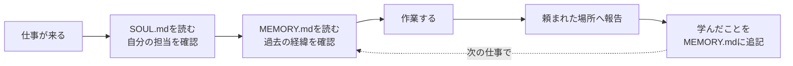
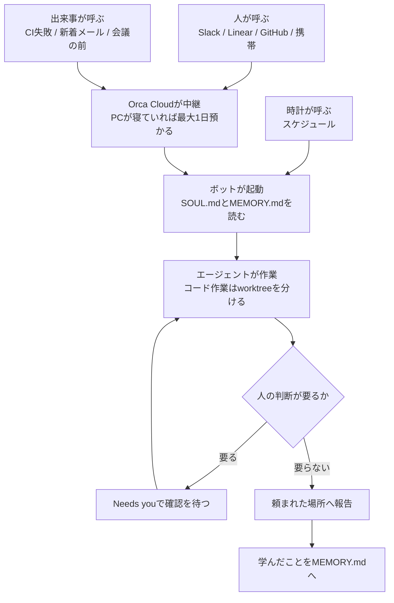
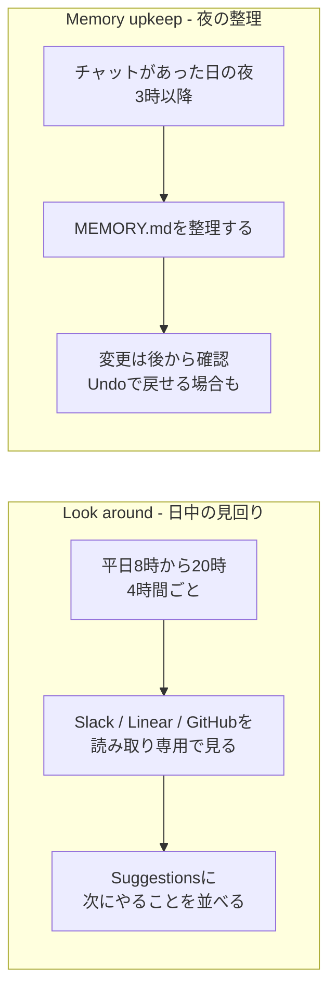
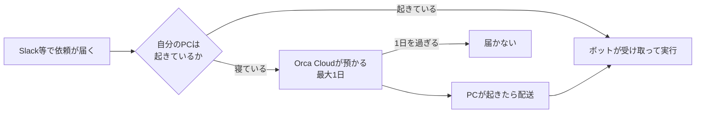

## はじめに

Claude Codeを並列で回すようになってから、ターミナルのタブがどんどん増えました。こっちでは機能追加、あっちではバグ調査、もう1つではリファクタ。気づくと、どのセッションが何をやっていて、どこまで進んだのか、自分でも分からなくなります。

止めたセッションの経緯は消えるし、毎朝のCI確認は結局、自分が思い出して自分で起動している。任せられる仕事は増えたのに、管理する側の負担も一緒に増えた、というのが最近の実感です。

その「並列で回す側」の道具として、Orcaという開発環境があります。Stably AIが作っているオープンソース（MIT）で、2026年3月公開、GitHubのスターは12万を超えています。

この記事では、まずOrca本体を「並列エージェントの置き場」として説明して、そのあと2026年11月19日に出た新機能「Bots」を取り上げます。Botsは、その置き場に「担当」を持たせる仕組みです。

（僕はOrcaもBotsも、まだ常用まではしていないです。公式ドキュメントと、公開されている実践報告をもとに書いています）

※名前の似た別製品「OrcaBot」の話はしません。後ろの方で少しだけ触れます。

## 並列で回すと、何が困るのか

困りごとは、だいたい3つに分かれます。

1つ目は、作業の置き場です。同じリポジトリで複数のセッションを回すと、同じファイルを触ってぶつかります。git worktreeを手で切って分ける運用はできますが、セッションのたびに切って、終わったら片付けるのは地味に面倒で、切らずに回すと上書きし合います。

2つ目は、見失うことです。セッションが3つ、4つと増えると、どれが終わって、どれが承認待ちで、どれがエラーで止まっているのか、把握が人間の記憶頼みになります。ターミナルを行ったり来たりして確認する時間が、じわじわ増えます。

3つ目は、セッションが使い捨てなことです。前提も経緯も、セッションを閉じれば残りません。

「このリポジトリではCIが落ちたらまずこれを見る」という前提は、毎回ゼロから説明することになります。定型の見回りも、起動するのは人間なので、忙しい日には飛びます。

たとえば毎朝のCI確認です。やることは決まっているのに、思い出して、ターミナルを開いて、指示を出すところまでが人間の仕事になっています。

Orcaは、このうち主に1つ目と2つ目を引き受ける道具です。3つ目への答えが、Botsになります。

## Orcaという置き場

Orcaは、複数のAIコーディングエージェントを並べて動かすためのデスクトップIDEです。公式ドキュメントの定義はこうです。

> a desktop IDE for running multiple AI coding agents side by side. Every task gets its own git worktree, its own agent terminal, and its own browser tab
> （複数のAIコーディングエージェントを並べて動かすデスクトップIDE。各タスクには専用のgit worktree、専用のエージェントターミナル、専用のブラウザタブが割り当てられる）

大事なのは、Orca自体はモデルではないという点です。動かすのは、自分がすでに契約しているエージェントです。

Claude Code、Codex、Cursor、GitHub Copilot、Gemini CLI、OpenCodeなど、ターミナルで動くCLIエージェントならだいたい使えます。契約を乗り換える話ではなく、今の契約の上に置く道具です。

タスクごとにworktreeが分かれるので、並列で回しても作業はぶつかりません。各セッションの状態はIDEの中で一覧できて、誰が何をしているかは画面を見れば追えます。

利用枠の確認（Usage & Accounts）もあり、ClaudeやCodexの上限をどれだけ使ったかと、リセット時刻が見られます。並列で回すと枠の減り方も速いので、これは地味に助かるはずです。

もう1つ、orchestrationという仕組みもあります。coordinator役のエージェントが大きな仕事を分割してworkerに割り振り、各workerは自分のworktreeで動く、という使い方です。

`orca orchestration` というCLIがあり、エージェント自身がそのループを回せます。ただ、これはまだ実験的な位置づけの機能で、使い方のパターンは固まっていないという評価も見かけます。

置き場所は自分のコンピュータだけとも限りません。リモートのサーバやSSHホスト、worktreeごとのクラウドVMでも回せます。

「ノートPCが寝てもエージェントは動き続ける」というのは、Orca本体のこの仕組みの話です。後で出てくるBotsの常駐とは、仕組みが少し違います。

Orca自体は無料で、MITライセンスのオープンソースです。払うのは、今のエージェント契約だけです。

ここまでで「置き場」と「見失う」問題には手が付きました。ただ、セッションが使い捨てなのは変わりません。

毎朝の見回りを誰が起動するのか。前提を毎回説明し直す手間はどうなるのか。ここからがBotsの話です。

## Orca Bots - セッションから担当へ

Botsは、Orcaの中に住むボットの仕組みです。公式ドキュメントの定義はこうです。

> Each bot has a name, a purpose, a memory and automations, and lives in a folder on one computer.
> （各ボットは名前・目的・記憶・自動化を持ち、1台のコンピュータ上のフォルダに住む）

この中で私が引っかかったのは記憶の置き場所で、これはプレーンなMarkdownファイルとしてフォルダに置かれます。

```
bot-folder/
  SOUL.md    … そのボットが何者で、何を担当するか
  MEMORY.md  … 覚えたことのメモ
```

モデルの中でも、サービスのデータベースの中でもない。自分のコンピュータにある、ただのファイルです。読めるし、編集もできる。CLAUDE.mdを書いている感覚に近いですかね。

ボットの1回の仕事は、このファイルの読み書きとして描けます。



公開は2026年11月19日、Orca v1.4.265（GitHubのリリースでは「Beta」の表記つき）でした。この記事を書いている時点の最新版は v1.4.269 です。対応エージェントも速いペースで広がっていて、公開から2日でCursor、GitHub Copilot、Hermes、Kiro、Gemini CLIなどにも広がりました。出たばかりで、仕様自体がまだ速く動いている段階だと思っておいた方がいいです。

たとえば、こんなボットです。

「このボットはCI担当。CIが落ちたら一次調査をして、原因の当たりを付けて報告する」

### チャットと何が違うのか

Claude Codeのセッションは、人が話しかけたときに動き始めます。記憶はその会話の中だけで、セッションが終われば基本リセットです。

Orca Botsは、担当と記憶を持ったまま存在し続け、スケジュールや外部の出来事でも起動します。

たとえば、先週「このIssueは様子見」と判断した経緯がMEMORY.mdに残っていれば、次の見回りで同じIssueを蒸し返さずに済みます。

表にするとこうです。

| | チャット | Orca Bots |
|---|---|---|
| 動き始めるきっかけ | 人の入力 | 入力＋スケジュール＋出来事 |
| 記憶 | 会話の中だけ | MEMORY.mdに残り続ける |
| 仕事の単位 | 1回の依頼 | 担当業務 |
| 存在 | セッション中だけ | フォルダとして常駐 |

セッションとの違いは、性能ではなく単位です。1回の依頼に応える存在から、担当業務を受け持ち続ける存在に変わっています。

### なぜわざわざボットなのか

セッションのままでも困らない場面は多いと思います。ただ、困ることもあります。

毎回ゼロから説明すること。「このリポジトリではCIが落ちたらまずこれを見て」という前提は、セッションが切れるたびに消えます。CLAUDE.mdに書く手はありますが、あれはプロジェクト全体の前提を書く場所で、担当ごとの前提までは書き分けないことが多いです。CI担当なら「落ちたらまず見る場所」というように、前提は担当ごとに違うのに、置き場所が分かれていない。僕も担当ごとの前提までは書いていないです。ボットのSOUL.mdは、その担当専用の前提を置く場所として分かれています。

次に、定型の見回りが「覚えている人」に依存すること。毎朝のCI確認や未返信の洗い出しは、やること自体は決まっているのに、起動するのは人間なので忙しい日には飛びます。

あと、依頼はSlackやGitHubに来るのに作業はターミナルの中、というずれもあります。その往復を人間がやっています。

### 仕事はどこから来るのか

入口で一番使うことになりそうなのはGitHubとSlackとスケジュールかなと思います。

GitHubは、IssueやPRでのメンションのほか、CIの失敗やレビュー依頼でも起動できます。SlackはチャンネルでのメンションやDMで起動し、ボット専用のSlack appが作られます。スケジュールはhourly / daily / weekdays / weekly / cron / RRULEで指定できます。

他にもGmail、カレンダー、Webhook、Linear、携帯電話のアプリといった入口があります。



細かい点ですが、GitHubでは自分自身のコメントやpushでは起動しません。ボットが「自分として」動くからです。ただしCI結果やマージ競合など、GitHub側が報告する変化では起動しうる、と公式に書かれています。

### 誰にも頼まれていない仕事

ボットには、依頼がなくても動く仕事が2つあります。Look aroundとMemory upkeepです。

Look aroundは、Slack・Linear・GitHub・プロジェクトを読み取り専用で見回る機能です。平日の8時から20時のあいだ、4時間ごとに動いて、「次にやること」をSuggestionsに並べます。

Memory upkeepの方が私は気になっています。記憶のファイルは放っておくとだらだら長くなって、古い前提が残ったままになる。手で整理するのは面倒で、結局やらないことが多いです。

Memory upkeepは、その日のチャットがあった日の夜、3時以降にMEMORY.mdを整理する機能です。ツールを使わず返信だけで実行されることがOrca側で強制されます。変更は後から確認できて、Undoで戻せる場合もあります。



### 「常駐」の実態

私も最初はクラウド側でずっと動くものだと思っていました。実際は違います。

ボットが動くのは自分のコンピュータ（または自分で用意してペアリングしたサーバ）の上です。Orca Cloudの役割はSlackやGitHubからの依頼の中継だけで、自分のPCに受信用のポートを開けなくて済むのはこの中継のおかげです。

では、コンピュータが寝ているあいだに依頼が来たらどうなるか。



Webhookの本文だけは最大7日保持されます。

スケジュール実行も、コンピュータが起きている間だけです。寝ていて逃した分は、起きたときに1回だけキャッチアップされます。夜に閉じるノートPCが前提なら、常駐の絵はだいぶ変わります。

### 1体目の作り方

公式の手順はこうです。

1. OrcaのサイドバーのBotsから「New bot」を選ぶ（24種類のテンプレートから始めることもできます）
2. 名前と画像を付ける
3. 「Who it is and what it does」の欄に、担当を一文で書く
4. 実行場所（どのコンピュータか、どのエージェントか）を確認する
5. Createを押す

Createを押すまで、作りかけのボットが勝手に動き出すことはないです。

もう1つ、テンプレートに付いてくるスケジュールは初期状態ではオフだという点。対象のリポジトリやチャンネルを指定して、ボットの画面でオンにして初めて動き出します。

ボットは作るときに選んだコンピュータに留まる、という注意書きも公式にあります。

### テンプレート

公式のUse casesで詳しく書かれた仕事は8つ、テンプレートは全部で24種類あります。全部は追わないです。私が気になったのはCI失敗の調査です。

CI失敗の調査は、指定したリポジトリでチェックが失敗したときに起動します。失敗を読んで、flaky（不安定なだけの失敗）か本物かを判定し、根拠と一緒に説明してくれる。

本物を直し始める前にはNeeds youで確認が入り、承認されれば別のworktreeで修正してPRで返します。flakyの一覧は保持し続け、月曜9時に定期投稿までされます。

夜のうちに落ちたCIを朝見に行くのが私の普段の動きなのですが、あれを先に読んで「これはflakyっぽい」「これは本物で、たぶんこの変更」と当たりを付けて渡してくれるなら、それだけでだいぶ違います。直すかどうかは自分で決めたいですが、読むところまでは任せたい。

PRレビューは、自分のレビューがリクエストされたときに起動して、リスクの高い変更と不足しているテストを、ファイルと行番号付きで列挙します。結果はまずボットのチャットにだけ届いて、GitHubへは許可するまでコメントしません。

バグ調査は、Slackでメンション付きで報告されたバグが対象です。workerに別worktreeで再現させて原因の箇所を特定し、修正に着手する前と出荷の方法（フラグを付けるか、全員に出すか）はNeeds youで人が決めます。

LinearのIssueトリアージは、新しいIssueの再現手順の有無を確認し、重複を探し、ラベルと担当者を提案します。クローズは承認なしにはしません。この仕事だけテンプレートがなく、チャットで定義して自動化として作る形です。

- スタンドアップノート: 平日9時に、workspace・PR・Issueから「昨日やったこと／次にやること」を書く
- リリースノート: 頼まれたときに、前回リリース以降にマージされたPRから下書きを作る
- ドキュメントの同期: 水曜10時に、マージされたPRとドキュメントを突き合わせ、合わなくなったページを列挙する

残りのテンプレートも名前だけ並べておきます。Support triage（未回答の質問の列挙）、Replies you owe、Email digest（返信すべきメールの列挙。送信はしない）、Meeting prep、Workspace cleanupなど、全部で24種あります。

### 複数置く場合

ボットは複数置くことが公式の前提で、ボットごとにフォルダが分かれ、記憶・自動化・使うエージェントを別々に持てます。連携はgroup chatの中だけです。

v1.4.269で、他のメンバーにメンションしてターンを渡せるようになりました。公式デモ「Launch crew」では、Release・Review・Docsの3ボットが分担していました。

ボットが別のボットを勝手に作ることもありません。

### 記憶は育つのか

ボットは最初の仕事の後に自分の役割を書き留め、以後は学んだことを記憶に保ちます。

たとえばスタンドアップでは、前日の訂正が翌日のノートに引き継がれます。

i-Style社の報告には面白い観察がありました。ボットが、頼まれていないのに自分のSOUL.mdに「見る場所」と「報告先」を書き足していたそうです。人格ファイルはボット自身も書き換えるので、定期的に目視で見返すことにはなりそうです。

なお、数週間以上にわたって記憶を育て続けた運用の報告はまだありません。

## 入れる前に決めること

決めるのは権限・動く場所・利用枠の3点で、これは実機で試したi-Style社の記事が挙げているものでもあります。

### 権限

Orcaの権限モードは4段階あります。

- Ask for approval（実行前に承認を求める）
- Accept edits
- Approve for me
- Full access（確認なしで実行する）

注意したいのは、初期設定がFull accessだという点です。

公式のセキュリティ文書はかなり正直で、「どれも保証にはならない」「モデルは騙されうる」と書かれています。

他人からも呼べるボットや、メールなど外部のメッセージを読むボットはAsk for approvalに切り替えるよう勧めています。

誰がボットに頼めるかの初期設定は自分だけです。他人を追加すると、その人の依頼は自分のアクセスで、自分のコンピュータ上で実行されます。公式の表現では、「自分のキーボードの前に座らせてもいい人だけを追加してください」です。

ボットが誰の名前で動くかも決まっています。Slackではボット専用のアプリとして発言し、GitHubやLinearでは返信はOrcaのアプリ名義、その他の作業は自分のログインで行われます。他人からの依頼で動いたときは、LinearのコメントやGmailの下書きに、誰の依頼でどのボット経由かを示す行が付きます。

隔離のされ方も知っておいた方がいいです。ボット専用のサンドボックスはなく、コード作業はgit worktreeを分けることで分けられているだけです。コンピュータ自体への到達範囲は、権限が許す範囲で自分として、です。

WebhookはURLを知っている人なら誰でも自動化を起動できます。署名シークレットを追加する対策はありますが、公式は「URLはパスワードのように扱ってください」と書いています。

やめ方も用意されています。自動化の一時停止や、Settings → Botsでのボット全体のオフです。オフにしてもフォルダ・記憶・チャットは残ります。

### 動く場所

夜に閉じるノートPCに、夜間の見回り担当は置けません。常時起動のデスクトップやサーバがあるなら、そちらに住まわせる選択肢があります。

### 利用枠

Orca自体は無料のオープンソース（MIT）で、Bots専用の料金も公式ページには見当たりません。

ただし、ボットの仕事はすべて自分のClaude CodeやCodexの契約枠を消費します。ここが実質のコストです。

i-Style社の報告では、数字がかなり具体的でした。作った直後の「頼んでいないあいさつ」だけで、AIへの問い合わせ4回、読み込み約38万トークン。「記事ファイルを数える」という短い依頼で、問い合わせ9回。出力は約3,400トークンでしたが、読み込みは約95万トークンでした。読み込みが膨らむ主因は、ボットが持ち主のClaude Code設定（CLAUDE.mdやスキルなど）を毎回読み込むためだそうです。

1社の1環境での数字なので、鵜呑みにはできないですが、「短い依頼でも読み込みは大きい」という傾向自体は、設計から見てもうなずける話です。僕自身、以前Claude Codeでスキルに色々詰め込んでコミットさせたら、一瞬でlimitに達したことがあります。

Look aroundとMemory upkeepも同じ枠を食べるので、台数を増やす前に枠の配分を決めておかないと、本来の開発作業の枠を圧迫しかねません。どちらも頻度を変えたりオフにしたりできるので、最初から全部入りで始めず、見回りの頻度を落として始めるのが現実的かなと思います。

## どういう仕事から任せるか

向いているのは、CI失敗の一次調査のような読み取り中心の見回りと、メール返信の下書きのような、下書きまでで止まる仕事です。形式が決まっている仕事もそうです。

慎重に始めたいのは、外部への送信や公開を伴う仕事です。権限をAsk for approvalに絞ってからにした方がいいかと思います。夜間に無人で回す仕事も、マシンが起きている前提と利用枠の消費を先に見積もってからです。

## 他の常駐エージェントと比べると

Orca Botsの位置づけは、他の常駐エージェントと並べると見えやすくなります。この秋は、各社が常駐するエージェントを一斉に出した時期でもありました。

| 製品 | 動く場所 | 記憶 | 費用 | 常駐性 |
|---|---|---|---|---|
| Orca Bots | 自分のPC | SOUL.md / MEMORY.md（手元のファイル） | Bots専用の料金は公式に見当たらない（今のエージェント契約の枠を使う） | PCが起きている間だけ |
| dots（OpenAI） | OpenAIのクラウド（専用のクラウドコンピュータ） | ChatGPTのメモリと共有。サービスの中 | Pro（月100ドル〜）などに1体込み。Enterpriseは別料金 | PCを閉じても24時間 |
| Claude Duet | Anthropicのクラウド | Claudeのメモリ等を引き継ぐ。サービスの中 | Pro / Max / Ultraに含まれる。利用枠はClaude全体と共有 | PCを閉じても回る |
| Perplexity Teammates | Perplexityのクラウド（1体ごとに隔離されたコンピュータ） | 会話をまたいで保持。サービスの中 | Maxのみ。Computerと同じクレジットを消費 | 常駐する |
| Devin Bots | Cognitionのクラウド | Devinの中（InstructionsとMemory） | 専用課金（Max 200ドル/月〜。Teamsは80ドル/月の共有プール） | 24時間 |
| ChatGPT Tasks | OpenAIのクラウド | ChatGPTのMemory（ファイルではない） | ChatGPTプランの枠。タスク数に上限（Free / Goで各3件、Plusで5件） | PCを閉じても回る |
| ChatGPT GPTs | OpenAIのクラウド | なし（毎回まっさら） | プランに含まれる | 常駐しない |
| OpenClaw | 自分のマシン／サーバ | SOUL.md / MEMORY.md等（手元のファイル） | 無料（MIT）。払うのはモデル費用のみ | マシンが起きていれば |
| OrcaBot（別製品） | ベンダーのクラウドVM | 作業ファイルは残る。記憶の仕組みは公式に明記なし | 公式に明記なし。APIキーは自前 | タブを閉じても回る |
| Copilot coding agent | GitHubのクラウド | Copilot Memory（サービスの中。ファイルではない） | Copilotプラン＋計算資源の月次枠とAI credits | 常駐しない（Actionsのセッションは最大59分） |

（料金と仕様は、2026年11月22日に各社の公式ページで確認したものです）

一番の対照はOpenAIのdotsです。名前・目標・記憶を持ち、頼まれなくても先回りして調べる、という構成要素はOrca Botsとよく似ています。違うのは置き場所で、各dotには専用のクラウドコンピュータが割り当てられ、自分のPCを閉じても止まりません。その代わり、dot独自のメモリは個別に閲覧・編集・削除ができず、消すにはdot自体を削除する必要があります。MEMORY.mdがただのファイルであることとは、ここがだいぶ違います。

Devin Botsはクラウドで24時間働き、Cognitionの発表によればAndroid Botは44日で1,134件のPRをマージしたそうです。常駐の強さではこちらが上ですが、費用は専用で、Botsが使えるのはMax（200ドル/月）やTeams（80ドル/月）などのプランです。

OpenClawは、自分のマシンで動かす個人用のエージェント基盤で、SOUL.md / MEMORY.mdの形もよく似ています。違いは、自分で立てて運用する基盤か、IDEの中の機能かという点です。

ボット基盤を使わず、素のClaude Codeと自動化だけでも部品はそろっています。クラウドで回るscheduled tasks、Desktopのscheduled tasks、セッション内の `/loop` です。足りないのは、人格と記憶を育てるファイルの運用、Slackなどから依頼を受ける常設の入口、承認待ちを並べる場所で、この3つは基盤なしでは全部自分で組み立てることになります。

私が気になっているのはOrca Botsの方です。記憶と実行が手元に残って、今の契約の枠で使えるという組み合わせは、他にはあまりないので。PCを閉じても回すことが最優先なら、クラウド側のものを選ぶことになります。

## まだ分からないこと

Orca Botsは公開からまだ数日です。英語圏も含めて、一次の実践報告はほとんどありません。

たとえば、記憶が数週間育ったボットは実際に賢くなるのか、チームで1体のボットを共有すると権限や依頼の交通整理はどうなるのか、契約枠の消費は結局ひと月あたりどれくらいが目安なのか。

仕様の側にも、公式に書かれていないことがあります。

- ボット同士が記憶を共有・参照し合う仕組みは、公式ドキュメントに記載がない
- 1台に置けるボットの上限や、台数に応じた利用枠の目安も、公式には書かれていない
- MEMORY.mdのサイズの上限や、古い記憶を捨てる基準の詳細も、公式には書かれていない

Orca本体の方も、orchestrationのような実験的な機能がどう落ち着くかは、まだこれからだと思います。

## まとめ

並列で回すようになると、困りごとは「置き場」「見失う」「使い捨て」の3つに分かれました。Orcaは置き場と見失う問題を引き受けるIDEで、Botsはそこに担当と記憶を持ち込んで、使い捨ての問題に答える仕組みでした。

とりあえず、読み取り中心の担当を1体作って、普段の見回りを任せてみるところからでいいと思います。

（蛇足ですが、Full accessのまま他人からも呼べる形で置くのはやめておいた方がいいと思います）
