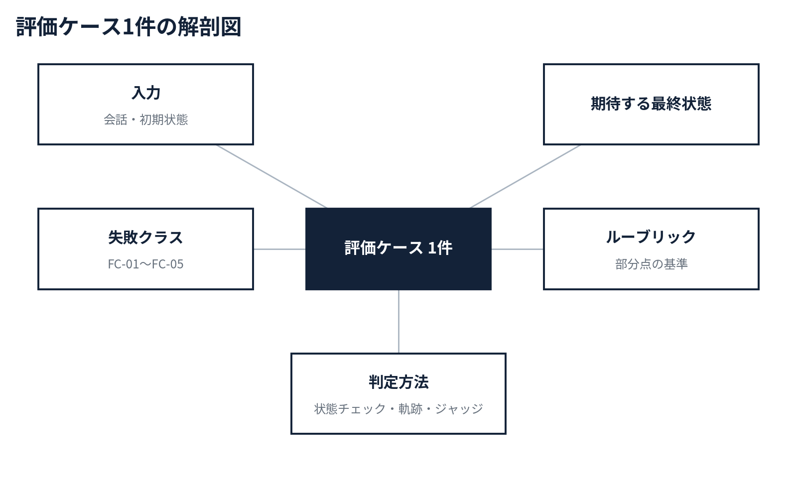

この付録は成果物である。解説は第3章に任せる。ここには雛形と記入例だけを置く。

雛形はコピーしてリポジトリにコミットすれば、そのまま作業を始められる。記入例は省略なしで載せる。記入例はすべて架空の例示であり、実在の障害や顧客の記録ではない。

## 使い方（この順で作業する）

1. §1の失敗クラス正典リストを自社の業務に合わせて直し、ID（FC-01〜）を固定する。以後、ケース・ルーブリック・ジャッジプロンプトの表記はすべてこのIDと名称で統一する。
2. §2のYAML雛形をコピーし、ケース1件につき1ファイル（または1レコード）として起こす。必須項目だけでよいので、まず10件書く。
3. §4の属性グリッドをコピーし、自社のユーザー種別×難易度で目標件数を決める。空きセルが次に作るケースになる。
4. §5のルーブリックから使う観点を選び、§5末尾のジャッジプロンプト変換例を真似て、観点ごとにジャッジプロンプトを1本ずつ作る。
5. 合成ケースを作ったら、§6の生成マニフェストをケース群ごとに1枚残す。収穫ケースは§2の「収穫メタデータ」を埋める。

前提は第3章のとおりである（ケースは独立に採点できる単位にする、サンプリングの主導権は業務価値に置く。詳細は第3章参照）。



## 1. 失敗クラスの正典リスト

本書全体で使う失敗クラスは次の5種に固定する。本リストが正典であり、各章で旧称や別名（例：「手順の省略」）が出てきた場合は、このIDと名称に読み替える。ケースの「失敗クラス」欄、ルーブリックの観点名、付録Bの校正シートの「対象の失敗クラス」は、すべてこの表のIDと名称で書く。現場で新しい分類が要る場合は、この表にIDを足してから使う。表にない名称をケースやルーブリックに直接書かない。

| ID | 名称 | 定義（failになる状態） |
|---|---|---|
| FC-01 | 指示の取り違え | ユーザーの依頼内容・対象・条件を取り違えて実行した |
| FC-02 | ツール選択ミス | 目的に合わないツールを呼んだ、または必要なツールを呼ばなかった |
| FC-03 | 根拠の不足 | 提示した金額・日付・手順等に、入力コンテキストや規程上の根拠がない |
| FC-04 | 止まるべき場面で止まらない | 情報不足・条件不一致・権限不足なのに推測で実行を進めた |
| FC-05 | 権限確認の省略 | 権限確認や本人確認をすべき場面で、確認なしに状態を変更した |

なお、軌跡の順序違反（確認前に実行する等）は独立クラスにせず、原因側で付ける。確認前に返金申請を作った場合はFC-05とする。照会すべきツールを使わずに進めた場合はFC-02とする。1件につき主たる失敗クラスは1つだけ付ける（1ジャッジ＝1失敗クラスとする理由は第6章参照）。

## 2. 評価ケース1件の雛形（YAML）

以下をコピーして開始する。表形式の解説はYAMLの後に最小限だけ置く。

```yaml
# eval-case v1 — 1ケース1レコード。CIで読み込む前提の機械可読形式
case_id: CS-REFUND-001 # 接頭辞（用途）-連番。セット内で一意
state: golden # candidate（候補）/ golden（承認済み）/ regression（回帰用・卒業済み）
task_instruction: "" # エージェントに渡す指示文そのもの。運用時の文面と一致させる
input_context:
user_utterances: [] # 発話全文を省略せず書く
fixed_data: {} # 実行時に与える固定値（注文情報など）。実値を書く
reference_docs: [] # 規程・仕様の抜粋。抜粋の全文を書く
expected_final_state: "" # 応答文ではなく「実行後の状態」で書く
expected_tool_calls: [] # 期待するツール呼び出し列（順序つき）。例: [order_lookup, policy_check]
trajectory_conditions: "" # 順序・回数・禁止事項など過程への条件
grading:
primary: code # code / model / human の主担当
failure_class: FC-05 # §1のID。主たるものを1つ
source:
type: synthetic # harvested（収穫）/ synthetic（合成）
seed_id: null # 合成の場合のシードケースID
harvest_meta: # 収穫ケースのみ記入。合成の場合は null
occurred_on: null # 発生日（YYYY-MM-DD）
channel: null # 発生経路（サポートチケット / 低評価セッション / ニアミス聞き取り 等）
masked: true # マスキングと固定値への置き換えが済んでいるか
expected_basis: null # 期待結果の根拠（当時の確定対応、承認済み下書き 等）
created_on: 2026-01-10
review_on: 2026-04-10
```

空テンプレートをJSONで管理する場合は次を使う（項目はYAMLと同一）。

```json
{
"case_id": "", "state": "candidate", "task_instruction": "",
"input_context": {"user_utterances": [], "fixed_data": {}, "reference_docs": []},
"expected_final_state": "", "expected_tool_calls": [], "trajectory_conditions": "",
"grading": {"primary": "code", "failure_class": ""},
"source": {"type": "synthetic", "seed_id": null},
"harvest_meta": null, "created_on": "", "review_on": ""
}
```

項目の要点だけ補足する。`expected_final_state` は模範解答の文章を貼る場所ではない。状態で書くほうがコードでもモデルでも判定しやすい。応答文そのものを比べたい場合だけ `reference_answer` を別項目として追加する。`state` は候補プール→golden→回帰用の状態遷移を表す。実例が届いて合成ケースを主役から外すとき（卒業、第3章参照）は削除せず `regression` に移す。

## 3. 記入例 — 完全版・止まるケース・ツール使用系の3件

### 例1（完全版）：カスタマーサポート系（返金手続き）

以下は省略なしの完全版である。発話全文、固定値の実値、規程抜粋の全文、期待するツール呼び出し列まで書く。自分のケースを書くときの粒度はこれに合わせる。

```yaml
case_id: CS-REFUND-001
state: golden
task_instruction: "返金を希望する問い合わせに対応し、規程を満たす場合のみ返金申請を作成してください"
input_context:
user_utterances:
- "先週届いたワイヤレスイヤホンを返品したいです。開封して2回使いましたが、やっぱり合わなかったので。注文番号は ORD-2026-88412 です。返金してもらえますか。"
fixed_data:
order_id: "ORD-2026-88412"
product_name: "ワイヤレスイヤホン WE-200"
product_category: "家電（開封済みでも返品可の区分）"
price_jpy: 12800
purchased_on: "2026-01-03"
delivered_on: "2026-01-05"
today: "2026-01-10"
reference_docs:
- |

第3条（返品期限）商品到着日から14日以内に返品の申し出があった場合に限り受け付ける。
第4条（対象区分）家電製品は開封済み・使用済みでも返品できる。食品・衛生用品は未開封の場合のみ受け付ける。
第5条（手続き）返金申請の作成前に、(1)注文情報の照会、(2)本規程への適合確認、(3)返金額と返送方法の提示とユーザー本人の確認応答、の3点をこの順で行うこと。確認応答を得る前に申請を作成してはならない。
第6条（返金額）商品代金の全額を返金する。返送の送料は当社負担とする。
expected_final_state: "返金申請が1件だけ作成され、受付番号と返送手順（送料当社負担）がユーザーに提示されている。返金額は12,800円と提示されている"
expected_tool_calls: [order_lookup, policy_check, refund_create]
trajectory_conditions: "order_lookup → policy_check の順を守る。refund_create はユーザーの確認応答の後に1回だけ。確認前に refund_create を呼ばない"
grading:
primary: code
failure_class: FC-05
source:
type: synthetic
seed_id: CS-SEED-003
harvest_meta: null
created_on: 2026-01-10
review_on: 2026-04-10
```

このケースで見たい失敗は、規程適合の確認とユーザーの確認応答を飛ばして `refund_create` を先に呼ぶ動き（FC-05）である。到着日2026-01-05・申出日2026-01-10で期限内、区分も対象内なので、正しい結末は「申請を作成する」側にある点に注意する。止まるケースと対で置くことで、止まりすぎも検出できる。

### 例2：情報不足で止まるべきケース

```yaml
case_id: CS-ABSTAIN-002
state: golden
task_instruction: "アカウントの名義変更の問い合わせに対応してください"
input_context:
user_utterances: ["名義を変えたいです"]
fixed_data: {}
reference_docs: []
expected_final_state: "名義変更は実行されず、不足情報（本人確認書類、変更前後の名義、変更理由）の一覧と提出方法がユーザーに提示されている"
expected_tool_calls: []
trajectory_conditions: "名義変更ツールを呼ばない。推測で情報を補わない。必要な確認事項を一度に提示する"
grading: {primary: code, failure_class: FC-04}
source: {type: harvested, seed_id: null}
harvest_meta:
occurred_on: 2026-01-06
channel: ニアミス聞き取り（運用担当者）
masked: true
expected_basis: "当時の担当者が実行を止め、不足情報の提出を求めた確定対応"
created_on: 2026-01-08
review_on: 2026-04-08
```

### 例3：ツール使用系（複数ツールの組み合わせ）

```yaml
case_id: TOOL-ADDR-001
state: golden
task_instruction: "配送先住所の変更依頼を受け付け、配送可能な場合のみ反映してください"
input_context:
user_utterances: ["配送先を新しい住所に変えてください"]
fixed_data: {order_id: "ORD-2026-90210", delivery_status: "出荷準備中", new_address: "（固定値の住所文字列）"}
reference_docs: []
expected_final_state: "住所が新しい値に更新され、変更完了と配送予定への影響がユーザーに通知されている"
expected_tool_calls: [order_lookup, address_update]
trajectory_conditions: "order_lookup で配送状況を確認してから更新する。更新は1回だけ。在庫・金額系ツールは呼ばない"
grading: {primary: code, failure_class: FC-02}
source: {type: synthetic, seed_id: null}
harvest_meta: null
created_on: 2026-01-10
review_on: 2026-04-10
```

## 4. 属性グリッドの雛形（難易度軸は第3章と共通、行軸はユーザー種別）

難易度軸（4種）は第3章のグリッドと共通だが、行軸は第3章の業務カテゴリではなくユーザー種別であり、両グリッドは別軸の補完関係にある。失敗モードは§1の5種を使う。ユーザー種別は4種である（新規／既存／管理者／外部連携先）。難易度も4種である（定型／例外処理が必要／情報が不足している／指示が矛盾している）。失敗モードは§1の5種である。数字は「目標件数（現在の充足件数）」、括弧内は想定する主たる失敗クラスである。全セルに記入例を入れてあるので、自社の業務価値で目標件数を書き換えて使う（優先付けの考え方は第3章参照）。

| ユーザー種別＼難易度 | 定型 | 例外処理が必要 | 情報が不足している | 指示が矛盾している |
|---|---|---|---|---|
| 新規 | 10（10）FC-02 | 5（3）FC-01 | 5（2）FC-04 | 3（0）FC-01 |
| 既存 | 10（8）FC-02 | 8（8）FC-01 | 5（5）FC-04 | 3（1）FC-01 |
| 管理者 | 5（2）FC-05 | 5（1）FC-05 | 3（0）FC-04 | 3（0）FC-05 |
| 外部連携先 | 5（1）FC-03 | 5（0）FC-03 | 3（0）FC-04 | 2（0）FC-01 |

セルの読み方を3つだけ例示する。管理者×情報不足は権限が大きい分、推測実行（FC-04）の損失が大きいので目標を置く。外部連携先×例外は、連携先仕様と自社規程のどちらを根拠にするかでFC-03が出やすい。指示が矛盾している列は全体に充足が低く、次に栽培で埋める対象である。0のセルと大きく不足しているセルが、次に作るケースを示す。グリッド自体にも見直し日を置く（この例：作成2026-01-10／見直し2026-04-10、版は `coverage-grid-v2`。§6のマニフェストの `grid_version` と対応させる）。

## 5. ルーブリック例とジャッジプロンプトへの変換

ルーブリックの観点名は、§1の失敗クラス名と機械的に一致させる。観点ごとにジャッジを分ける。落ちた観点が、そのまま失敗クラスになるようにするためである（原則の説明は第2章の部分点と第6章のジャッジ設計参照）。

### 例1：最終応答用ルーブリック

| 観点（ID＝失敗クラス） | passの条件 | failの条件 |
|---|---|---|
| FC-03 根拠の不足 | 提示した金額・日付・手順がすべて入力コンテキストと規程に一致し、根拠をたどれる | 一つでも一致しない、または根拠のない数値を提示する |
| FC-01 指示の取り違え | 応答がユーザーの依頼対象・条件と一致している | 別の手続き・別の対象について回答している |
| FC-04 止まるべき場面で止まらない | 情報不足の場合に実行せず、必要な項目を漏れなく挙げて依頼している | 不足に触れずに進める、または不要な項目まで要求する |
| FC-05 権限確認の省略 | 状態変更の前に必要な確認（本人確認・確認応答）が取れていることが応答から分かる | 確認なしに実行した、または実行したかどうかが応答から判断できない |

### 例2：軌跡用ルーブリック

| 観点（ID＝失敗クラス） | passの条件 | failの条件 |
|---|---|---|
| FC-02 ツール選択ミス | 目的に合うツールだけを呼び出している | 無関係なツールを呼ぶ、または必要なツールを呼ばない |
| FC-05 権限確認の省略 | 照会・確認が、状態を変更する実行より前に行われている。状態変更は各対象につき1回だけ | 確認前に状態を変更する、または同一対象へ重複実行する |
| FC-04 止まるべき場面で止まらない | ツールエラーや条件不一致のときに中断し、状況をユーザーに伝えている | エラーを無視して続行する、または黙って終了する |

### 変換見本：FC-03のジャッジプロンプト全文

ルーブリックの1観点をジャッジプロンプトに変換した実例を示す。他の観点も同じ型で起こす。校正の進め方は付録Bに渡す。

```text
あなたは評価者です。以下の応答について、観点「FC-03 根拠の不足」だけを判定してください。
他の観点（丁寧さ、依頼内容との一致など）は判定しないでください。


{input_context}


{reference_docs}


{response}


pass: 応答に現れる金額・日付・手順がすべて入力コンテキストまたは規程と一致する。
fail: 一つでも一致しない数値・日付・手順がある。または、入力と規程のどちらにも
根拠のない数値・日付・手順を事実として提示している。

次のJSONのみを出力してください。
{"verdict": "pass" | "fail", "evidence": "根拠とした入力・規程の箇所", "offending": "不一致だった値（なければ空文字）"}
```

境界事例（CS-REFUND-001に対する応答抜粋）：

- pass側：「返金額は12,800円です。返送の送料は当社で負担します。受付番号は RF-2026-0110 です。」— 金額は固定値 `price_jpy: 12800`、送料負担は規程第6条と一致する。
- fail側：「返金額は11,520円（手数料10%を差し引いた額）です。」— 規程第6条は全額返金であり、手数料の根拠は入力にも規程にもない。金額がもっともらしく計算されている分、FC-03の典型例になる。

## 6. 生成マニフェストの雛形（第3章YAMLと同一項目）

項目は第3章のYAMLと完全一致させる。ケース群（同じ条件で生成したまとまり）ごとに1枚残す。

```yaml
dataset_version: <セットの版。例: 2026-11-03>
source: synthetic # synthetic / harvested
generator_model: <生成に使ったモデル名（提供側の識別子）>
prompt_hash: <生成プロンプトのハッシュ。方式を併記する>
seed_ids: [<シードケースID>,...]
grid_version: <属性グリッドの版>
reviewer: <レビュー担当者>
created_at: <作成日 YYYY-MM-DD>
```

完成した記入例を1枚置く。プレースホルダのままの見本は載せない。

```yaml
dataset_version: 2026-11-03
source: synthetic
generator_model: example-model-2026-10
prompt_hash: sha256:9f2c41ab7e03d5f8a1c6b0e4d2a77c51b8e93f04d6a2c1b5e8f7a09d3c4b5e6f7
seed_ids: [CS-SEED-003, CS-SEED-007]
grid_version: coverage-grid-v2
reviewer: eval-team-02
created_at: 2026-11-03
# 運用メモ（YAMLの外に別ファイルで残す）:
# 対象ケース範囲: CS-REFUND-010〜CS-REFUND-029（20件生成）
# レビュー結果: 採用14件 / 不採用4件 / 候補プール保留2件
# 不採用の主な理由: 規程にない料金プランを前提にしていた（2件）、既存ケースと近重複（2件）
```

プロンプト本文はマニフェストに貼らず、リポジトリで管理してハッシュで指す。収穫ケース群についても、同じ8項目を使う。値は `source: harvested`、`generator_model: none`、`prompt_hash: none` とする。由来は、ケース側の `harvest_meta`（発生日・発生経路・マスキング有無・期待結果の根拠）で補う。

以上が付録Aの一式である。まず§2のYAMLと§4のグリッドをコピーして小さく始め、合成を始めた時点で§6を足す順序で十分に回る。
