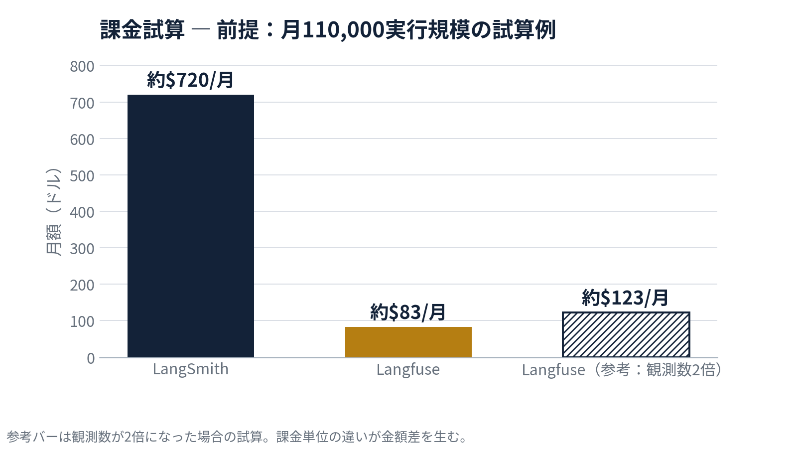

第8章では、評価基盤をどう考えるか、どの軸で選ぶかを扱いました。この付録は、第8章とは逆の置き方をします。考え方は最小限にとどめます。手元に置いて引くための表と推奨構成だけを置きます。

結論は第8章と同一である。ツールは機能で選ぶな、課金単位とデータの置き場で選べ。

料金とプランの記載は、2026年11月21日時点で各公式料金ページ・公式ドキュメントを確認した内容です。金額は米ドル建ての定価ベースの概算で、為替や契約条件で変わります。契約前に、必ず公式ページで現行の条件を確認してください。

## 使い方（この順で作業する）

1. §1の決定表の3問に答え、自組織がパターン1〜3のどれに当たるかを決める。
2. §2の比較表で、候補ツールの課金単位（何が1単位で、何で跳ね上がるか）とデータの置き場を確認する。
3. §3の試算例の型に自組織のtrial数・トレース件数を当てはめ、月額の桁を確認する。
4. §4の推奨構成を出発点にし、§5の自前リポジトリ構成で評価セットとID対応表を用意してから導入する。

## 1. 決定表（3問でパターンへ誘導する）

| 質問 | 回答 | 行き先 |
|---|---|---|
| Q1. 本番トレースを外部SaaSに出せるか | 出せない | パターン3の観点（セルフホスト前提）で §2 を読む |
| Q2. 中心フレームワークは何か | Google ADK採用済み | パターン1〜2でADK標準機能を第一候補にする |
|  | LangGraph中心 | 蓄積側はLangSmithを第一候補にする（パターン2） |
|  | それ以外／未定 | 蓄積側はLangfuseを第一候補にする（パターン2） |
| Q3. 月間trace数と運用段階（第8章の規模定義は人数ではなくtrace数が軸） | 月1万trace未満 | パターン1 |
|  | 月1万〜10万trace | パターン2 |
|  | 月10万trace超、または外部送信不可（外部送信不可はQ1で判定済み。監査・保持ポリシーが選定条件になる場合も含む） | パターン3 |

## 2. ツール比較表

比較軸は、第8章の5軸をもとにしています。データの置き場・保持・削除とアノテーション導線を加え、得意な評価タイプを外した6軸で引きます。6軸とは、課金単位／データの置き場と保持・削除／アノテーション導線とラベル還元／CI適性／誤差表示／セルフホスト可否です。「向いている規模」は §4 のパターン側に寄せ、表からは外しました。

誤差表示は2段で判定します。第1段は「標準誤差または信頼区間をツールが標準で出すか」です。第2段は「出さない場合でも、試行別の生データをエクスポートして集計側で区間を出せるか」です。

| ツール | 課金単位（何が1単位か／何で跳ね上がるか） | データの置き場・保持・削除 | アノテーション導線・ラベル還元 | CI適性 | 誤差表示 | セルフホスト可否 |
|---|---|---|---|---|---|---|
| Inspect AI | OSS（MIT）は無償。費用はモデル利用料と実行基盤のみ。trial数を増やすほどモデル利用料が比例して増える | 自前実行のため置き場は自組織。保持・削除も自前ポリシーで決められる | 標準では持たない。トランスクリプトの確認とラベル付けは自前で用意する | 高い。CLI実行と結果のファイル出力が中心で、CIに組み込みやすい | 標準で出す：結果に標準誤差を添えて出す設計が特徴（第8章の記述どおり）。試行別データも残る | 可（OSSとして自前で実行） |
| DeepEval | OSS（Apache-2.0）は無償。背後の商用基盤Confident AIは別料金（履歴管理・共有・オンライン評価を買う場合の選択肢。2026年11月21日確認：第8章のとおりStarter 月200ドル、SSOやRBACが要るTeamは月2,000ドル） | OSS実行分は自前。Confident AIを使う部分は同サービスの置き場になる | OSS側は限定的。Confident AI側にレビュー導線がある | 高い。pytestとして実行でき、既存のテスト基盤に載せやすい | 標準では出さない。指標ごとのスコアが中心。試行別結果はエクスポートでき、区間は集計側で出す | 可（OSSとして自前で実行。Confident AIのセルフホスト条件は契約時に確認） |
| LangSmith | シート課金＋trace単位の課金が中心（2026年11月時点：Plus $39／シート／月、含まれるbase trace 10,000件／月、超過分は約$5／1,000 trace。保持を extended に上げたtraceは追加で約$2.50／1,000 trace）。本番の全量トレーシングと大量trialで跳ね上がる。アノテーションやフィードバックを付けたtraceは保持区分が上がりやすい点にも注意 | 原則SaaS（LangChain側）。base traceの保持は14日、extendedは保持180日（第8章の記述どおり。2026年9月以降のSaaSの上限であり、契約時に現行条件を確認）。削除・エクスポート条件はプラン依存 | 強い。キューでトランスクリプトを回し、付けたラベルを評価セット／校正データへ還元できる導線が製品側にある | 中〜高。オフライン評価をCIから呼ぶ構成は可能だが、本領は継続的な観測と評価の運用側 | 標準では出さない。実行単位の結果と集計画面が前提。試行別結果は取得でき、区間は集計側で出す | 原則SaaS。セルフホスト／ハイブリッドはEnterpriseプランのみで、個別契約が前提。自前運用の可否はプランで決まる |
| Langfuse | ユニット制：trace＋observation（モデル呼び出し・ツール呼び出し等の各ステップ）＋scoreの合計が1ユニット単位で数えられる（2026年11月時点：Cloud Core $29／月、100,000ユニット含む、超過分は$8／100,000ユニットから逓減）。1回のエージェント実行が複数ユニットになるため、ステップ数が多いエージェントほど跳ね上がる | Cloud（リージョン選択可）またはセルフホスト。Cloudのデータアクセス期間はプランで異なる（Hobby 30日／Core 90日／Pro 3年が2026年11月時点の目安）。セルフホストなら保持・削除は自前ポリシー | スコアと人手フィードバックをトレースに紐づけられる。キュー形式の作業導線の充実度は導入前に実物で確認する（第8章の注意どおり） | 中。評価の実行基盤というより、結果とトレースの受け皿としてCIや本番とつなぐ | 標準では出さない。スコアとトレースは保持でき、試行別データはエクスポート可能。区間は集計側で出す | 可。OSS版（コアはMIT）のセルフホストが選べる点が大きな特徴。一部エンタープライズ機能は別ライセンス |
| promptfoo | OSS（MIT）は無償。2026年3月にOpenAIによる買収合意が公表され、OSSはMITで継続する方針（第10章参照）。費用はモデル利用料と実行基盤のみ | 自前実行のため置き場は自組織 | 対象外に近い。比較とレッドチーミングが主目的で、アノテーション導線は持たない | 高い。設定ファイル中心でCLI実行でき、CIへの常設に向く | 標準では出さない。ケース単位の合否と集計が中心。試行別結果はファイルに残り、区間は集計側で出す | 可（OSSとして自前で実行） |
| Google ADK標準評価機能 | フレームワーク自体は無償。費用は利用するモデルと実行基盤側が中心 | フレームワーク内蔵のため、実行環境とデータの置き場は自前の構成に依存する | 標準では持たない | 中〜高。フレームワークの作法に沿う範囲では回しやすいが、前提はADK採用であること | 標準では出さない。評価基準ごとの結果表示が中心。試行別結果を取り出せる範囲で集計側で区間を出す | 可（フレームワーク内蔵のため自前環境で実行） |

表の読み方は第8章どおりです。行は競合ではなく役割で見てください。役割は次のとおりです。Inspect AIとDeepEvalは「評価を実行する側」です。LangSmithとLangfuseは「トレースと結果を蓄積し、人が見る側」です。promptfooは「比較とレッドチーミング」、ADK標準機能は「フレームワーク内蔵」です。「どれか一つを選ぶ」表ではありません。「どの役割が不足しているか」を確認する表として使ってください。LangSmithについては、周辺の agentevals／openevals（MITのOSS）を採点部品として単独で使う選択肢も別途あります。

この軸で差がつかないのは、現時点では「日本語サポートの手厚さ」です。いずれも英語ドキュメントが正で、選定の決め手にはなりません。差がつくのは、上の6軸に限ると考えてよいでしょう。

## 3. 課金試算例 — LangSmithとLangfuseの月額の桁

第8章の指示（候補ツールの課金単位に当てはめて月額の桁を確認する）の見本を1パターン置きます。単価は §2 の2026年11月時点の値を使った概算です。モデル利用料（エージェント実行とジャッジのAPIコスト）は含みません。モデル利用料は基盤課金とは別に必ず発生します。実試算では別枠で足してください。本付録の金額は米ドル建てのままとし、円換算はしていません。第8章の円換算（1ドル=158円）や第11章の試算（1ドル=150円・月30万トレース前提）とは前提が違います。円額を直接比べないでください。

想定：小規模チーム（シート5人）。PR評価は月200回、各回50ケース×1 trial＝月10,000 trace。本番トレースは月100,000件、そのうちアノテーション対象として10%を長期保持する。Langfuse換算では、1実行あたり trace 1＋observation 5＋score 1＝7ユニットと仮置きする。

| 構成 | 計算 | 月額の桁 |
|---|---|---|
| LangSmith（Plus） | シート 5人×$39＝$195。trace合計 110,000件のうち含まれる10,000件を除く100,000件×$5／1,000件＝$500。長期保持10,000件×追加$2.50／1,000件＝$25。合計 約$720／月 | $700台。本番traceを全量入れる設計にした時点で決まる。本番トレースのみサンプリング率を10%に落とすと（PR評価分は全量のまま）、trace課金は約$50まで下がる |
| Langfuse（Cloud Core） | ユニット合計 110,000実行×7＝770,000ユニット。含まれる100,000を除く670,000ユニット×$8／100,000＝約$54。基本料$29と合計 約$83／月 | $100未満。ただしobservation数が仮置きの2倍（ステップの多いエージェント）になるとユニットは約1,320,000になり、超過分は逓減単価（総ユニット100万まで、つまり超過分のうち90万ユニット分は$8／10万、総ユニット100万を超える分は$7／10万）で約$94、合計 約$123／月へ動く |

読み取り方は2点あります。第一に、LangSmithはtrace件数に、Langfuseはステップ数（observation数）に感度が高いことです。同じトラフィックでも、跳ね上がる変数が違います。第二に、どちらの構成でもモデル利用料は別です。pass^k のようにtrial数を増やす設計（第5章）は、基盤課金より先にモデル利用料で効いてきます。



## 4. 規模別の推奨構成（第8章「規模別の選び方」と一致）

各パターンは、第8章の規模区分に対応させたものです。規模区分は、月1万trace未満／月1万〜10万trace／月10万trace超または外部送信不可です。ここにチームの段階を重ねています。いずれも「評価セットと採点基準は自前のリポジトリで管理する」ことを前提にします（§5）。

### パターン1：個人開発（第8章の規模区分「月1万trace未満、外部送信可」に対応）

実行系は、第8章の結論どおり、DeepEvalかInspect AIのどちらか一つから始めてください。すでにADKを使っているなら、ADK標準機能も候補になります。蓄積はLangSmith Developer（無料）かLangfuse Hobbyで足ります。統合基盤には課金しません。安全性の確認にpromptfooを足し、結果の保存はローカルファイルとGit管理までとします。蓄積や可視化の基盤に時間をかけるより、ケースを増やし、失敗した実行を読む時間に使うほうが効果が出ます。

次に足すべきものは、本番に近い形で使い始めた段階でのトレース保存です。実行ログを後から追えなくなったと感じたら、その時点でパターン2へ移ってください。

### パターン2：小規模チーム（〜10人）（第8章の規模区分「月1万〜10万trace、外部送信可」に対応）

オフライン評価とCIゲートは、DeepEvalまたはInspect AIの実行系で回します。トレースと結果の蓄積・オンライン評価は、LangSmithかLangfuseのどちらかで一元化します。どちらを選ぶかは、LangGraphへの依存度と、データを外に出せるかで決めてください。LangGraph中心ならLangSmithです。データを自前に寄せたい、セルフホストの余地を残したいならLangfuseです。これが第8章の結論です。レッドチーミングの定期実行にはpromptfooを常設します。CIのゲートは最初は警告止まりにし、誤検知の傾向を見てからブロックに切り替えてください。

次に足すべきものは、本番トレースからのサンプリング評価です。あわせて、アノテーションの担当と頻度を決めた運用ルールも必要です。蓄積側の導入は、ダッシュボードを作るためではありません。アノテーションと失敗ケースの共有を回すために行います。

### パターン3：組織規模（第8章の規模区分「月10万trace超、または外部送信不可」に対応）

選定の主因は、指標の豊富さではありません。セルフホスト可否・監査・データ保持ポリシーです。構成の中心は、Langfuseのセルフホストです。または、OSSの実行系（Inspect AI／DeepEval／promptfoo）を自前基盤に載せる形になります。SaaSを使う場合も、事前に確認してください。確認するのは、トレースに何が含まれるか、保持期間と削除の扱い、エクスポート可否です。オフライン評価のスイートはCIのゲートとして維持します。本番側は、サンプリングした実行へのオンライン評価に絞ります。ADK製エージェントが含まれる場合は、その部分にADK標準機能を併用して構いません。ただし結果の集約先は全体の蓄積側に寄せ、二重管理にしないでください。

あわせて、評価の実行コストと基盤の課金を合わせた予算を先に置いてください（コスト設計は第11章）。次に足すべきものは、評価セットの棚卸しです。飽和したケースの入れ替えを、定期作業として持ってください。

## 5. 乗り換え・併用のための最小構成（実例）

乗り換え可能性は、評価セットと採点基準を自前で持ち続けているかで決まります。そのための最小構成を、実例で置きます。

### リポジトリ構成例

```text
evals/
  cases/                  # 評価ケース（付録AのYAML形式、1ケース1ファイル）
    CS-REFUND-001.yaml
    CS-ABSTAIN-002.yaml
  rubrics/                # 採点基準・ルーブリック（付録A §5）
    FC-03.md
  judge_prompts/          # ジャッジプロンプト（版管理し、校正シートの版と対応させる）
    judge_prompt_v1.3.txt
  manifests/              # 生成マニフェスト（付録A §6）
    2026-11-03.yaml
  calibrations/           # 校正シートと履歴サマリ（付録B）
    CAL-2026-014.md
    history.csv
  runs/                   # 実行結果の自前控え（入力・出力・スコア・設定）
    2026-11-10_pr-1234.json
  id_map.csv              # 実行ID対応表（下記）
```

### 実行ID対応表の雛形

実行側と蓄積側を分けると、同じ実行を指すIDが複数生まれます。併用を始める時点で、共通IDを1つ決めて両側に記録してください。

```csv
run_id,case_id,ci_run_url,platform,platform_trace_id,judge_prompt_version,executed_at
run-20261110-001,CS-REFUND-001,https://example.invalid/ci/1234,langfuse,tr_9f2c41ab,v1.3,2026-11-10T14:30:00+09:00
```

`run_id` の命名規則は `run-YYYYMMDD-連番` とします。CI・蓄積側・自前控え（`runs/`）のすべてに、同じ値を書いてください。これがあると、CIで落ちたケースを本番側のトレースで追えます。

### 乗り換え前後のスコアずれ記録表

ツールや基盤を乗り換えると、ジャッジの既定値が変わり、スコアの連続性が切れることがあります。切り替え前に、同じ評価セットを両環境で実行し、ずれを記録してください。記録の形式は付録Bの校正シートに接続します。ずれが大きい場合は、測定系の変化として再校正の対象にします。

| 項目 | 記入欄 |
|---|---|
| 切り替え日／移行元→移行先 | ＿＿＿＿ |
| 対象スイートとケース件数 | ＿＿＿＿ |
| 旧環境の補正後スコア（95%信頼区間） | ＿＿＿＿（算出は付録B §5） |
| 新環境の補正後スコア（95%信頼区間） | ＿＿＿＿ |
| ずれの大きさと、区間の重なり | ＿＿＿＿ |
| 判定（製品の変化か、測定系の変化か） | ＿＿＿＿ |
| 対応する校正シートID（付録B） | ＿＿＿＿ |

そのほかの注意は2点に絞ります。第一に、サービス側のデータセット機能を使う場合も、定期的に書き出してください。`cases/` との差分を確認できる状態を保ちます。第二に、過去トレースの完全な移行は前提にしません。重要な評価結果については、トレースへの参照だけでなく、入力・出力・スコア・実行時の設定を `runs/` に自前でも残してください。
