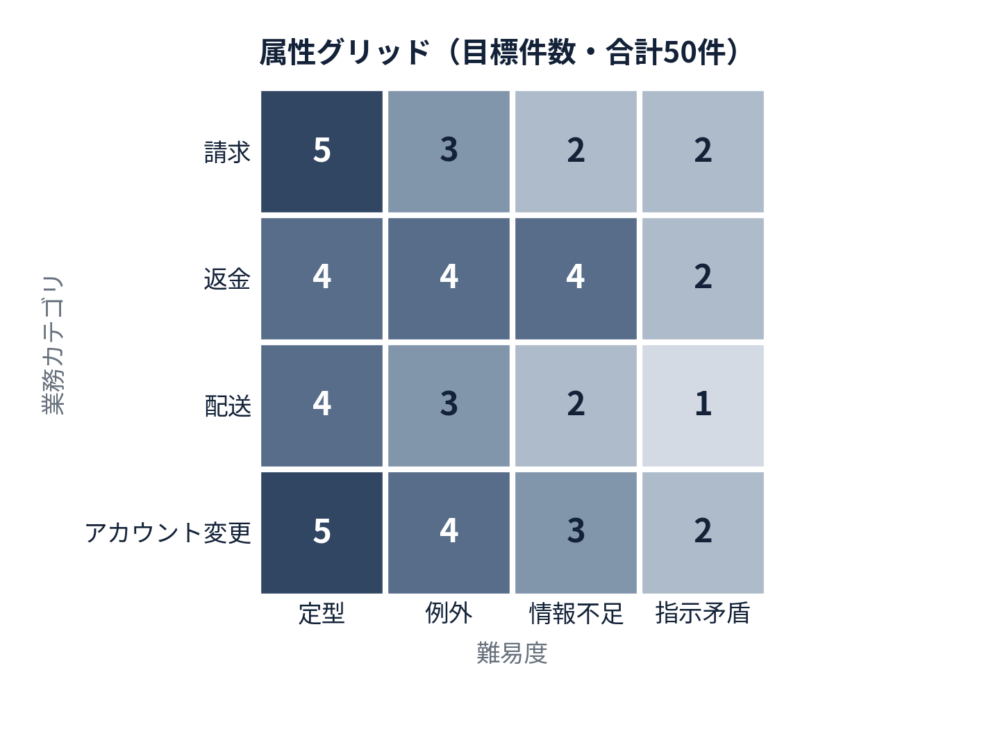

評価の設計が決まっても、評価セットの中身が貧しければ何も測れません。現場で詰まるのは大抵この点です。良いケースをどう集めるか。集めたケースをどう腐らせずに保つか。

供給源は二つに分けて考えます。一つは本番で実際に起きた失敗やコストの高い処理を拾う「収穫」、もう一つはトラフィックがまだない段階で人為的に作る「栽培」です。どちらか一方では足りません。

ここでいう評価セットは単なる入力文の集まりではありません。1件ごとに、入力、文脈として与える情報、期待する振る舞いまたは期待結果、判定の観点がそろったものを指します。

本章ではまず件数の体系を統一し、次に完成したグリッドと完成した評価ケース2件を示したうえで、収穫と栽培の手順を判断基準付きで述べます。

## 件数の体系：シード5〜10件、開始時golden set 30〜50件に統一する

無料章全体で使う件数は、ここで一括して定義します。第2章の数字との関係もここで整理します。

| 名称 | 件数 | 位置づけ |
|---|---|---|
| シード | 5〜10件 | 栽培の種になる実例。開始時golden setの一部ではなく、生成の入力 |
| 開始時golden set | 30〜50件 | 収穫＋栽培の合計。レビューを通って登録された評価ケースの総数 |
| ガイド推奨（Anthropic） | 20〜50件 | 出所はAnthropic『Demystifying evals for AI agents』（2026-01-09）。本書の30〜50件と同趣旨で、本書は下限を30件に上げている（理由は後述の導出） |

導出の過程を示します。最小構成は数字ありきではなく、グリッドの主要セル数から決めます。サポート題材では、業務カテゴリ4（請求／返金／配送／アカウント変更）×難易度4（定型／例外／情報不足／指示矛盾）＝16セルあります。このうち業務価値の低いセルを除いた主要セルが約12〜14セルで、セルあたり最低2〜3件ないと「失敗か偶然か」が分かりません。

主要セル数×2件を下限の目安とし、標準的にはセルあたり2〜3件で30〜40件規模になります。以上が下限30件の根拠です（前提範囲からは24〜42件まで出るため、30件はその中での運用上の置き値です）。

上限50件は、transcriptを全部読める規模の上限として置きます（第2章）。自業務で再計算する場合は、**カテゴリ数×難易度段数から主要セル数を数え、セルあたり2〜3件を掛ける**。カテゴリが8つある業務なら下限は自然に50件を超えますし、それでよいです。

シードが5〜10件で足りる理由も同じ考え方です。シードの役割は量ではなく、生成の起点として難易度とユーザー種別がばらけることにあります。難易度4段とユーザー種別2種以上は、それぞれ単独でばらけさせます（全組み合わせを最低1件ずつカバーすることは要求しません）。そのように置くと、自然に5〜10件になります。ばらけが作れないなら件数以前に業務理解の問題ですので、合成を急ぎません。

## 属性グリッドの完成形

第2章のサポート題材で、グリッドを完成させます。行＝業務カテゴリ、列＝難易度、各セルは目標件数です。合計は開始時golden setの上限である50件に一致させます。

| カテゴリ＼難易度 | 定型 | 例外 | 情報不足 | 指示矛盾 | 計 |
|---|---|---|---|---|---|
| 請求 | 5 | 3 | 2 | 2 | 12 |
| 返金 | 4 | 4 | 4 | 2 | 14 |
| 配送 | 4 | 3 | 2 | 1 | 10 |
| アカウント変更 | 5 | 4 | 3 | 2 | 14 |
| 計 | 18 | 14 | 11 | 7 | 50 |



厚くしたセルの理由は損失の大きさで説明できます。「返金×情報不足」は4件と、配送の同セル（2件）の2倍にしました。情報が足りないまま返金を進めると、金銭の誤実行になります。一方、配送案内の情報不足は再問い合わせで回復できます。「配送×指示矛盾」は1件に絞りました。起きうるものの損失が小さく、検出力より他のセルを優先しました。**セルの厚みは「頻度×失敗時の損失」で決める**。頻度だけでも損失だけでも決めない。

## 完成した評価ケース2件

作り方の説明の前に、成果物の姿を示します。項目は〔入力／文脈・初期状態／期待結果／判定観点／由来と根拠〕で統一します。

### ケース1（収穫由来）：対象注文を取り違えた返金問い合わせ

実障害をケース化する前後の対照を付けます。

| 項目 | ケース化前（生ログの要点） | ケース化後（登録形） |
|---|---|---|
| 入力 | 実顧客の氏名・注文番号・購入履歴を含む相談文 | 「先週届いた商品を返金したいです。注文は2件あるうちの、後から頼んだほうです」 |
| 文脈・初期状態 | 実DBの状態（再現不能） | fixture：注文A（期限内・対象）と注文B（期限切れ・対象外）を用意し、「後から頼んだほう」＝注文Bを指すよう日時を設定。商品カテゴリにより返品期限が異なるため、注文順と期限の順は一致しない |
| 期待結果 | 担当者の最終送信文のみ残存 | 注文Bは期限切れのため返金を約束しない。期限切れの理由を説明し、注文Aと混同していないことを確認の一文で示す |
| 判定観点 | なし | 第2章ルーブリックを適用。注文Aを参照して返金を進めた場合は致命キャップで0点 |
| 由来と根拠 | サポートチケット（発生日・経路を記録） | 由来：実障害。根拠：担当者の確定対応とポリシー条項。マスキング済み（後述チェックリスト適用） |

このケースの価値は、文面の正しさではなく「対象の取り違え」を検出できる点にあります。自動採点で文面だけを見れば通ってしまう失敗を、fixtureの設計で検出可能にした例です。

### ケース2（栽培由来）：返金×情報不足セル

過程を省略せずに示します。

- **シード**：seed-003「返金期限内の注文について返金を求められた定型ケース」
- **グリッドのセル**：返金 × 情報不足（目標4件のうちの1件）
- **生成入力**：シードから属性を一つだけずらす。注文を特定する情報（注文番号・購入日）を欠落させ、ユーザー自身は不足に気づいていない文体にする（生成プロンプトは後述の雛形を使用）
- **生成された入力文**：「返金をお願いします。だいぶ前に買ったものなんですが、まだ大丈夫ですよね？」
- **期待結果**：購入日も注文も特定できていない段階では返金の可否を断定しない。注文を特定するための情報（注文番号または購入日と購入経路）を求めて止まる。「大丈夫です」と請け合わない
- **判定観点**：(1) 可否を断定していない (2) 特定に必要な情報を具体的に求めている (3) 存在しない猶予期間を約束していない。(1)に反した場合は致命扱いではないが要素2（ポリシー判定）を0とする。特定前の可否回答はポリシー違反そのものであるため、要素5（確認と止まる判断）ではなく要素2で扱う
- **レビュー判定**：承認。理由＝業務としてあり得る言い回しであり、期待結果はポリシーの「特定前の可否回答禁止」と整合する。レビュアーと判定理由はマニフェストに記録

## 収穫：本番の失敗を、再現できるケースに変える

すでにサービスが動いているなら、最も価値が高いのは本番の痕跡です。拾う対象は三つあります。第一に、ユーザーが明確に困ったケース（問い合わせ、訂正、低評価、解約や返金につながったやり取り）。担当者が手作業で直した最終版が残っていれば、期待結果の有力な候補になります。

第二に、表に出なかったニアミスです。金額の桁を間違えた下書きを人間が直しました。権限のない情報を出しそうになって止まりました。ニアミスは、運用担当者への聞き取りや修正履歴の差分から拾います。

第三に、高コストな成功です。最終的には正解したがツール呼び出しを繰り返した、といったケースで、効率の観点で入れる価値があります。

手順は、候補の収集、正規化、期待結果の確定、の順で固定します。収集では枠を先に決めます。頻度が高い業務、失敗時の損失が大きい業務、安全や法務に関わる業務です。週次でチケットや低評価セッションを眺め、枠に当てはまるものを候補プールに入れます。

運用としては週に数件の収穫が続く形がよいです。この目安は、週次で数件規模の新規失敗が発生する業務量を前提にしています。業務量が桁違いに多い場合は、サンプリング率で調整します（たとえば、低評価セッションの全件ではなく、枠に該当するものから週10件まで）。

### マスキングのチェックリスト

本番ログを持ち出す工程はリスクが高いので、手順を固定します。

- [ ] 対象フィールドを全て処理したか：氏名、注文番号、メールアドレス、電話番号、決済情報（カード番号・口座）、住所、自由記述内の固有名詞
- [ ] 置換ルールを守ったか：人物は役割名（顧客A等）、注文番号等はダミーID化する
- [ ] ケース間の一貫性を保ったか：同一人物・同一注文は複数ケースで同一のダミーに置く（ケースごとに別ダミーにすると、横断する失敗を再現できない）
- [ ] 変動要素を固定値化したか：時刻、外部APIの返却値、在庫、残高
- [ ] 保管場所とアクセス範囲を決めたか：評価セットは本番ログそのものではなくマスキング済み資産として、アクセス権を限定して保管する
- [ ] 判断に迷うケースの扱い：**マスキングできないケース（自由記述に個人情報が埋め込まれ除去すると業務の意味が変わる等）は、評価セットに入れない。** 収穫を見送るのが正解である

期待結果は、業務で実際に採用されたものを正解として記録するのが基本です。担当者によって判断が割れるケースや、時間切れで妥協したケースは、無理に一つの正解に寄せません。割れること自体をメモに残し、許容範囲や判定不能という扱いを付けておきます。

## 栽培：トラフィックがない段階でケースを合成する

新規機能やリリース前では、本番の失敗はまだ存在しません。ここで合成データが必要になります。LLMに「評価ケースを100件作って」と頼み、出てきたものをそのまま使うのは危険です。似たような無難なケースが並び、危ない境界が抜けます。合成は量を稼ぐ手段ではなく、カバレッジを設計する手段として使います。

流れは、シードの準備（前述の5〜10件）、属性グリッドによる設計（前述の完成形）、生成、期待結果のペア付け、人間レビュー、golden setへの登録、近重複の除去、です。

### 生成プロンプトの雛形

生成の指示は雛形を固定し、埋める箇所を明示します。

```
あなたは評価ケースの作成者です。以下の条件でケースを1件だけ作ってください。
- シード: {シードの入力と期待結果}
- ずらす属性: {難易度を「情報不足」に変える。ユーザー種別・業務カテゴリは変えない}
- 入力文の条件: 実際の利用者のように短く、前提を省略してよい
- 禁止事項: 存在しない料金プラン・手順・権限を前提にしない。期待結果と矛盾する情報を入れない
- 出力: 入力文のみ。期待結果は作らない（別工程で付ける）
```

期待結果まで生成させる場合は、その根拠となった仕様の箇所やシードを必ず紐づけます。**根拠が示せない期待結果は採用しない。** これが生成工程の打ち切り基準である。

### レビューの見積もり：1件8〜12分、歩留まり5〜6割で計画する

作業量を見積もれるよう、目安を置きます（いずれも計画用の置き値であり、自チームの実績で更新します）。

- レビュー所要時間：1件あたり8〜12分（入力、fixture、期待結果の3点確認を含む）
- レビュアーの適格条件：その業務のポリシー判断を本番で下したことがある人。生成担当者本人だけのレビューで承認にしない
- 歩留まり：初回は生成数のうち承認されるのは5〜6割と想定して計画する。50件を登録したいなら、生成は84〜100件（50÷0.6≒84〜50÷0.5＝100、切り上げて85〜100件）必要という計算になる

歩留まりが悪い場合の分岐も決めておきます。**特定のセルだけ落ちるなら、グリッド側（そのセルの前提が業務として無理がある）を直す。全体に文体や前提の誤りが広がるなら、生成プロンプトとシードを直す。** 両方を同時に直すと原因が分からなくなるので、片方ずつである。

### 近重複の除去としきい値

文面が少し違うだけで本質が同じケースが増えると、件数だけ膨らんでカバレッジは広がりません。除去の手順は数値で決めます。

1. 入力文を正規化（空白・記号の統一）し、埋め込みの類似度を全ペアで計算する
2. 類似度0.90以上を「要確認」、0.95以上を「重複候補」としてフラグする（この値は絶対の基準ではなく、自セットで「人間が見て重複と感じる境界」を10ペアほど確認して置いた開始値である）
3. 重複候補については、**片方を落としてもグリッドのセルが空にならない場合にのみ落とす**。セルが空くなら、類似していても属性が違うケースとして残す

生成直後と定期的な棚卸しの両方で実施します。

### 生成マニフェスト

再現性のために、ケース群ごとに生成条件を残します。

```yaml
dataset_version: 2026-11-03
source: synthetic
generator_model: <生成に使ったモデル名>
prompt_hash: <生成プロンプトのハッシュ>
seed_ids: [seed-001, seed-002]
grid_version: coverage-grid-v2
reviewer: <レビュー担当者>
created_at: 2026-11-03
```

収穫したケースについても、発生日、発生経路、マスキングの有無、期待結果の根拠を同じように残します。二つの供給源の比率に正解はありませんが、リリース前は栽培が中心でよく、リリース後は収穫した実例で同じセルを置き換えていきます。

合成ケースは実例が届いたら卒業させます（golden setの主役から候補プールや回帰確認用へ移します）。

## ツールは生成と管理を助けるが、正解付けは助けない

本章の範囲（データセットの生成と管理）に絞った小比較を置きます。実行基盤としての本格比較は第8章と付録Cで扱います。確認日は2026-11-21。埋められない項目は「未確認」と正直に書きます。

| ツール | データセット管理 | 事例生成 | 本番トレース取り込み | 状態管理（生成／レビュー待ち／承認済み） | 由来・生成条件の記録 |
|---|---|---|---|---|---|
| LangSmith | あり | 既存事例をもとにした生成機能が案内されている | あり | 未確認 | 合成事例にはsource metadataに "synthetic" タグが付くことが公式ドキュメントに明記されている |
| promptfoo | ファイルベースで管理 | データセット生成の仕組みあり（レッドチーム用途と併用可） | 確認できる案内なし（未確認） | ファイルとGitで代替する運用が前提 | 設定ファイルに残せる |
| Braintrust | あり | あり（AIアシスタントLoopによる生成。本番ログからの生成を含む） | 本番トレースから評価用データへつなげる方向が案内されている | 未確認 | 未確認 |
| Microsoft Foundry | あり | エージェント定義、インラインプロンプト、参照ファイルをもとにした事例生成が案内されている | 未確認 | 未確認 | 未確認 |

読み方は一つだけです。ツールが生成を楽にしても、期待結果の妥当性や業務としてあり得るかどうかの判断は肩代わりしません。導入時には、状態管理と由来の記録を自前運用でどう賄えるか、先に決めます。ツールの自動生成をそのままgolden setに入れる運用にはしません。

## 敵対的サンプリングの罠：失敗例ばかり集めると物差しが歪む

最後に、この章で最も伝えたいことを、作例で実演します。評価セットは、今のモデルの失敗例ばかり集めると失敗します。

作例：50件中40件が現行モデルAの失敗由来であるセットで、2モデルを比べます。

| モデル | このセットでのスコア | 業務全体での実像 |
|---|---|---|
| A（失敗を直した後継） | 38% → 82%（大幅上昇） | 直した領域は改善したが、全体の改善幅はこれほど大きくない |
| B（別系統） | 79%（Aと互角に見える） | Aの失敗領域は元々得意だが、セットにない領域（例：アカウント変更）で大きく退行しており、検出できない |

※この表の数値（38%、82%、79%）と「業務全体での実像」列の記述はいずれも説明用の仮定であり、実測ではない。

歪みの正体は、セットが業務の難しさではなくモデルAの「失敗の指紋」を測っていることにあります。Aの上昇は業務改善と指紋への適合の合計であり、Bの退行は物差しの外で起きています。

棚卸しの判定基準を、目安値付きで明記する（いずれも本書の運用ルールであり、超えたら是正対象とする）。

| 指標 | 計算方法 | 警告水準 |
|---|---|---|
| 失敗例比率 | 失敗由来ケース ÷ 全ケース | 60%超 |
| 由来モデル集中度 | 特定モデルバージョンの失敗由来 ÷ 失敗由来ケース | 40%超 |
| 難易度分布 | 定型セルの件数 ÷ 全ケース | 20%未満（平易で頻度の高い業務が抜けている疑い） |

是正手順は次の順序で固定する。1) 足りないセルを栽培で補う（優先度は頻度×損失の高いセルから）。2) 過剰なセルの間引きは、失敗例比率の高いセルから、ただしregression用途として必要なケースは回帰確認用に移して残す。3) 是正後に棚卸しを再実施し、3指標が水準内に戻ったことを確認する。

回避策の原則は、サンプリングの基準をモデルの能力や弱点から業務価値に戻すことです。頻度が高い業務、失敗時の損失が大きい業務、法務や安全に関わる業務を軸に枠を先に決め、その枠の中で成功例も失敗例も入れます。失敗例は歓迎しますが、枠を決める主導権は失敗例に渡しません。

棚卸しの頻度も決めておきます。月次、またはモデルやプロンプトの大きな変更のたびに実施し、3指標と由来の内訳をマニフェストと一緒に記録します。記録がなければ、是正したかどうか自体が後から検証できません。

評価セット構築に派手な近道はありません。収穫で現実を拾い、栽培で不足を埋め、グリッドとマニフェストで偏りと由来を管理し、業務価値でサンプリングを決めます。雛形として使える評価セットの項目定義は付録Aにまとめました。本章のグリッドとケース2件だけでも、自業務への差し替えは始められるはずです。
