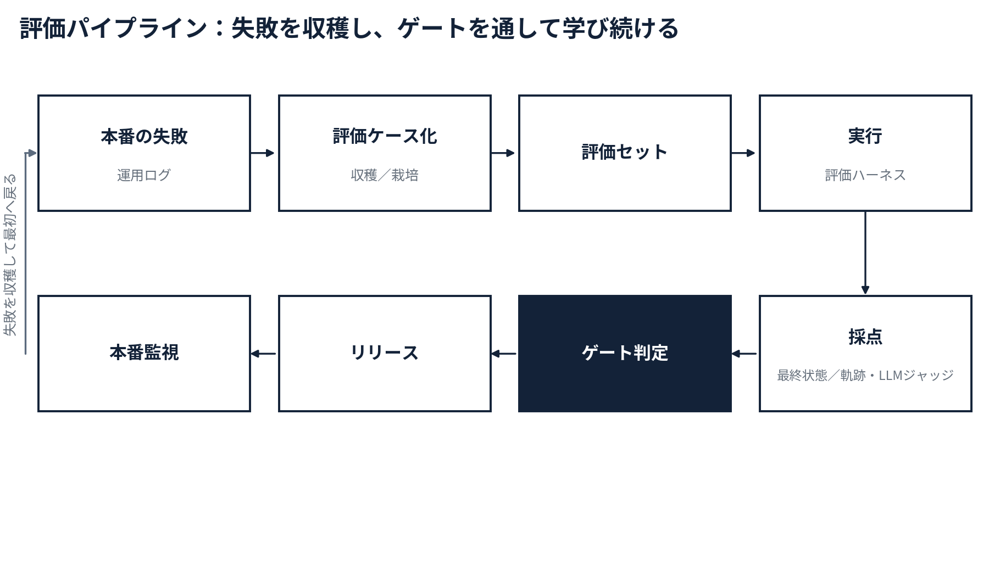

評価の話が噛み合わない会議は、珍しくない。一人は「テストケースを増やそう」と言い、もう一人は「精度が下がった」と言い、別の人は実行ログを眺めて「動きは悪くない」と言う。後日確認すると、「テストケース」が指すものが人によって違っていた。

本章の逆張りの主張を、断定できる範囲に絞って置く。現場で先に詰まるのは、技術よりも語彙の不一致であることが多い。モデルが弱い、ジャッジが賢くない、データが足りない。そうした問題は確かにある。だがその前に問題がある。「何を一つの課題と数えるか」「何をもって成功とするか」が人によって違うまま、数字だけが流通する。改善したのか悪化したのかすら合意できないことが起きる。

語彙の不一致が数字の解釈違いを生むパターンは、主に3類型ある。

| 類型 | 何が起きるか | 語彙統一で解消すること |
|---|---|---|
| taskの単位の不一致 | 一方は入力例1件を、一方は入力＋期待結果＋採点基準の一式を「1件」と数え、件数も進捗も合わない | taskの定義を固定し、件数の数え方が揃う |
| 成功の定義の不一致 | 一方は「文面が正しければ成功」、一方は「最終状態が正しければ成功」とし、同じtrialへの評価が割れる | outcomeを軸にすると決め、割れる理由が特定できる |
| 集計単位の不一致 | 「45/50成功」が、各1 trialなのか、各5 trial中1回でも成功なのかで意味が変わり、会議で別々の数字を議論する | trial数と集計単位を報告に必須化し、数字が比較可能になる |

本章は本書全体の共通言語を置く章である。この章だけで「評価の語彙と設計図」が完結するよう、定義、判断基準、そして完成したルーブリックを並べる。

## Anthropicのガイドを共通語彙にする

2026年1月9日にAnthropicが公開した『Demystifying evals for AI agents』は、エージェント評価の実務を整理したガイドである。本書もこのガイドの語彙を土台に採用する。独自の用語を作る理由がないし、外部の資料やツールと話をつなげるうえでも都合がよい。

先に、本書とガイドの差分を明示しておく。本章の中核の多くはガイド由来であり、それ自体は隠さない。本書が足すのは、ガイドが扱わない「自社適用の判断」である。

| 項目 | ガイドに書いてあること | 本書が足すこと |
|---|---|---|
| 語彙（task等5語） | 定義と使い分け | 語彙不一致の3類型と、会議での詰まり方 |
| 開始規模 | 20〜50件のtaskから始める | 件数の体系と導出（第3章で統一表に整理） |
| trial数 | 複数回回す必要性 | 用途別の推奨trial数と、信頼区間の読み方（本章） |
| 部分点 | 要素に分けて採点する考え方 | 配点まで決めた完成ルーブリック1件（本章） |
| 9ステップ | 進め方の全体手順 | 小規模チームが捨てる順序と、段階ごとの卒業条件（本章） |
| ハーネス | 評価ハーネスの安定性 | 固定項目チェックリストと分離の分岐（本章） |

以下、ガイドの核になる五つの言葉を、本書での使い方として定義する。

| 語彙 | 定義 | 混同しやすいもの |
|---|---|---|
| task | 評価したい一つの課題。入力と、期待される振る舞いや到達点が決まっている単位 | 入力例そのもの |
| trial | 一つのtaskを実際に一回試行すること | taskそのもの |
| grader | trialの結果を基準に照らして採点する主体とその基準。人間、コードベース（ルールベース）、モデルベース（モデルジャッジ）のいずれもありうる | 最終出力の見た目の印象 |
| transcript | 一回のtrialの実行記録。ツール呼び出し、受け取った観測、中間の判断を含む | 最終回答のテキスト |
| outcome | そのtrialの末に実際に起きた最終状態。返金処理が正しく記録された、といった環境側の結果 | モデルが「完了しました」と言ったかどうか |

taskは一回の実行で完結するものを想定する。重要なのは、入力だけでなく到達点まで含めて一つのtaskだという点である。入力例だけを集めてtaskと呼ぶと、採点基準は別途どこかにあることになり、そこで語彙がずれる。

trialはtaskと分けて数える。「50件中45件成功」という数字は、50 taskを各1 trialなのか、各5 trialのうち一度でも成功したのかで意味がまったく違う。

### trial数は用途で決める

各taskを何trial回すべきかは、用途で決める。本書の目安は次のとおりである。

| 用途 | 推奨trial数／task | 根拠 |
|---|---|---|
| 能力の現在地（capability） | 3 | 1回では偶然の成功・失敗と区別できない。3回で「全滅／混在／全成功」の3区分が見える最低ライン |
| 回帰検知（regression） | 3 | 後退か揺らぎかの切り分けに最低3回要る。混在したtaskは定義の曖昧さの候補として扱う |
| 出荷判定 | 5〜10 | 判定を誤ると損失が出る用途では、混在taskの割合まで見て決めるため多めに取る。コストと相談し、高リスクtaskから優先する |

あわせて、成功率の報告には不確かさを併記する作法を決めておく。例として、20 task × 3 trial = 60 trialで54件成功し「90%」と報告する場合、注意書きはこうなる。

> 報告例：成功率90%（54/60 trial）。ただしn=60での95%信頼区間（Wilson法）は約80〜95%であり、「真の成功率が80%程度である可能性」はこの結果からは排除できない。task単位では、全trial成功したtaskは20件中14件（70%）だった。

同じ90%でも、20 trial中18件成功なら区間は約70〜97%まで広がる。nが小さいときは点推定を大きく見せない。これが作法である。

指標の定義もここで確定させる。**全trial成功率**とは、対象taskについて全trialが成功したtaskの割合を指す。本書では出荷判断と安定性の議論では原則として全trial成功率を使い、「1回でも成功した割合」は能力の上限を見る用途に限る。pass^kの本格的な扱いは第5章に譲るが、定義は本章のものを前提にする。

graderは採点者である。採点の主体と基準をtaskとは別に定義すること。graderを明示しない評価は、再現も議論もできない。

transcriptとoutcomeの区別は、エージェント評価が通常の入出力テストと違う点そのものである。最終回答が自然な文章でも、途中で誤った顧客の注文を参照していれば、そのtrialは失敗である。採点は原則としてoutcomeを軸にし、transcriptは「なぜそのoutcomeになったか」を調べるために読む。

## エージェントハーネスと評価ハーネスを分ける

エージェントハーネスは、モデルにツールや実行環境を与えて実際に仕事をさせる基盤、本番で動いているエージェントそのものの足場である。評価ハーネスは、そのエージェントをtaskごとに呼び出し、初期状態を用意し、transcriptとoutcomeを集め、graderにかける側の仕組みである。

混ぜると事故が起きる。評価のために入れた外部送信を止めるモックが本番に紛れ込む。逆に本番の失敗時リトライが評価にも効くと、モデルの素の失敗が採点に現れない。

構成はテキスト図で表すとこうなる。

```
[評価ハーネス] fixture投入 → 実行指示 → transcript/outcome収集 → grader採点
        │ 呼び出す（中身には触らない）
        ▼
[エージェントハーネス] モデル＋プロンプト＋ツール定義＋権限  ← 本番と同一構成
        │
        ▼
[環境] テスト用DB／モックAPI（本番データとは分離）
```

分離の判定基準は分岐で決める。**評価側の都合で入れた変更（モック、時刻固定、送信停止）は、評価ハーネス側に閉じ込める。本番の挙動を変える変更（リトライ、フォールバック、プロンプト）は、評価対象そのものとしてエージェントハーネス側に置き、評価では無効化しない。** どちらか迷ったら「本番でもその変更は入れるか」で分ける。入れるなら対象側、入れないなら評価側である。

固定項目チェックリストも置く。実行前に全項目を確認する。

| 固定項目 | 固定しないと何が起きるか |
|---|---|
| モデルバージョン | スコア変化がモデル更新か自社変更か切り分けられない |
| 生成パラメータ（temperature等） | ばらつきの条件が変わり、前回と比較できない |
| プロンプト版 | 改善したのか偶然かが分からない |
| ツール定義版 | 引数仕様の変更が失敗として紛れ込む |
| fixture版 | 入力条件のずれをモデルの後退と誤読する |
| 外部APIのモック有無 | 本番障害や仕様変更がスコアに混入する |
| 時刻の扱い（固定するか） | 期限判定など日時に依存するtaskが日によって変わる |

評価ハーネスがやるべきことは四つに絞る。初期状態の固定、実行、記録、採点である。

## capability evalとregression evalは別物である

| 観点 | capability eval | regression eval |
|---|---|---|
| 目的 | これから伸ばす能力の現在地を測る | すでにできることの後退を検知する |
| taskの難易度 | 現状では解けないものを含めてよい | 解けることが確認済みのものだけ |
| 合格率の前提 | 低くてよい | ほぼ100%を維持するのが前提 |
| 数字が落ちたとき | まず内訳を見る | 一件でも落ちたら理由を調べる |
| 数字が上がったとき | 改善の証拠になる | 当然の状態 |

capability evalは、まだ解けない難しいtaskを集め、合格率が低く出ることを前提にする。合格率が天井に張り付いたら、そのスイートは役目を終えつつある。ガイドが注意を促す「飽和」である。ここで第1章と接続しておく。**第1章で見たGAIAの飽和は、自分のcapability evalでも起きる。違いは、自分で検知してtaskを難化させたり、解けるようになったtaskをregression側へ卒業させたりできる点にある。** 外の物差しは店じまいを見守るしかないが、自分の物差しは保守できる。

現場でよくある混乱は、この二つを一つのスイートに混ぜて平均点だけを見ることだ。スイートを分けるか、少なくとも集計を分けること。capability側で安定して解けるようになったtaskは、卒業させてregression側へ移す。

## 部分点は失敗の位置を残すために付ける

合否の二値だけでは情報が足りない。処理の大半は合っていたが、最後の記録を間違えたtrialがある。最初から見当違いだったtrialもある。どちらも0点として並べると、改善の優先順位が見えなくなる。そこで部分点を使う。ただし甘くするためではなく、失敗の位置を残すために付ける。

原則は三つある。第一に、outcomeを採点可能な要素に分解する。各要素は、transcriptとoutcomeから機械的に、少なくとも再現可能に確認できるものにする。第二に、要素ごとに重みを付け、合計をスコアとする。重みは重要度で決め、件数の多さで決めない。第三に、致命的な失敗には上限（キャップ）を設ける。

原則だけでは書けないので、返金taskのルーブリックを完成形で1件載せる。題材は「返金期限内の注文について、正規の返金を受け付ける」taskである。

| # | 要素 | 配点 | 満たす／満たさないの判定条件（見る場所） |
|---|---|---|---|
| 1 | 正しい注文を参照した | 20 | transcriptの注文照会ツールの引数が、fixtureの対象注文IDと一致する |
| 2 | ポリシー判定が正しい | 25 | 期限内・対象商品であることの判定が、fixtureのポリシー条項と一致する |
| 3 | 返金処理の金額と状態が正しい | 30 | outcome：返金レコードの金額が注文金額と一致し、状態が「処理中／完了」の正規値になっている |
| 4 | 顧客への説明に虚偽がない | 15 | 最終回答に、ポリシーにない条件や存在しない手続きが含まれていない |
| 5 | 確認と止まる判断が適切 | 10 | 金額確認の提示があり、情報不足時は推測で進めず確認を求めている |

致命キャップの発動条件は次のとおり。**誤った顧客・誤った注文への返金を実行した場合は、他要素によらず0点。存在しない返金ポリシーを約束した場合も0点。返金すべきでない注文に返金を実行した場合は上限20点。** キャップに触れたtrialは、平均点とは別に件数を常時表示する。

重みの決め方も書いておく。この配分は業務の損失構造から決めた。金額と状態の誤り（要素3）は金銭損失と後処理コストに直結するので最大の30点にした。ポリシー判定（要素2）は誤ると要素3の誤実行に連鎖するので25点。説明の虚偽（要素4）は単体では金銭損失にならないが信用を毀損するので15点に留めた。**重みは「間違えたときの損失の大きさ」の順に付ける**のが運用ルールである。自社のルーブリックを作るときも、要素を並べたらまず損失の順に並べ替えてから配点するとぶれにくい。

## 題材：カスタマーサポート用エージェントで具体化する

本章では一貫してカスタマーサポート用エージェントを例に取る。注文照会、返金受付、配送遅延の案内などを扱う構成である。

開始規模については、ガイド推奨の20〜50件と本書の推奨する開始時golden set 30〜50件の関係を第3章の統一表で整理する。本章では配分だけを示す。50件の配分例は次のとおりである（属性グリッドの完成形は第3章）。

| カテゴリ | 件数 | 配分理由 |
|---|---|---|
| 請求 | 12 | 頻度が高い。誤案内は問い合わせ増に直結する |
| 返金 | 14 | 取り返しのつかない状態変更を含むため、頻度以上に厚くする |
| 配送 | 10 | 定型が多く、他カテゴリより境界が少ない |
| アカウント変更 | 14 | 権限確認の省略が事故につながるため厚くする |
| 合計 | 50 |  |

単一ドメインの題材を他ドメインで使うための読み替え表も置く。

| サポートでの要素 | コーディングでの相当物 | 社内業務での相当物 |
|---|---|---|
| 返金処理（取り返しのつかない状態変更） | 本番DBへの書き込み、外部への送信・公開 | 承認の確定送信、顧客データの更新 |
| 注文の取り違え | 対象リポジトリ・ブランチの取り違え | 対象案件・対象者の取り違え |
| ポリシー判定 | マージ条件・レビュー規則の判定 | 規程・承認ルートの判定 |
| 期限切れの説明 | サポート終了バージョンへの対応可否 | 締切を過ぎた申請への対応可否 |

素材の集め方は失敗事例からである。対象は、過去のサポートチケットのうち、エージェントが誤案内したもの、人間にエスカレーションされたもの、返金処理を手で直したものである。これらを並べ、一件ずつtaskの形（問い合わせ文、fixture、期待するoutcome、採点要素）に直す。個人情報や注文番号はダミーに置き換える（手順の詳細は第3章）。

最後に、各taskを複数trial回し、transcriptを全部読む。読んでいて「これは成功とみなすのか」と迷うtrialが出てきたら、taskかgraderの定義が曖昧だというサインである。件数を増やす前に、定義のほうを直す。



## 9ステップを小規模チームの地図に圧縮する

公式ガイドは評価の進め方を9ステップで示している。早く小さく始める、手作業の確認を評価に移す、taskを曖昧さなく書く、問題の配分を偏らせない、安定した評価ハーネスを作る、graderを慎重に設計する、transcriptを読む、capability evalの飽和を監視する、評価を長期的に保守する、である。

小規模チームが全部を一度にやる必要はない。捨てる順序にも条件がある。**最初に捨ててよいのは「自動化（CI組み込み）」と「本番サンプリング」で、条件はgraderの基準が文書化されるまで。次に捨ててよいのは「大規模なtask増産」で、条件はtranscriptを全部読む習慣が付くまで。逆に最後まで捨ててはいけないのは「taskを曖昧さなく書く」と「transcriptを読む」の2つで、この2つを捨てると残り全部がノイズになる。**

本書では9ステップを四段階の成熟度として読み替え、各段階に卒業条件を付ける。

- **第一段階（手元で回せる）**：実際の失敗から集めたtaskを用意し、複数trial回してtranscriptを目で読む。卒業条件＝全taskを複数trial回し、全transcriptを読んだうえで、迷ったtrialを「定義の曖昧さ」として列挙できていること。→第3章
- **第二段階（チームで同じ判断ができる）**：graderの基準を明文化し、モデルジャッジを使う場合でも人間との一致を確かめる。卒業条件＝ジャッジと人間の一致率を測り、数値を記録していること（目標値の決め方は第6章）。→第4〜6章
- **第三段階（変更のたびに止められる）**：評価が自動で回り、regression evalの後退で変更を止められる。卒業条件＝ゲートのしきい値を数値で決め、後退時に実際に変更を止めた記録が1件以上あること（しきい値の決め方は第7章）。→第7章
- **第四段階（出荷後も続く）**：本番の実行をサンプリングして評価し続け、見つかった失敗をtaskとして戻す循環を作る。卒業条件＝収穫の循環が週次で回り、飽和の監視（第1章・本章の卒業運用）が定例化していること。→第11章

順番も大事である。graderが定まっていない段階で自動化しても、ノイズを高速に回すだけになりがちだ。まず手元で少数を回し、transcriptを読んで納得できる採点になってから自動化する。

## 第2章の持ち帰り：語彙5語・ルーブリック・固定項目チェックリスト

本章の持ち帰りは、語彙5語と2種類のevalの区別、trial数の目安表と信頼区間の作法、完成ルーブリック1件、固定項目チェックリスト、成熟度の卒業条件である。次章では、そのtaskの集め方と作り方を扱う。件数の統一表、属性グリッドの完成形、評価ケースの完成形は第3章に置く。
