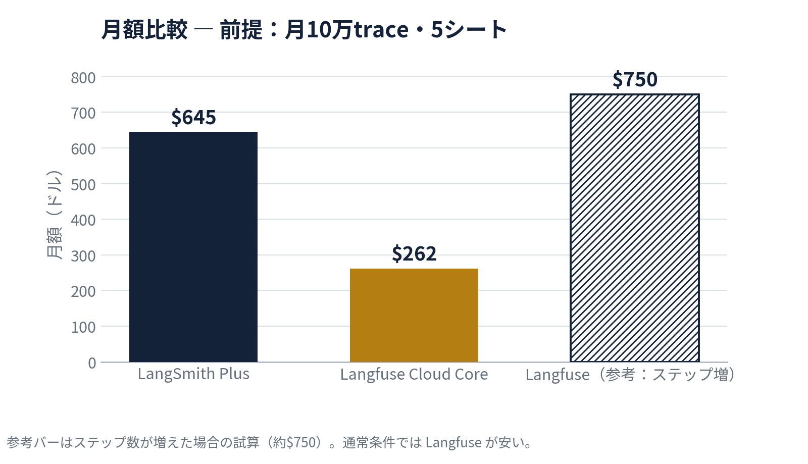

第7章では、評価をコードの隣に置き、CIでゲートする話をした。次に残る判断は一つだけである。そのゲートを、どのツールで、どういう構成で動かすか。本章は、基盤構成を決める判断の章である。

先にこの章の逆張りを書いておく。ツール選定で失敗する原因は、たいてい機能不足ではない。課金単位と運用形態の見誤りである。指標が足りないツールは後から足せる。一方、「trace単位で課金される基盤に本番の全トラフィックを流し続ける」ような構成は危うい。月末の請求で初めて間違いに気づく。逆に、データを外に出せない制約がある組織がセルフホストできないツールを選べば、導入自体が止まる。だから本章では、機能の前に課金と運用の話をし、料金は実額で示す。料金は2026年11月時点の各公式料金ページに基づく（2026年11月21日確認）。価格は変わるため、契約前に再確認すること。円換算は1ドル=158円で統一した。

## パイプラインは三層に分け、データの置き場を決める

評価基盤は三つの層で考える。第一がオフライン評価（開発中とPRで回る層）、第二がCIゲート（第7章で設計した差分判定の層）、第三が本番のオンライン評価（第11章で扱う層）である。三層を一つのツールで賄う必要はない。層ごとに要求が違い、一体型は課金とデータの置き場も一つに寄る。選定とは、三層のどこを一つの製品に任せ、どこを分けるかを決めることである。

各原則には実務値を埋めておく。

- PRで回すサブセットの選び方：全件ではなく、変更されたプロンプト・ツール・モデル設定にひも付くケース＋regression全件を基本とし、実行時間の上限（目安15分）を超える場合はtrial数を落としてでも件数を維持する。件数を落とすと第7章の検出可能な差が広がるためである。
- トレースの保持期間：SaaSの既定は短い。後述のとおりLangSmithのbase traceは14日、Langfuse CloudのHobbyは30日である。障害の振り返りとジャッジ再校正（第6章）の材料として残したいトレースは、保持の長い区分に上げるか、自前にエクスポートする前提で設計する。
- スコア履歴のエクスポート形式：ケースID、実行日時、モデルとプロンプトの版、trial単位の成否、集計スコアを、JSONまたはCSVで定期的に自前ストレージへ書き出す。形式をベンダーの画面の中だけに閉じると、乗り換えのたびに過去との比較が切れる。

データは三種類に分ける。評価セット（ケース定義）はGitで管理する。トレースとトランスクリプトは量が大きく本番由来の個人情報を含みうるため、保持ポリシーに従って基盤側に置く。スコアと判定の履歴は量が小さいので、自前にも残す。この分担が前提である。

もう一つ、評価ハーネス（評価を実行する側）とエージェントハーネス（評価される側）は分離する。分離の具体形は、評価ハーネスがエージェントを外部プロセスやAPIとして起動し、入出力とトレースだけを受け取る形である。分離していない構成から移行する場合は、次の順序が現実的である。まず、評価側からエージェントの内部関数への直接呼び出しを、起動スクリプト経由の呼び出しに置き換える。次に、入出力とトレースの受け渡し形式を固定する。最後に、運用ルールを置く。評価側のコード変更には、エージェント側の変更を伴わせない。評価側は、ケース追加と採点基準の見直しでのみ触る。

## 比較軸は五つ — 料金の実額から見る

ツール比較の軸は、機能一覧ではなく運用条件から引く。第一に課金単位、第二にCI適性、第三に誤差表示の有無、第四にセルフホスト可否、第五に得意な評価タイプである。まず課金の実額を並べる。

| ツール | 形態 | 無料枠 | 有料の開始点 | 課金の単位 |
|---|---|---|---|---|
| Inspect AI | OSS（MIT） | 本体は無償 | ― | なし。費用はモデルAPIと実行基盤のみ |
| DeepEval | OSS（Apache-2.0）。商用面はConfident AI | 本体は無償。Confident AI Freeは2シート、1プロジェクト、テスト実行は週5回まで、トレース1GB-month | Confident AI Starter 月200ドル（組織単位、シート無制限） | Confident AIは組織単位の月額＋トレース量（GB-month、超過は1GB-monthあたり1ドル） |
| LangSmith | SaaS（セルフホストはEnterpriseのみ） | Developer無料：1シート、base trace月5,000件 | Plus 月39ドル/シート（base trace月10,000件を組織で共有） | シート課金＋trace従量。枠超過のbase traceは1,000件あたり5ドル、保持180日のextended化は1,000件あたり2.5ドル追加 |
| Langfuse | OSS（MIT）＋Cloud | Cloud Hobby無料：月50,000ユニット、2ユーザー、保持30日。セルフホスト版は無償 | Cloud Core 月29ドル（月100,000ユニット込み、超過は100,000ユニットあたり8ドルから逓減） | ユニット制。1ユニット＝trace 1件、観測（スパン・生成等）1件、スコア1件のいずれか |
| promptfoo | OSS（MIT） | 本体は無償 | ― | なし。費用はモデルAPIのみ |
| Google ADK標準評価 | フレームワーク内蔵 | フレームワーク自体は無償 | ― | なし。費用は利用するモデルと基盤のみ |

ここで効くのは、Langfuseの「ユニット」の定義である。traceそのものも1ユニットだが、その内側の観測とスコアもそれぞれ数えられる。ステップ数の多いエージェントでは、1 traceが数十ユニットに膨らむ。逆にLangSmithはtraceの木全体で1件と数えるため、ステップ数には課金が反応しない。代わりにシート課金があり、人数に比例する。この構造差が、次の試算で金額差として現れる。

## 試算 — 月間トレース規模で請求はこう変わる

仮定を固定する。1 traceは平均30ステップ（観測30件）、スコア2件を付け、Langfuseでは1 trace＝33ユニットに換算する。モデルAPIの実行コストとジャッジのコストは、どの基盤でも別途かかるため含めない。基盤の利用料だけの比較である。

### パターンA：月10万trace（本番連携あり、利用者5人）

| 基盤 | 内訳 | 月額 |
|---|---|---|
| LangSmith Plus | シート 39ドル×5人＝195ドル。trace 10万件のうち枠内1万件、超過9万件×（5ドル/1,000件）＝450ドル | 645ドル（約10.2万円） |
| Langfuse Cloud Core | 10万trace×33＝330万ユニット。枠内10万、超過320万ユニットのうち90万まで8ドル/10万、残り230万は7ドル/10万で233ドル。基本料29ドル | 262ドル（約4.1万円） |
| OSS実行系のみ（Inspect AI／DeepEval＋結果は自前保存） | 基盤利用料は0。ただし保存・集計・画面は自前で持つ | 0ドル（＋自前の基盤費用と運用工数） |

この規模ではLangfuseが安い。ただし感度を見ること。1 traceの平均ステップが30から100に増えると、Langfuseのユニットは1 trace＝103に増える。月1,030万ユニットで、月額は約750ドル（約11.9万円）となる。LangSmithはステップ数に反応しないため645ドルのままである。そのLangSmithを上回る。ステップ数の多いエージェントでは、ユニット制の安さは条件付きである。

もう一つ。LangSmithで振り返りのために全traceをextended（180日保持）に上げると、超過分に1,000件あたり2.5ドルが乗り、パターンAでは月225ドル増える。保持期間は機能ではなく請求の項目である。

### パターンB：月1万trace（小規模チーム、利用者3人）

| 基盤 | 内訳 | 月額 |
|---|---|---|
| LangSmith Plus | シート 39ドル×3人＝117ドル。trace 1万件は枠内 | 117ドル（約1.85万円） |
| Langfuse Cloud Core | 1万trace×33＝33万ユニット。超過23万ユニットで約18ドル。基本料29ドル | 約47ドル（約0.75万円） |
| Langfuse Cloud Hobby（無料） | 枠は月5万ユニット。33ユニット換算では約1,500 traceで尽きる | 0ドル（ただし本番全量は入らない） |

無料枠の読み方も換算が要る。Langfuse Hobbyの「5万ユニット」は、チャット型の短い応答なら月5万件近いが、30ステップのエージェントでは約1,500 trace分しかない。LangSmith Developerの無料枠はtrace単位で5,000件であり、ステップ数の多いエージェントの試用ではこちらのほうが広い。無料枠の大小は、単位の定義を自社のtraceに当てはめて初めて比較できる。

Confident AIを使う場合は桁が違う。無料枠はテスト実行が週5回までで、CI常設には不足する。共有ダッシュボードやオンライン評価が要るならStarterの月200ドル（約3.2万円）が実質の開始点であり、SSOやRBACが要るTeamは月2,000ドルである。DeepEval本体は無償である。そのため、「DeepEvalは無料」という理解も正しい。「運用基盤まで含めると月200ドルから」という理解も正しい。選定では後者で見積もる。

## 比較表 — 五軸そろえて見る

| ツール | 課金 | CI適性 | 誤差表示 | セルフホスト | 得意な評価 |
|---|---|---|---|---|---|
| Inspect AI | OSS無償 | 高い。CLI実行とログファイル出力が中心 | 出す。標準誤差と信頼区間（95%）が組込み | 可（自前実行） | 再現性と厳密さが要る測定、モデル選定の最終比較 |
| DeepEval | OSS無償。商用面は組織単位の月額 | 高い。pytestとして実行でき終了コードで判定 | 集計側で出せる。試行結果は残るが区間の組込み表示はない | 可（自前実行） | 単体テスト型の回帰評価、指標ベースの採点 |
| LangSmith | シート＋trace従量 | 中〜高。API経由の実行は可能だが本領は観測と運用側 | 集計側で出せる。実行単位の結果は残る | Enterpriseのみ | トレーシング、オフライン／オンライン評価、アノテーションの一元化 |
| Langfuse | ユニット従量（Cloud）。OSS版は無償 | 中。実行基盤というより結果とトレースの受け皿 | 集計側で出せる。スコアとトレースは保持できる | 可（OSS版） | 本番トレースの観測と継続評価、データを自前に置く構成 |
| promptfoo | OSS無償 | 高い。設定ファイルとCLIでCI常設に向く | 出す手段がない。ケース単位の合否と集計が中心 | 可（自前実行） | レッドチーミング、プロンプトとモデルの比較 |
| Google ADK標準評価 | フレームワーク内蔵 | 中〜高。ADKの作法の範囲内 | 集計側で出せる。基準ごとの結果表示が中心 | 実行環境は自前構成に依存 | ADK製エージェントの軌跡・応答評価 |

誤差表示は3値で読む。「出す」はツール自体が標準誤差や信頼区間を返すもの、「集計側で出せる」はtrial単位の結果がエクスポートでき自前の集計で区間を出せるもの、「出す手段がない」は合否の集計しか残らないものである。第6章・第7章の議論に沿えば、最低限「集計側で出せる」ことがゲート運用の前提になる。

### 各ツールのハマりどころと、向かないケース

- Inspect AI：ハマりどころは重さである。サンドボックス実行と厳密なログ形式（.evalログ）を前提とするため、セットアップと実行時間のコストがかかる。日常のPRゲートにそのまま使うと、第7章の「遅いゲートは迂回される」を招く。向かないケースは、軽い回帰確認だけが目的の小規模なCIである。
- DeepEval：ハマりどころは二つある。テレメトリが既定で有効であり、無効化には環境変数 `DEEPEVAL_TELEMETRY_OPT_OUT=1` が要る（公式FAQで確認）。また指標の多くはLLMジャッジであり、既定では外部APIに評価データを送る。指標を増やすほど、ジャッジの呼び出しとコストは比例して増える。そのため公式ドキュメント自身が、指標は合計5つ程度までを推奨している。向かないケースは、評価データを外部に出せない環境での既定設定のままの運用である。
- LangSmith：ハマりどころは保持期間である。base traceの保持は14日で、月次の振り返りの頃には消えていることがある。extended化は追加料金であり、しかもセルフホストはEnterprise契約でしか選べない。向かないケースは、データを自前に置くことが前提の組織と、少人数だがtrace量だけが大きい構成（シートではなくtrace従量が支配的になる）である。
- Langfuse：ハマりどころはセルフホストの運用負荷である。構成は6要素である。webとworkerの2コンテナに、PostgreSQL、ClickHouse、Redis、S3互換ストレージを加える。バージョンアップでは、ClickHouse側の要件変更への追随が要る。「セルフホストできる」と「タダで運用できる」は別である。Cloud版では、アノテーションキュー数がプランで制限される（Hobby 1つ、Core 3つ、Proは無制限）点も実務で効く。向かないケースは、運用担当を割けない小規模チームのセルフホストである。
- promptfoo：ハマりどころは守備範囲である。汎用評価に流用すると、履歴の蓄積と比較、誤差の扱いは自前で持つことになる。また2026年3月にOpenAIによる買収が公表され、OSSはMITライセンスで継続する方針が示されているが、他ベンダーのモデル評価を中立な基盤で行いたい組織では、この出自を検討材料にする場合がある。向かないケースは、オンライン評価とアノテーションまでを含む統合基盤の代替である。
- Google ADK標準評価：ハマりどころは対象範囲である。評価できるのはADKで構築したエージェントであり、基準は `tool_trajectory_avg_score`（軌跡の一致）や `response_match_score`（参照応答との類似）などフレームワークが用意したcriteriaが中心になる。他フレームワークのエージェントや、独自の採点器を中心に据えた評価には広がらない。向かないケースは、フレームワーク混在の構成全体を一つの物差しで測ることである。

## 規模別の選び方 — 定量で定義する

規模は人数ではなく、月間trace数と「本番トレースを外部に送れるか」の2軸で定義する。

| 規模の定義 | 推奨構成（結論） |
|---|---|
| 月1万trace未満、外部送信可 | 実行系はDeepEvalかInspect AIのどちらか一つ。蓄積はLangSmith Developer（無料）かLangfuse Hobbyで足りる。統合基盤に課金しない |
| 月1万〜10万trace、外部送信可 | 実行系（DeepEval／Inspect AI）＋蓄積側を一つ。LangGraph中心ならLangSmith Plus、ステップ数が少なくユニット換算が軽いならLangfuse Core。試算はパターンA・Bを自社条件に直して使う |
| 月10万trace超、または外部送信不可 | セルフホスト可能な構成が前提。Langfuseセルフホスト＋OSS実行系。運用担当とアップグレードの手順を先に決める。SaaSを使う場合は保持区分とシート数の設計が必須 |

選定の進め方は次の順序である。まず三層のうち、自前で持つ層と製品に任せる層を決める。次に試算ワークシートを埋める。項目は、月間trace数、1 traceの平均ステップ数と付けるスコア数、利用者数、必要な保持日数、外部送信の可否である。埋めた条件で、候補2つの月額を並べる。パターンAの表が、その完成形の例である。三つ目に、PoCで次を確認する。

- 自社の典型的な1 traceが、候補の課金単位でいくつに換算されるか（実測）
- PR評価1回あたりの実行時間と、結果がPR上で差分として読めるか
- ケース定義とスコア履歴を標準形式でエクスポートできるか
- ジャッジのモデルとプロンプトを自前で固定できるか（乗り換え時にスコアの連続性を保つため）
- 保持期間の既定値と、延長した場合の追加料金

ここまで確認してから、初めて指標や画面の使い勝手を比べる。順序が逆になると、比較表の行数で決めた選定になる。

## オンライン評価ではアノテーション導線とスコア後付けで差がつく

サンプリング設計、アラート、コスト試算を含むオンライン評価の運用論は第11章に譲る。ここでは基盤選定の観点で差がつく機能差だけを挙げる。

第一にアノテーションの導線である。キューにトランスクリプトを流し、ラベルを付ける。そのラベルを評価セットやジャッジの校正データに還元できるかが、差になる。LangSmithはアノテーションキューを全プランで備える。Langfuseもキューを持つが、前述のとおり数にプラン制限がある。第二に、スコアの後付け可否である。本番トレースに対して後から別のジャッジで採点し直せるかは、再校正の運用を左右し、両基盤ともスコアをAPIで後付けできる。第三に、ラベルからデータセットへの還元の手間である。画面上で完結するか、エクスポートと整形を自前で挟むかで、失敗ケースを回帰スイートに戻す速度が変わる。PoCではこの往復を1件通してみることを推奨する。

## 課金単位とデータの置き場で選ぶ — 本章のまとめ

この章の判断を一文で言えば、ツールは機能で選ぶな、課金単位とデータの置き場で選べ、である。試算の結論も本章で完結させる。月10万trace・30ステップの条件ではLangfuse Coreが約4.1万円、LangSmith Plusが約10.2万円。ステップが100に増えればLangfuseは約11.9万円となり順位は逆転する。つまり結論は製品名ではなく、自社のtraceの形で決まる。個別ツールの網羅的な比較表は付録Cに置いたが、あくまで参照用の詳細表であり、選定の判断と試算は本章の表とワークシートで行う。三層のパイプラインを固定し、ケースはGit、スコアは手元にも残し、評価ハーネスとエージェントハーネスを分ける。その前提の上でなら、ツールは後から差し替えても困らない。
