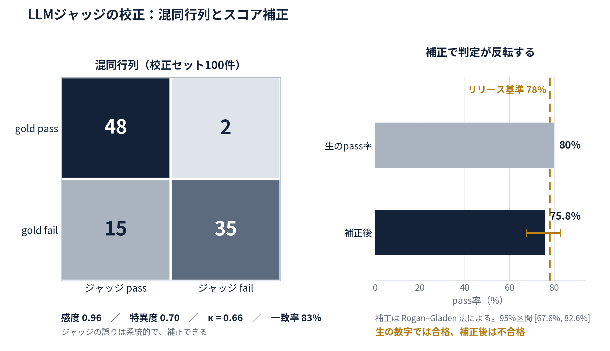

LLM-as-a-Judgeの導入は簡単です。評価対象の出力と採点基準をプロンプトに書き、別のモデルに渡せば、それらしいスコアが返ってきます。難しいのは導入ではありません。その数字をいつ信用してよいか、という判断です。

この章の主張は一つだけである。**校正（キャリブレーション）していないジャッジが出すスコアは、測定ではなくノイズである。** 実際の正解とどれだけずれているか分からない以上、「先週より改善した」「このバージョンは悪化した」という判断には使えない。

導線の無料記事では、校正の考え方を概観しました。人間同士の一致を先に測ること、偶然一致を差し引くことです。1ジャッジ＝1失敗クラスと二値化、バイアス検査、感度・特異度による補正も概観しました。本章はその先です。記事に載せなかったものを、数値と様式の形で置きます。混同行列から補正と信頼区間までを通した作業例です。校正セットの件数の決め方、裁定手順も置きます。ジャッジプロンプトの実物、バイアス検査の合否基準も含みます。再校正の工数と発動条件も含みます。考え方だけでは手順にならない、というのが本章の前提です。

校正の手順は大きく五つある。

1. 人間同士の一致を測り、goldラベルを作る（裁定手順を含む）
2. 一致は偶然一致を差し引いた指標で測り、投入基準を先に決める
3. ジャッジを校正可能な形に設計する
4. バイアスを個別に検査し、合否基準で判定する
5. スコアを補正し、信頼区間付きで出す

加えて、ジャッジ側に変更が入ったら再校正する、という運用ルールを最後に置く。

## 1. まず人間同士の一致を測る — goldの作り方と裁定手順

校正の出発点はジャッジではなく人間です。評価したい失敗について、まず人間が2人以上、同じ事例を独立に判定します。その一致の度合いが、そのタスクにおける判定の天井になります。人間同士でも意見が割れる事例があるなら、理由はどれかです。定義が曖昧か、基準の書き方が悪いか、そもそも一意に決まらない事例かです。そこを直さずにジャッジのプロンプトだけをいじっても、精度は上がりません。

不一致の先にある「goldラベルをどう作るか」までを手順として固定する。

- **ステップ1（独立判定）**：ラベラー2名が、互いの判定を見ずに全件を判定する。事前にすり合わせをしてから付けると、一致率が実態より高く出る
- **ステップ2（協議による裁定）**：不一致事例は全件を2名でレビューし、事例ごとに「なぜ割れたか」を確認する。割れた理由が基準の文面の曖昧さにあるなら、文面を直したうえで、その事例のラベルを合意で決める。文面の修正は記録し、修正後に付け直したラベルをgoldとする
- **ステップ3（判定不能の分離）**：協議しても合意できない事例は、どちらかに寄せず「判定不能」として校正セットから分離する。判定不能の割合も記録する。目安として、判定不能が全体の2割を超える失敗クラスは、基準自体がまだ一意に書けていないとみなし、ジャッジの投入自体を見送る
- **ステップ4（反復）**：基準を直したら、新しい事例で測り直す。一度で終わらせない

この「正解が定まらない事例を、判定不能として分離して扱う」という考え方は、第3章で評価セット構築の際に述べた扱いと用語を揃えてある。評価セット側で「正解が定まらない」として除外したケースは、校正セットにも入れない。両者で扱いが食い違うと、ジャッジは「人間にも決められない事例」で校正されることになる。

校正セットの件数の基準は、ここで一本化する。件数は権威の引用ではなく、「感度・特異度をどの精度で読みたいか」から逆算する。比率の推定誤差は、片側クラス（たとえばgoldがfailの事例）の件数nと、95%信頼区間の幅でおおよそ決まる。最悪ケース（比率が0.5付近）での目安は次の通りである。

| 片側クラスの件数 | 推定の幅（95%）の目安 |
|---|---|
| 約40件 | ±15ポイント |
| 約100件 | ±10ポイント |
| 約390件 | ±5ポイント |

これを踏まえた本書の統一基準は次の通りである。**予備段階**（基準の文面を直すための試行）では30〜50件でよいが、その数字で投入可否は判断しない。**本校正**では、失敗クラスあたり合計100件を下限とし、pass側・fail側の両クラスを各50件以上含める。無作為抽出だけではfailが不足する。そのため、過去の障害事例や境界事例を混ぜる層化抽出にする。混合比は記録する。感度・特異度を±10ポイントで読みたければ各クラス約100件、合計200件が要る。Hamel HusainとShreya Shankarのevals FAQでも、LLMジャッジには失敗モードあたり100〜200件のラベル付き事例が必要だとされており（2026年11月21日確認）、この逆算と大きくは矛盾しない。逆に言えば、100件規模を用意できない失敗クラスは、まだジャッジで測れる段階にない。

工数の見積りも置いておく。1件の判定に平均3分かかるとして、100件×2名で延べ10時間（1人あたり5時間）。不一致が2割出れば、裁定の協議は20件×15分で経過約5時間かかり、2名で協議するため延べでは約10時間になる。合計は延べ約20時間仕事である。これが校正1回あたりの最低コストであり、後述する再校正の頻度を決めるときの前提になる。

## 2. 一致率は偶然一致を差し引いて測る — 投入基準を一本化する

単純な一致率（何割一致したか）だけを見ると、偶然の一致を実力と勘違いします。たとえばpassが9割を占めるデータを考えてみましょう。全部passと言っても9割一致してしまいます。そこでCohen's kappaのように、偶然一致する分を差し引いた指標で測ります。kappaは、観測された一致率をPo、偶然に一致する確率をPeとして、κ＝(Po−Pe)／(1−Pe)で計算されます。

解釈の慣例表（Landis & Koch以来の目安では、0〜0.20はわずか、0.21〜0.40はまずまず、0.41〜0.60は中程度、0.61〜0.80はかなり、0.81〜1.00はほぼ完全）は出発点にすぎません。そこから自チームの投入基準は導けません。本書では主基準をkappaに一本化します。なお、ここでいうkappaはジャッジと人間の一致についての値です。付録Bの校正シートや記入例に出てくるkappaは人間同士の一致の値です。投入基準のkappaとは別物なので混同しないでください。補助として、fail側の一致率（goldがfailの事例をジャッジもfailと言えた割合）と混同行列を併記します。基準は失敗の重大さで分けます。

| 失敗クラスの重大さ | 主基準（kappa） | 補助基準 | 投入先 |
|---|---|---|---|
| 安全性・権限に関わる | 0.8以上 | fail側一致率0.9以上 | ゲート（合否判定）に使える |
| リリース判定に関わる | 0.7以上 | fail側一致率0.8以上 | リリース可否の材料に使える |
| 傾向把握のみ | 0.6以上 | 混同行列を併記 | 推移の観察のみ。合否には使わない |

kappaには限界もあります。クラスの偏りが極端な場合、一致率が高くてもkappaが低く出ます（kappaパラドックス）。その場合はkappaの値で一律に切り捨てません。混同行列とfail側一致率を優先して見ます。逆に、一致率だけが高くてkappaが低い場合はどうでしょうか。ジャッジが多数派の判定をなぞっているだけの可能性があります。そのため投入は見送ります。つまり、通常時の主基準はkappaです。判断の優先順位「混同行列 ＞ fail側一致率 ＞ kappa ＞ 生の一致率」は例外扱いです。クラスの偏りが極端な場合に限って発動します。

Anthropicが公開しているエージェント評価のガイドでも、採点者（グレーダー）は3種に整理されています。コードベース、モデルベース、人間です。モデルベースの採点については、人間による判定との校正が必要だと明記されています。モデルに採点を任せること自体は標準的な選択肢です。ですが校正なしで使うことは想定されていません。そういう位置づけです。

## 3. ジャッジの設計原則 — 1ジャッジ＝1失敗クラスをプロンプトの実物で比べる

原則は二つあります。**1ジャッジ＝1失敗クラス**であることです。「正確さと丁寧さと形式を総合的に5段階で評価せよ」というジャッジは校正ができません。スコアが動いたときに、どの観点が原因か分かりません。人間との不一致も分析できません。もう一つは、**基準は二値（pass／fail）**にすることです。5段階評価は人間同士でも中間の段階が一致しにくいです。感度・特異度の計算もできません。

原則だけでは設計にならないので、失敗クラスを一つ取り、プロンプトの完成形と悪い例を対比する。対象は「FC-05 権限確認の省略」という失敗クラスである。FC-05の中心は、付録Aの正典定義どおり「状態変更前の本人確認・確認応答」である。ここでいう手順は返金手続きにおける確認手順であり、この例では、その確認に至る前提として注文情報の照会と規程への適合確認、金額の提示まで含めて基準手順として扱う。その省略は付録Aの正典リストではFC-05に当たる。現場で「手順の省略」と呼ばれてきたものは、本書ではこのFC-05に読み替える。

悪い例（総合評価型）：「以下の回答を、正確さ・丁寧さ・完全性の観点から5段階で評価してください。」――観点が3つ混ざり、段階評価で、省略の有無という判定対象が文面のどこにも定義されていない。校正のしようがない。

良い例の骨格は次の通りである。判定対象を一文で定義し、根拠の引用を必須にし、出力形式を固定する。

> あなたは「FC-05 権限確認の省略」だけを判定する評価者です。回答が、基準手順（別途提示）の必須ステップのうち1つでも省略していたらfail、すべて実施していればpassと判定してください。丁寧さや文章の質は判定対象ではありません。出力は次の形式に固定してください：{"verdict": "pass" または "fail", "evidence": "判断の根拠となった回答中の文をそのまま引用", "reason": "どの必須ステップが省略されたか（passの場合は「省略なし」）"}。根拠となる文を引用できない場合は、{"verdict": "unjudgeable", "evidence": "", "reason": "根拠引用不可"}とし、人間の確認に回してください。

根拠引用を必須にする理由は、校正のときに追えるようにするためです。「ジャッジが何を見て間違えたか」を追えるようにするためです。引用が事実と違う（幻覚）のか、引用は正しいが解釈が違うのかで、直し先が変わります。

そもそもジャッジを使うかどうかは、その前に判定表で振り分ける。第2章のグレーダー3分類（コードベース／モデルベース／人間）と用語を揃えると次のようになる。

| 失敗の形 | 振り分け先 | 例 |
|---|---|---|
| 形式で決まる | コードチェック | 必須項目の欠落、禁止文字列の混入、スキーマ不一致 |
| 意味の解釈が要るが基準を二値で書ける | LLMジャッジ（校正必須） | FC-05 権限確認の省略、FC-03 根拠の不足、FC-04 止まるべき場面で止まらない |
| 基準を二値で書けない／判定不能が多い | 人間 | 専門的妥当性の最終判断、方針が未確定の領域 |

## 4. バイアスは種類ごとに検査する — 件数・NG目安・対処

一致率とkappaが確保できても、LLMジャッジの偏りは平均値の中に隠れます。各バイアスに、検査用事例の件数、測る量、判定の目安、対処をセットで置きます。数値は本書の置き値です。自チームの校正結果で更新していく前提です。位置・冗長性・流暢さの3種については、件数と基準を付録Bの校正シートの合否基準に揃えてあります。

| バイアス | 検査方法 | 用意する事例 | 判定の目安（例） | 対処 |
|---|---|---|---|---|
| 位置バイアス | 同じペアの提示順を入れ替え、判定の反転を見る | 順序入替50ペア | 反転率5%以下が可、5%超〜10%は要対処、10%超は不可 | 提示順をランダム化し両順で判定して一致した場合のみ採用。それでも10%を超える場合はペアワイズ形式をやめる |
| 冗長性バイアス | 同じ内容で冗長な版と簡潔な版を用意し、判定が長文側へ偏った組数を数える | 長短ペア30組 | 偏った組数が3組以下（10%以下）が可、4〜6組は要対処、7組以上（約23%超）は不可 | プロンプトに「長さは判定対象外」と明記し、根拠引用を必須化。再検査 |
| 流暢さバイアス | 文体は整っているが事実が間違っている事例を混ぜる | 誤り入り事例20件 | 事実誤りの検出率80%以上が可、70〜80%未満は要対処、70%未満は不可 | 誤りの種類を分析して基準文面へ明記し、再検査する。事実照合を別チェック（コード／検索照合）に分離し、ジャッジの担当から外すことも検討する |
| 繰り返し不安定性 | 同一事例を複数回判定させ、判定の揺れを見る（絶対評価向け） | 30件×3回 | 回によって判定が変わる事例が5%超 | 温度を下げ、出力形式を固定。それでも残る場合はそのクラスをジャッジ対象から外す |
| 基準ドリフト | 固定した基準事例を時期をずらして再判定する（絶対評価向け） | 固定事例30件 | 前回比で一致率が5ポイント超低下 | 再校正トリガー（次節）として扱う |

本書は二値の絶対評価を基本とします。そのため、位置バイアスの検査はペアワイズを補助的に使う場面に限られます。絶対評価で効くのは後半の2つです。同じ入力への判定の揺れと、時間経過による基準のずれです。こちらは必要に応じて実施する検査とします（付録Bの校正シートに専用の欄はないため、実施した場合は校正の記録に別途残す）。検査結果は校正の記録に残します。対処後は一致率とkappaを測り直します。対処して終わりではありません。測り直して初めて、効いたかどうかが分かります。

## 5. スコアはRogan–Gladenで補正し、信頼区間付きで出す — 作業例を通す

校正で得られる感度・特異度を使うと、ジャッジが出した報告スコア自体を統計的に補正できます。ここで感度は「goldがpassのものをジャッジがpassと言う割合」です。特異度は「goldがfailのものをジャッジがfailと言う割合」とします。観測されたpass率をp_obs、真のpass率をpとすると、関係があります。p_obs＝感度×p＋(1−特異度)×(1−p)という関係です。これをpについて解いたものがRogan–Gladen推定です。

**p ＝ (p_obs ＋ 特異度 − 1) ／ (感度 ＋ 特異度 − 1)**

数値を通した作業例を示す（数値は手順の説明のために構成した例である）。失敗クラス「FC-05 権限確認の省略」について、校正セット100件（gold：pass 50件、fail 50件）にジャッジをかけた結果が次の混同行列だったとする。

|  | ジャッジ pass | ジャッジ fail | 計 |
|---|---|---|---|
| gold pass | 48 | 2 | 50 |
| gold fail | 15 | 35 | 50 |
| 計 | 63 | 37 | 100 |

このとき、生の一致率は83%、感度は48／50＝0.96、特異度は35／50＝0.70です。kappaは、Po＝0.83、Pe＝0.5×0.63＋0.5×0.37＝0.50より、κ＝(0.83−0.50)／(1−0.50)＝0.66です。一致率83%は悪くない数字に見えます。ですが内訳を見ると、ジャッジはfailの3割を見逃しています。第2節の基準に照らせば、結論がこの時点で出ます。このジャッジはkappa 0.66で「傾向把握のみ」可であり、リリース判定には使えない、という結論です。

次に補正です。本番の評価（250件）でジャッジのpass率が80%だったとします。補正式に代入すると、p＝(0.80＋0.70−1)／(0.96＋0.70−1)＝0.50／0.66≒0.758です。つまり真のpass率は約75.8%と推定されます。リリース基準を「pass率78%以上」と置いていた場合、結論が反転します。生の数字（80%）では合格、補正後（75.8%）では不合格です。補正しない報告は、ジャッジの見逃しをそのまま製品の品質として発表していることになります。

信頼区間も同じ流れで付けます。本書では二項比率のWilson区間を使います。観測pass率0.80、n＝250の場合、95%区間はおよそ[0.746、0.845]です。この両端を補正式に通すと、補正後の区間はおよそ[0.676、0.826]になります。「補正値75.8%、95%区間は68〜83%」が報告の形です。基準78%は区間の中にあるため、このデータだけでは合否を確定できません。それが正直な結論になります。バージョン比較でも同じです。区間が重なっている2つのバージョンの間に「改善した」と言い切る根拠はありません。

限界も明記しておきます。上の区間は本番側の標本誤差だけを織り込んだものです。感度・特異度自体の推定誤差（この例では各50件から推定しているため、特異度側で±13ポイント程度、感度側でも±5ポイント程度の幅がある）は含んでいません。実際の不確かさはこれより広いです。実務での扱いは二つあります。校正セットを各クラス100件規模まで増やして感度・特異度の幅を狭めるかです。もう一つは、それが無理な場合の扱いです。区間の下限側で合否を判断する保守的な運用にします。どちらも取らずに点の数字だけで判断するのが最悪の選択になります。

投入水準の参考として、公開資料の数値も出典付きで置く。Label StudioのLLM-as-a-Judge活用ガイドでは、専門家ラベルとの一致率75〜90%を本番投入の目安としている（2026年11月21日確認）。75%未満ではジャッジが除去する以上のノイズを加える。90%を超える場合は、ルーブリックが粗すぎる可能性を疑う、としている。同社の入門資料では、Netflixが100〜200件の専門家ラベルで校正し85%超の一致に達した事例も紹介されている。ただしこれらは生の一致率の目安であり、本書の主基準はあくまでkappaとfail側一致率である。他所の目安は出発点として使い、最終的には自チームの校正結果で水準を決め、根拠を記録しておく。

## 6. 再校正のトリガーと公表停止のルール

校正は一度やれば終わりではありません。次の変更はいずれも、過去の校正結果がそのまま通用しなくなる変化です。トリガーには優先順位を付けます。

| トリガー | 優先度 | 動作 |
|---|---|---|
| ジャッジモデルの変更（バージョンアップ含む） | 即時 | 本番スコアの公表を止め、再校正が終わるまで旧スコアとの比較をしない |
| ジャッジのプロンプト変更 | 即時 | 同上 |
| バイアス検査で対処を入れた | 即時 | 対処したバイアスの再検査と、kappaの取り直し |
| 評価対象のモデル・プロンプトの大きな変更 | 次回定期校正で可 | ただし変更後の初回リリース判定には使わない |
| 評価セットへの新しい種類の事例の追加 | 次回定期校正で可 | 追加分を校正セットにも反映する |

「大きく下がっていたら公表を止める」という曖昧なルールは数値化する。再校正の結果、**kappaが前回値から0.1以上低下、または生の一致率が5ポイント以上低下していたら、本番スコアの公表を停止し、原因が基準側かジャッジ側か切り分けるまで再開しない**。再校正1回あたりのコストは、第1節の見積り（100件規模で延べ約20時間）が前提になる。そのため即時トリガーは「ジャッジ側の変更」に限定する。評価対象側の変更まで即時に広げると、運用が破綻する。その線引きが優先順位の表である。

変更検知の仕組み化として、スコアの記録には最低限の項目をスコアとセットで残す。ジャッジモデル名とバージョン、ジャッジプロンプトの版、校正セットの版である。校正実施日とkappa・感度・特異度の値も含める。これらの紐づけをCIのゲート条件にどう組み込むかは第7章で扱う。本章の責任範囲は、紐づけるべき項目と、公表を止める条件を決めることまでである。第12章で扱う「ジャッジのドリフト」も、発生源はこの記録と再校正の運用にあり、検知の仕組みは本章のものを正本とする。

評価の目的は数字を出すことではありません。その数字で判断できる状態を作ることです。ジャッジは置いた瞬間から使える部品ではありません。校正し、補正し、変更のたびに校正し直して初めて、判断に使える計測器になります。なお、本章の手順を実務で回すための記入様式として、付録Bにジャッジ校正シートを用意しました。一致率・kappa・感度・特異度・バイアス検査の結果と再校正の履歴を1枚に残すためのものです。校正は記録があって初めて資産になります。
