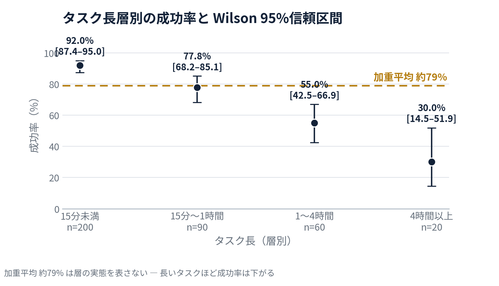

ここまでの章では、タスクは比較的短く、評価対象は単一のエージェントであることを前提にしてきた。その前提では、評価セット全体の平均スコアはそれなりに意味を持つ。ところが、タスクが数十分から数時間に伸び、構成が複数のエージェントに分かれた途端、この読み方は成り立たなくなる。

この章で扱う判断は一つだけである。スケールした構成で、失敗の責任箇所をどう特定するか。長時間タスクとマルチエージェントは一見別の話題だが、評価の観点では同じ問題を抱えている。どちらも、全体の成否だけを見ていては原因にたどり着けない。長さの違うタスクを混ぜた平均は、長いタスクでの崩れを隠す。複数エージェントの平均は、責任のあるステップを隠す。測り方を変える必要がある。平均を捨てるのではなく、平均の前に層別と帰属を置く。

他章との分担を先に置く。単一エージェントの軌跡をステップ単位で採点する方法は第4章、信頼性の報告形式としてのpass^kは第5章で扱った。本章はその先、つまり「タスク長で層別すること」と「失敗の帰属を特定すること」の組み合わせに固有の内容に絞る。サンプリングやコストの予算論は第11章に譲る。

## 平均スコアは長時間タスクでは嘘をつく

短いタスクの集合で高い成功率を示すシステムが、長いタスクでも同じ成功率を保つとは限らない。タスクが長くなるほど、途中で崩れる機会は増える。一つひとつのステップの成功率が高くても、何十回と積み重なれば、どこかで失敗する確率は上がる。しかもエージェントの失敗は独立ではない。前段の小さな誤読や要約の欠落が、後段では前提として固定され、取り返しのつかない分岐を生む。

評価セットの作り方もこの性質を覆い隠す。短いタスクは作りやすい。実行コストも安く、試行回数を稼げる。そのため評価セットは、自然と短いタスクに偏る。その偏った集合の平均スコアは、本番で任せたい長い仕事の成否についてはほとんど何も言っていない。この章の逆張りの主張はここにある。平均スコアは長時間タスクでは嘘をつく。見るべきは平均ではなく、タスク長で層別した信頼性曲線である。

## METRのタイムホライズンという物差し — 出典と限界

長時間タスクの測り方で参考になるのが、METRの「タイムホライズン」である。人間がそのタスクを終えるのに要する時間を基準にし、モデルが50%の確率で成功できるタスクの長さを指す。数値を引くときは、本書の他の章と同じ作法で、出典と確認日と限界をセットにする。

METRのTime Horizon 1.1（2026年1月公表、タスク228件）では、50%タイムホライズンの倍加時間は長期では約7ヶ月（約196日）、2024年以降に限ると約89日と再計算された。Claude Opus 4.6は2026年2月に同ページへ追加され、50%タイムホライズンは約12時間とされる。ただし、この値を単独で引用してはいけない理由がMETR自身の注記にある。第一に、現在のタスクスイートでは16時間を超える測定は信頼できないとMETRが明記している。第二に、2026年3月の正則化の誤りの修正や、公開タスクを除外した再分析では、値が大きく動くことが報告されている。条件次第で7時間台になる分析もある。第三に、同ページは2026年9月8日付で「積極的には更新されていない」ことが明示された（以上、METR公式ページを2026年11月21日に確認）。

本書で持ち出す意味は、特定モデルの値ではない。能力を「長さに対する耐性」として捉え、成功か失敗かの二値の集計から、どの長さまで耐えられるかという曲線の形へ視点を移すことにある。自前のシステムへの適用では、人間の所要時間の厳密な測定は要らない。実務で人が同じ仕事をしたら何分かかるかという見積もりで十分である。見積もりが難しい場合は、ステップ数やツール呼び出し回数で代用してもよい。大事なのは、長さの異なるタスクを混ぜて平均しないこと、その一点である。

## 信頼性曲線を自前で引く — 数値例と急落の判定

手順を決めておかないと、毎回違う切り方になり時系列の比較ができなくなる。まず評価セットの各タスクに想定所要時間を付け、15分未満、15分から1時間、1時間から4時間、4時間以上という粗い区分に分ける。見積もりの根拠はタスク定義に残す。次に、層ごとに成功率を、trial数と信頼区間とセットで並べる。

仮定を明示した数値例を示す。ある評価セットで、層別に次の結果が得られたとする（信頼区間はWilsonの95%区間）。

| 層 | trial数 | 成功率 | 95%信頼区間 |
|---|---|---|---|
| 15分未満 | 200 | 92.0% | 87.4〜95.0% |
| 15分〜1時間 | 90 | 77.8% | 68.2〜85.1% |
| 1〜4時間 | 60 | 55.0% | 42.5〜66.9% |
| 4時間以上 | 20 | 30.0% | 14.5〜51.9% |

この表の読み方は三つある。第一に、全体平均（この例では加重平均で約79%）は捨てる。この数字は短い層に引っ張られており、4時間以上の層の実態を何も表していない。第二に、各層の最低要件である。層の成功率を判断に使うには、おおむね30 trial以上を最低線とし、それ未満の層は信頼区間を必ず併記して参考値として扱う。上の例で4時間以上の層は20 trialしかなく、区間は14.5〜51.9%と広い。「30%まで崩れた」と断定はできず、「短い層より明確に低く、幅は大きい」と読むのが正確である。第三に、急落の判定である。隣接する層同士で信頼区間が重ならない差がある場合、その境目を急落点の候補とする。この例では15分未満の層と15分〜1時間の層で区間が重ならず（95.0%の下限87.4に対し、次の層の上限85.1）、最初の落ち込みはこの境目にあると判断できる。逆に区間が大きく重なる層間の差は、trial数を増やすまで急落と呼ばない。

曲線の形の読み方は従来どおりである。緩やかに下がるなら、長さに比例して小さな失敗が積み重なっている可能性が高い。特定の層で急落するなら、その長さで初めて必要になる要素が境目で破綻している可能性が高い。たとえば中間成果物の保持や、外部状態の変化への追従である。急落点こそ最初に調べるべき場所であり、改善投資の優先順位はそこから決める。

方向性を裏付ける外部の測定もある。所要時間で層別した信頼性スイートでは、短いタスクから非常に長いタスクにかけて平均pass@1が24.3ポイント低下した、と調査レポートが一次資料を引いて報告している（IntuitionLabs『Long-Running AI Agents』、2026年。2026年11月確認）。条件やタスクの作り方が自社と異なる以上、この幅をそのまま自社に当てはめることはできない。使うべきは「層別しない平均は、最大級の性能差の要因を見落とす」という方向性のほうである。

なお、成功の定義は層で変えない。長いタスクほど部分点を与えたくなるが、部分点を混ぜると曲線の比較ができなくなる。部分的な達成度は成功率とは別の指標として記録し、軌跡の読み取りに使う。コスト面では、短い層は試行数を多く取って回帰検知に使い、長い層は代表ケースを絞って失敗を深く読む対象にする二層構造が扱いやすい。予算の置き方自体は第11章の設計に従う。

## マルチエージェントでは全体スコアだけでは直す場所が見えない

構成が複数エージェントになると、最終成果物に対するスコアは得られても、直すべきなのは全体ではなく個別のステップである。この隔たりはクレジットアサインメント（貢献配分）の問題として知られている。

本書で想定するプランナーとワーカーの構成で考える。プランナーがタスクを分解して計画を立て、ワーカーが計画に沿って実行し、結果を返す。最終成果物が悪いとき、原因は複数ありうる。プランナーの分解自体が間違っていたのか、引き継ぎで前提条件が落ちたのか、ワーカーが計画を読み違えたのか、戻ってきた結果をプランナーが誤って統合したのか。最終スコアはこれらを区別しない。

さらに、相殺が起きる。あるエージェントの出力のまずさを、別のエージェントが偶然補正し、全体としては成功扱いになることがある。具体的な形を、架空の軌跡要約で示す。調査タスクで、ワーカーが情報源の日付を誤読し、古い数値を集めてきたとする。プランナーは統合の段階で「数値が前回報告と大きく違う」ことに気づいた。別の情報源で確認し直し、正しい値に置き換えた。最終成果物は正しく、実行は成功として記録される。しかしワーカーの日付の誤読は残ったままで、次回、プランナー側の確認が働かない入力ではそのまま失敗になる。成功した実行の中にも、次の失敗の種は含まれている。全体スコアは、その種を均してしまう。だから、成功した実行についても、後述の手順の第二（入力と出力の分離判定）だけはサンプルして適用する価値がある。

## 帰属研究を実務に翻訳する — 確認できたものだけを使う

帰属の問題を正面から扱う研究は、2026年に入って複数が報告されている。本書では、出典を確認できたものだけを挙げ、各手法について「元の要点」と「実務版で捨てる部分」を対にして示す。借りるのは発想までで、計算の厳密さは求めない。実務の目的は寄与率の推定ではなく、次の修正をどこに入れるかの決定だからである（出典は2026年11月21日確認）。

| 手法（出典） | 元の要点 | 実務で借りる発想 | 実務版で捨てる部分と理由 | 後述の手順での対応 |
|---|---|---|---|---|
| TRUCE（Wu et al.、ICML 2026） | 軌跡ベースのルール単位クレジット推定。結果へのフィードバックを部分軌跡にひも付け、プロンプトの局所的な更新に変換する | ステップごとに判定基準を先に決めておく | 自動のプロンプト最適化ループそのもの。障害切り分けでは、直す場所の決定が先で、自動更新は別の判断になるため | 手順の第一・第二（判定基準の事前定義） |
| SHARP（Li et al.、arXiv:2602.08335） | Shapley値に基づく限界的貢献の配分を、マルチエージェント強化学習の報酬設計に使う。実装では各エージェントをマスクした対照で近似する | 一つの原因に決め打ちせず、寄与の大小で候補を並べる。候補の検証は「そのステップを無効化・差し替えしたらどうなるか」で行う | Shapley値の厳密計算。組み合わせ数が膨らみ、障害切り分けの速度に合わないため | 手順の第四（差し替え確認）と候補の順位付け |
| GBC／AgentChord（Yang et al.、arXiv:2606.28187、SIGDIAL 2026） | エージェント間を計算グラフとみなし、勾配ベースの接続でトークン単位の影響度を測る。AgentChordはその実装 | 最終出力に最も影響した中間成果物から優先して調べる | 勾配の計算そのもの。自前の構成が微分可能な前提に合うとは限らず、API経由のモデルでは計算できないため | 手順の第一（読む順序の決定） |

対照ロールアウト（あるステップだけを差し替えた実行と元の実行の比較）も有力な発想だが、これは特定の研究名にひも付けて紹介するのではなく、本書の手順の第四として直接組み込む。なお、旧稿の執筆過程で名前が挙がった手法のうち、出典を確認できなかったものは本章から落としている。研究名の列挙は装飾ではなく、手順への対応が言えるものだけに限る。

## プランナーとワーカーで失敗を読む手順

対象は原則として失敗した実行である。手順は五つある。各ステップに、判定の仕掛けと記録の形を付ける。

### 手順の全体像

第一に、最終出力から読まない。最初に見るのは、後続のすべてが前提にした中間成果物、具体的にはプランナーの計画である。計画の判定は主観に寄せないため、次のチェックリストで項目ごとに可否を付ける。判定は可能なら2名が独立に行う。不一致の項目は協議せず、「判定保留」として記録する。保留が多い計画の型自体は、計画生成側の問題として扱う。これは第6章でジャッジに要求した校正の考え方を、人手判定にも適用するものである。

計画判定チェックリスト：

- [ ] 要求された成果物の要素が、サブタスクとして漏れなく分解されている
- [ ] サブタスク間の依存と実行順序が明示されている
- [ ] 各サブタスクの前提条件（参照すべき情報源、時点、対象範囲）が書かれている
- [ ] 各サブタスクの完了条件が、判定可能な形で書かれている
- [ ] ワーカーの権限とツールで実行可能な範囲に収まっている
- [ ] 失敗時に戻るべき分岐（再計画の条件）が書かれている

第二に、各ステップについて「入力は正しかったか」と「出力は入力に対して妥当だったか」を分けて判定する。入力が間違っているステップは「入力不良により判定保留」として記録し、責任候補から外す。入力が正しいのに出力が妥当でないステップが、責任ステップの第一候補になる。

第三に、引き継ぎの形式そのものを疑う。ワーカーが計画に書かれていない前提で動いている形跡があれば、責任は個々のエージェントではなく引き継ぎの設計にある。この場合、直す場所はプロンプトではなく、引き継ぎに含める項目の定義である。

第四に、差し替えによる確認を行う。目星を付けたステップの出力だけを人手で正しいものに置き換える。そこから先を再実行する。成功に転じれば、そのステップが支配的な原因だったと判断できる。上限は数値で縛る。候補は1〜2件まで、各候補の差し替え再実行は最大2回まで、再実行にかけるコストは元のタスクの通常実行コストの2倍を上限とする。長時間タスクでは再実行自体が高額なため、上限を超える場合は差し替え確認を省略し、その旨を記録に残して「未確認の推定」として扱う。

第五に、切り分けの結果を記録し、評価の単位に反映させる。記録テンプレートは次の形に固定する。

| 項目 | 記入内容 |
|---|---|
| 実行ID／タスクID／タスク長層 | 層別集計とひも付けるための識別子 |
| 最終結果 | 成功／失敗と、失敗の分類（成果物の誤り、未完了、形式違反等） |
| 責任ステップ | エージェント名とステップ番号。引き継ぎ設計に帰属する場合は「境界」と記す |
| 責任の種類 | 計画の誤り／入力の誤り／実行の誤り／統合の誤り／引き継ぎ設計 |
| 入力の正しさ | 正しい／誤り／判定保留（ステップごとに記録） |
| 差し替え確認 | 有無、差し替えたステップ、回数、結果（成功に転じたか） |
| 条件付き集計への反映 | 計画成功率、実行成功率のどちらに数えるか |

記録が積み重なると、「入力が正しい条件でのプランナーの計画成功率」「計画が正しい条件でのワーカーの実行成功率」といった条件付きの成功率が集計できる。直す場所の議論は、この条件付きの数字で行う。

### 通しの実演（架空ケース）：前提条件の欠落が責任箇所だった例

以下は手順の適用例として作成した架空のケースであり、実在のプロジェクトの実績ではない。タスクは「競合3社の料金改定を調査し、比較表を作る」（想定所要時間は1〜4時間の層）。最終成果物の比較表で、1社分だけ古い料金が載り、失敗と判定された。

1. 計画の判定：チェックリストで見ると、分解は料金・改定日・適用条件の3要素に分かれていたが、「各社の料金は公式ページの最新版で確認する」という前提条件が、サブタスクのうち1社分にだけ書かれていなかった（項目3が不可）。判定者2名とも同じ項目を不可とした。
2. 入力と出力の分離：その1社を担当したワーカーの入力は、前提条件を欠いた計画だったため「入力不良により判定保留」。ワーカーの出力自体は、与えられた計画に対しては妥当だった。
3. 引き継ぎの疑い：計画の書式自体は全社共通のテンプレートのはずが、前提条件の欄が任意記入になっていた。責任はワーカー個人ではなく、計画テンプレートと引き継ぎの設計に寄る。
4. 差し替え確認：問題のサブタスクに前提条件を補った計画を差し替え、そこから先を1回再実行したところ、最新の料金が取得され、比較表は正しくなった。再実行コストは通常実行の約0.4倍で、上限の範囲内だった。
5. 記録：責任ステップは「プランナーの計画生成（テンプレート側）」、責任の種類は「計画の誤り」、ワーカーは判定保留、差し替え確認あり（1回、成功に転じた）と記録した。条件付き集計では、計画成功率の分母・分子には数えず（失敗として計上し）、ワーカーの実行成功率には数えない。

直す場所は一つに決まる。ワーカーのプロンプトではなく、計画テンプレートで前提条件の欄を必須化することである。

### 構成が変わる場合の分岐

手順は2者直列以外では次のように変わる。

| 構成 | 手順の変更点 |
|---|---|
| 並列ワーカー（複数が独立に実行し、後段で統合） | 各ワーカーは入力と出力を個別に判定する。加えて統合ステップを独立したステップとして判定対象に加える。差し替え確認は「1ワーカー分の出力だけを差し替える」を基本とし、全差し替えはコスト上限を超えやすいため行わない |
| 分岐・再計画あり（途中で計画が書き換わる） | 再計画のイベント自体をステップとして記録し、計画は版ごとに判定する。責任が初版の計画か再計画の判断かを取り違えないためである。再計画で前提が変わった場合、それ以前のステップの入力判定は旧版の計画を基準にやり直す |
| 3者以上の直列 | 読む順序は上流からとし、入力不良で判定保留になったステップの下流は、入力が連鎖して汚染されている前提でまとめて保留にする。差し替え確認の候補は最上流の1件を優先する。上流を直せば下流の判定条件が変わるためである |
| 人手承認を挟む構成 | 承認ステップをステップとして記録し、「承認が妥当だったか」を分けて判定する。承認者が誤った中間成果物を通した場合、責任は生成側と承認側に分けて記録する |

## 層別で崩れる層を特定し、帰属で直す場所を決める

長時間タスクの信頼性曲線と、責任ステップの特定は、別々に運用するものではない。まずタスク長で層別し、どの層で崩れるのかを特定する。そのうえで、崩れる層の失敗実行についてだけ、責任ステップの切り分けを行う。すべての失敗を深く読む必要はない。

集計は、層別×責任ステップのクロス表で出す。次は記録テンプレートから集計したサンプルの形式である（数値は形式を示すための例）。

| タスク長層＼責任箇所 | 計画 | 引き継ぎ（境界） | ワーカー実行 | 統合 | 判定保留 | 失敗計 |
|---|---|---|---|---|---|---|
| 15分未満 | 1 | 0 | 2 | 0 | 1 | 4 |
| 15分〜1時間 | 2 | 1 | 3 | 1 | 2 | 9 |
| 1〜4時間 | 5 | 3 | 2 | 1 | 2 | 13 |
| 4時間以上 | 3 | 2 | 1 | 0 | 1 | 7 |

この形で集計するには、第8章の基盤側で、トレースにタスク長層のタグと、切り分け記録の責任ステップをスコアとして後付けできることが前提になる。崩れる層の失敗を優先的に読む運用は、第11章の層別サンプリング（重点層の抽出率を上げる設計）と接続する。層別サンプリングで拾った失敗を本章の手順で読み、結果をクロス表に積む。その往復である。

判断の形も変わる。「平均スコアが3ポイント上がった」ではなく、「1時間から4時間の層で成功率が改善し、その層の失敗では計画の分解漏れが減った」という形で語れるようになる。層別はどこで崩れるかを示し、帰属はなぜ崩れるかを示す。どちらか一方だけでは、直す場所は決まらない。

最後に繰り返す。この章の判断は、スケールした構成で失敗の責任箇所をどう特定するか、であった。答えは、平均スコアを主指標から降ろすことである。タスク長で層別した信頼性曲線で崩れる層を特定し、その層の失敗実行を軌跡で読み、入力と出力を分けて判定し、疑わしいステップだけを上限を決めて差し替えて確認する。研究が示す帰属の厳密な計算は、そのための発想の借り先として使えば十分である。直すべき場所が分からないまま構成をいじり続けるコストに比べれば、層別と切り分けにかかる手間のほうがずっと小さい。
