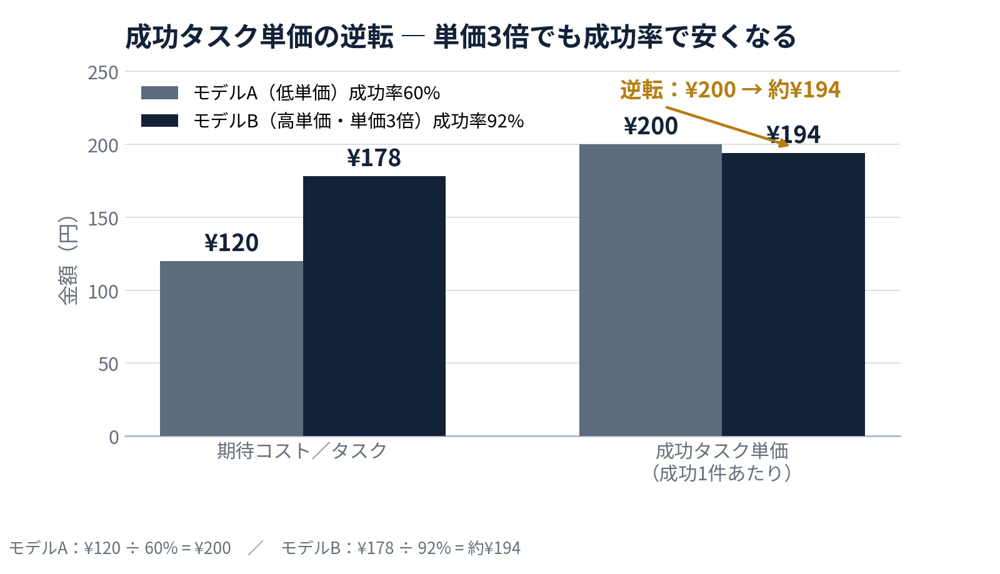

本書ではここまで、主に出荷前の評価を扱ってきた。評価セットを作り、軌跡を採点し、ジャッジを校正し、CIにゲートを置く。どれも必要な作業だが、それで評価が終わるわけではない。出荷は評価の開始である。オフライン評価が答えられるのは「用意したケースに対して、今の実装がどれくらい耐えるか」までである。本番の入力の分布も、想定外の使い方も、外部ツールの挙動の変化も、オフライン評価には入っていない。出荷した瞬間から、評価の対象はテストケースではなく現実のトラフィックに移る。

この章で扱う判断は一つだけである。出荷後の評価を、どの指標で、どれだけのコストをかけて回し続けるか。モデルは差し替わり、プロンプトは書き換わる。連携先のAPIは仕様を変え、ユーザーの使い方も少しずつずれる。昨日まで正しかった成功率の数字が、今日も同じ意味を持つとは限らない。

継続評価とは、ずれを検知し、修正し、再び測れる状態に戻すための運用そのものである。設計すべきは評価の仕組みというより、評価が止まらないための仕組みだと言ったほうが近い。

## オフライン評価は本番の代理にすぎない

オフライン評価とオンライン評価は、別の道具ではなく一つのループとして設計するのが実務的である。本番で失敗が見つかったら、トランスクリプトを捨てず、再現可能なケースに整形して回帰スイートに入れる。修正したら、個別のケースだけでなくスイート全体で劣化がないかを確認し、再び本番に戻す。この往復が止まった時点で、スイートは現実からずれていく。なお、このループのうち安全性に関わる失敗（攻撃が通った軌跡）の追加先と証跡の残し方は第10章で扱った。本章のループは品質側、つまり通常タスクの失敗を対象にする。証跡の保存形式と保存期間も第10章の設計に従い、ここでは繰り返さない。

ケース化で意識すべきは、失敗をそのまま保存しないことである。本番のトランスクリプトには、個人情報や業務固有の機密、再現に不要な偶然の要素が大量に混ざっている。残すべきは失敗の構造である。整形の変換を、匿名化した類型例（実在のトランスクリプトではない）で1件通して示す。

生の失敗トランスクリプト（要約）: 「利用者が『先月の請求書をもう一度送って』と依頼。エージェントは請求検索ツールを先月＝先々月と解釈して呼び出し、発行済みの古い請求書PDFを再送した。利用者の会社名、担当者名、金額、振込先口座がトランスクリプトに含まれる。利用者は直後に『違う、未払いのほう』と訂正した。」

整形後のケース:

- 入力（最小化）: 相対表現（「先月」）で対象期間を指定し、請求書の再送を依頼する。対象期間の候補が2つある文脈。
- 前提条件: 発行済み請求書が2件あり、うち1件が未払い。
- 期待するoutcome: 対象を特定できない場合は確認質問を返す。または未払いの請求書を候補として提示してから送る。
- 失敗の構造: 曖昧な期間指定を、確認なしに一意に解釈してツールを実行した。
- 除去したもの: 氏名、会社名、金額、口座情報、文書ID。日時は相対関係だけを残した。

第3章の「収穫」との差分は、本番由来であることに起因する注意点である。第一に、除去の対象が合成データより広い。偶然混ざった第三者の情報まで含むため、整形は公開前のレビューを必須にする。第二に、失敗の判定根拠が利用者の訂正や後段システムの記録にしか残っていないことが多く、判定根拠をケースに明記しないと後の担当者が失敗かどうかを再判定できない。第三に、発生頻度の情報である。本番由来のケースには「月に何件起きたか」を付けておくと、スイート内での優先順位付けに使える。合成ケースにはない情報である。

このループを回すには、本番側の記録が要る。すべての実行について、入力、最終的な成否、たどったステップとツール呼び出しをひも付けて残す。モデルとプロンプトのバージョン、所要時間とコストもあわせて残す。記録できていれば、障害対応そのものが評価セットへの投資になる。

## トレース収集の基盤と、サンプリング評価の前提

収集の基盤としては、LangfuseやLangSmithのようなトレーシング基盤を使うのが現実的な選択肢である。選定の軸と課金単位の比較は第8章で扱った。本章では、基盤費の試算だけを後の予算の節で行う。自前のログ基盤に寄せる選択もありうるが、トレースの階層表示やバージョンとのひも付け、後付けのスコアリングを自作するコストは小さくない。まずは既存の基盤に乗せ、制約が明確になってから移行を検討するほうが開始は早い。

本番のオンライン評価で前提にすべきなのは、全件評価ではなくサンプリングである。すべてのトレースにLLM-as-a-Judgeを走らせれば、評価コストが本体の推論コストに近づくことも珍しくない。通常のトラフィックからは一定率で無作為に抽出する。低スコアのものや、ツールエラー・上限到達を含むものは抽出率を上げる。そうした層別サンプリングが扱いやすい。無作為な層は必ず残す。層別サンプリングは「全体を推定するための無作為層」と「失敗を効率よく拾うための重点層」に分けて考え、集計も分ける。混ぜて集計すると、重点層の失敗が全体の失敗率を水増しして見せる。

サンプリング率の決め方には統計の側から目安を置ける。成功率の推定に必要なサンプル数は、許容誤差e、信頼水準95%として n＝1.96²×p(1−p)／e² で見積もる。成功率pを0.9と想定した場合と、最も保守的なp＝0.5の場合を並べる。

| 許容誤差 | n（p＝0.9想定） | n（p＝0.5、保守的） |
|---|---|---|
| ±5ポイント | 約140件 | 約390件 |
| ±2ポイント | 約870件 | 約2,400件 |
| ±1ポイント | 約3,500件 | 約9,600件 |

日次の傾向を±2ポイントで追いたいなら、無作為層は日に900件程度が目安になる。トラフィックが日に3万件なら率は3%で足りる。逆に日に500件しかないサービスでは、全件に近い率でなければ日次推定は成立せず、週次に束ねて見る設計に変えるほうがよい。「日に数百件で傾向は追える」という言い方は、±5ポイント前後の粗さでよければ、という条件付きでのみ成り立つ。

稀な失敗の検出は別の計算になる。発生率pの失敗を少なくとも1件拾う確率は 1−(1−p)^n である。発生率0.1%（1,000件に1件）の失敗では、n＝700件で約50%、n＝3,000件で約95%、n＝4,600件で約99%になる。つまり0.1%の失敗を95%の確率で拾うには約3,000件のサンプルが要り、しかも拾えるのは「1件以上」であって、率の推定にはさらに桁違いの件数が要る。稀な失敗はサンプリングではなく、ルールベースの検出（特定ツールのエラー、上限到達、禁止パターンの一致）やユーザー報告の経路で拾う。サンプリングは全体傾向の把握に使う。このように役割を分けるべきである。

## コストは成功したタスクあたりで見る

コストの見方について、本書の立場は明確である。コストはコール単価ではなく成功タスク単価で見る。安いモデルに替えて呼び出しが半額になっても、失敗とリトライが増えて成功率が下がれば、仕事は高くつく。意味を持つのは、成功したタスク1件あたりのコスト、つまり cost per successful task である。分子は一定期間の推論、ツール実行、評価にかかった総コスト、分母はその期間に成功と判定されたタスク数とする。

中心指標の計算を、仮定を明示した2モデルの比較で示す。数値は実在モデルの実測ではなく、計算の型を示すための仮定である。1ステップあたり単価は、そのステップの入力・出力トークンとツール実行費を加重平均したものとする。リトライ率は、失敗または上限到達で最初からやり直す試行の割合で、追加試行のコストは平均と同じと仮定する。

| 項目 | モデルA（低単価） | モデルB（高単価） |
|---|---|---|
| 1ステップあたり単価 | 6円 | 18円 |
| 平均ステップ数／試行 | 16 | 9 |
| リトライ率 | 25% | 10% |
| 期待コスト／タスク（単価×ステップ×(1＋リトライ率)） | 6×16×1.25＝120円 | 18×9×1.10≒178円 |
| 成功率 | 60% | 92% |
| cost per successful task | 120÷0.60＝200円 | 178÷0.92＝約194円 |

ステップ単価が3倍のモデルBが、成功タスク単価では逆転して安くなる。差を生んでいるのは単価ではなく、ステップ数とリトライと成功率である。逆転の分岐点も計算できる。モデルBの期待コスト178円がモデルAの成功タスク単価200円と並ぶのは、Bの成功率が178÷200＝89%のときである。つまりBの成功率が89%を下回れば逆転は消える。逆にAは、成功率が120÷194＝約62%まで上がればBに並ぶ。モデル選定の議論は「単価が何倍か」ではなく「成功率が分岐点のどちら側にあるか」で行うべきであり、そのためには成功率の推定精度（前節のサンプル数）が前提になる。

成功の判定が曖昧なタスクでは、分母がぶれる点に注意が要る。観測方法は、ユーザーからの明示的なフィードバック、後段の業務システムでの完了記録、ジャッジによるサンプリング評価などである。タスクごとに「成功とは何か」の観測方法を先に決めておく。判定方法を変えたら、変更日と理由を残し、系列をそこで切る。成功率が高い水準に達した後は、成功タスク単価だけを見ると安易なコスト削減が成功率を静かに削る方向に働く。指標は単独で目標化せず、成功率の下限とセットで運用するのが原則である。

コストと並んで置くエージェント固有のシグナルは、次の5つに絞る。各指標に計算式、集計窓、除外条件を付ける。

| 指標 | 計算式 | 集計窓 | 除外・注意 |
|---|---|---|---|
| cost per successful task | 期間の総コスト（推論＋ツール＋評価）÷成功タスク数 | 日次集計、判断は週次 | 成功の定義を変えた日で系列を切る |
| ツール呼び出しエラー率 | エラーになった呼び出し数÷全呼び出し数 | 1時間窓と日次 | リトライで回復したエラーも分子に含める（劣化の早期検知のため）。回復率は別系列で併記する |
| タスクあたりステップ数（p95） | 完了タスクのステップ数の95パーセンタイル | 日次 | 上限到達で打ち切られたタスクは別系列にする |
| ループ検出数 | 同一ツール・同一引数（正規化後）の呼び出しが5分窓内に4回以上現れた実行の件数 | 日次 | ポーリング等の冪等な繰り返しが仕様のツールは除外リストに置く |
| ステップ上限到達率 | 上限到達で打ち切られた実行数÷全実行数 | 日次 | 上限値そのものを変更した日で系列を切る |

ステップ数のp95がじわじわ伸びているときは、モデルや外部APIの挙動が変わり、迂回や再試行が増えている兆候であることが多い。指標を増やしすぎると誰も見なくなる。新しい指標を足すときは既存のどれかと置き換える、くらいの規律があったほうがダッシュボードは長持ちする。

## アラートは率で置く — 即時通知は3種に絞る

アラートは、件数ではなく率に対してしきい値を置くのが基本になる。トラフィック量は時間帯で大きく変わり、件数のしきい値は夜間に無反応で昼間に過敏になりがちである。しきい値の置き方には、決め方の手順と初期値の両方を示す。手順は次のとおりである。まず直近4週間の日次（または時間帯別）の値からベースライン分布を取り、平均と標準偏差σを出す。発報ラインは原則として、平均から3σ外れた位置に置く。率の指標では絶対値の下限（例: 成功率なら5ポイント以上の低下）を併用する。σが小さすぎる指標で過敏にならないようにするためである。そのうえで、最小サンプル数と継続時間を満たした場合にだけ発報する。

初期値の例を指標別に置く。自社の分布が取れるようになったら、分布由来の値に置き換える。

| 指標 | 発報条件（初期値） | 宛先 |
|---|---|---|
| 成功率（無作為層） | 直近4週の同曜日・同時間帯の平均から5ポイント以上低下が2時間継続、かつ窓内のサンプル200件以上 | 即時通知 |
| cost per successful task | 7日移動平均が直近4週平均の+20%超、3日連続 | 即時通知 |
| ツール呼び出しエラー率 | ベースライン+3σかつ絶対値で+2ポイント以上が30分継続、かつ呼び出し500回以上 | 即時通知 |
| ステップ数p95 | ベースライン比+30%以上が3日連続 | 週次レビュー |
| ステップ上限到達率 | ベースラインの2倍以上、かつ実行200件以上 | 日次サマリ |

人を起こすのは上の表で即時通知にした3種に絞る。それ以外はサマリとレビューで扱う。すべての異常を同じチャンネルに同じ強さで流すと、受け手はやがて全部を弱く扱うようになる。

もう一つ効くのが、発報条件に「再現性」を入れることである。単一のトレースの失敗では発報しない。同じ失敗パターンが複数件まとまって観測されたときに初めてアラートにする。発報したアラートについては、実際に対応が必要だったかどうかを後から記録し、不要だったアラートの条件は四半期ごとに見直す。見直しの進め方は保守の節のカレンダーに組み込む。

## 評価そのものに予算を付ける

見落とされがちだが、評価にもコストがかかる。トレースの保存、ジャッジの推論、人間によるレビュー、基盤の利用料である。評価コストを「運用費」に埋もれさせず、評価予算として独立に設計しておくことを勧めたい。月にいくらまで使ってよいのかが決まっていれば、サンプリング率もレビュー体制も、その範囲内で調整できる。

まずジャッジ費用を、単価の仮定ではなくトークン量から積み上げる。ジャッジモデルにGPT-5級のモデル（2026年10〜11月時点の公開単価で入力100万トークンあたり1.25ドル、出力10ドル）を使い、為替を1ドル150円と仮定する。1トレースあたりの入力はトランスクリプトとルーブリックで、短い軌跡で約8,000トークン、長い軌跡で約50,000トークン、平均30,000トークンと置く。出力は判定と理由で約400トークンとする。すると1件あたりは次のとおりである。入力は30,000×1.25÷100万＝0.0375ドル、出力は400×10÷100万＝0.004ドルである。合計は約0.042ドル、つまり約6円になる。軌跡の長さで2円から10円程度まで動く値であり、「ジャッジ1件いくら」は自社の平均トランスクリプト長から毎月実測し直すのが正しい。人間レビューは、1件3分の確認作業、時給換算6,000円として1件300円と置く。これは人件費の仮定であり、レビューの深さで変わる。

基盤費も変動費として計算に入れる。課金単位の比較自体は第8章に譲るが、試算の手順は本章の担当である。前提を置く。前提は次のとおりとする。月間30万トレースを全件収集する。1トレースは平均8個の観測（モデル呼び出しとツール呼び出し）を持つ。サンプリングで判定したトレースには、スコアが1つ付く。2026年11月時点の公開料金は次のとおりである。Langfuse CloudのCoreは月29ドルで、100,000ユニットを含む。超過分は100,000ユニットあたり8ドルから逓減する（ユニットはトレース、観測、スコアの各1件）。この前提ではユニット数は300,000×（1＋8）＋判定15,000件＝約272万ユニットとなり、料金は29＋72＋約120＝約221ドル、約33,000円になる。LangSmithはPlusが1席あたり月39ドルで10,000トレースを含み、超過は1トレース0.005ドルである。同前提では（300,000−10,000）×0.005＋39×3席＝約1,570ドル、約235,000円になる。なおこの試算は、第8章・付録Cの試算とは前提が違う。第8章は為替1ドル=158円、付録Cは米ドル建てで円換算をしていないのに対し、本章は1ドル=150円で換算している。規模も、第8章パターンA（月10万trace・平均30ステップ）や付録C §3（月11万実行・7ユニット換算）とは異なり、本章は月30万トレース・平均8観測である。金額を章またぎで直接比べず、各章の前提に引き直して読むこと。差を生むのは単価ではなく課金単位であり、ステップ数の多いエージェントでは観測数で数える方式が効いてくる。逆に、サンプリング率を5%から20%に上げても基盤費はほとんど動かない。Langfuseではスコアのユニットが45,000件増えるだけで、金額では数ドルである。つまり基盤費は、サンプリング率に対してはほぼ固定だが、トラフィック量と1トレースあたりのステップ数に対しては変動費である。「固定費」と置くのも「率に比例する」と置くのも、どちらも正確ではない。料金は変動が速いので、契約時点で公式の料金表を再確認し、この試算の前提だけを自社の値に差し替えて使うこと。

そのうえで、サンプリング率と監視費のトレードオフを計算する。前提は、月間の本番タスク数30万件、ジャッジ約6円／件（上の積み上げ）、人間レビューはジャッジ対象の10%に1件300円、基盤費はLangfuse前提で約33,000円とする。

| 項目 | 率5% | 率20% |
|---|---|---|
| ジャッジ対象 | 15,000件 | 60,000件 |
| ジャッジ費用 | 約90,000円 | 約360,000円 |
| 人間レビュー | 1,500件、約450,000円 | 6,000件、約1,800,000円 |
| 基盤費 | 約33,000円 | 約33,000円 |
| 評価費の合計（月） | 約573,000円 | 約2,193,000円 |

率を4倍にすると、ジャッジとレビューは4倍になるが基盤費はほぼ動かず、合計は約3.8倍になる。4倍の費用で買えるものは主に二つある。一つは成功率の推定精度の向上、もう一つは中程度の頻度で起きる失敗の検出速度の向上である。推定精度はサンプル数の平方根に比例してしか改善しない。率を4倍にしても誤差は半分にしかならない。すでに日次の傾向把握に十分な精度があるなら、増分は割に合わない。判断材料は精度の理論値ではなく、「先月にサンプルから見つかり、修正につながった失敗が何件あったか」という運用実績のほうである。

予算の配分でもう一つ決めておくべきは、評価予算を本体の推論コストとどう関係付けるかである。実務では、本体コストに対する比率で上限を置く方法が扱いやすい。たとえば評価の変動費は本体の推論コストの10〜20%以内を目安とする。比率自体に普遍的な正解はない。タスクの失敗が業務に与える影響の大きさで決めるべきものである。ただし上限の置き方を先に合意しておけば、トラフィックが10倍になったときに評価費も無言で10倍になる事態は避けられる。トラフィックの増加に対しては、率を下げてサンプル件数を一定に保つ設計が基本になる。母数が増えるほど、低い率でも精度は保てるためである。

## スイートは腐る — 保守と年間カレンダー

最後に、評価スイート自体の保守について触れておく。スイートは作った時点が最も新鮮で、後は劣化していく。分かりやすい兆候が飽和である。全ケースで満点が続いている状態は、エージェントが完成した証拠ではなく、測れていない証拠だと考えるべきである。飽和の検知自体は単純で、ケースごとの直近の合格率を並べ、一定期間すべて合格しているケースの割合が増え続けていないかを見る。満点のケースへの対処（引退の判断基準と、飽和がモデル選定を誤らせる経路）は第12章の参照パターンにまとめた。本章では保守の置き場所、つまりカレンダーと担当に絞る。

| 頻度 | 作業 | 所要時間の目安 | 成果物 |
|---|---|---|---|
| 月次 | 本番から収穫した失敗のケース化の滞留確認 | 2時間 | 滞留件数と解消計画 |
| 月次 | アラートの誤報レビュー（発報件数と実対応の突き合わせ） | 1時間 | 誤報率、条件の修正案 |
| 四半期 | 新規ケースの正式な取り込みと、前提が変わったケースの引退 | 1〜2日 | スイートの版、引退理由の一覧 |
| 四半期 | ジャッジの再校正（第6章の手順） | 半日 | 校正結果とkappaの記録 |
| 変更イベントごと | モデル・プロンプトの大きな変更時のベースライン取り直し | 半日 | 新旧ベースラインの対応表 |
| 年次 | 成功の定義と指標体系の見直し | 1日 | 定義の版、指標の追加・廃止の記録 |

難しいケースだけを残すと時系列の比較ができなくなるため、固定した中核のケース群は残し、周辺を入れ替える二層構造にしておくと、比較可能性と新鮮さを両立しやすい。保守の責任者も曖昧にしない。スイートの保守は全員の仕事であると同時に、誰の仕事でもなくなりやすい。ローテーションでもよいので、その期の保守担当を決め、ケースの追加と引退の判断をその担当が担う形にしておく。引退は削除ではなく履歴を残したうえでの無効化とし、判断理由を一行残す手続きにしておくと、引退への抵抗は下がる。

本書を通じて繰り返してきたのは、公開ベンチマークの数字をそのまま信じるな、ということである。代わりに、自前のケースで測り、ジャッジを校正し、出荷後も測り続ける。コストもまた、呼び出しの単価ではなく、成功したタスク1件がいくらで済んだのかで語るときにだけ、設計の判断に使える数字になる。この二つを運用として回し続けられるかどうかが、エージェントをデモで終わらせないための最後の分かれ目である。
