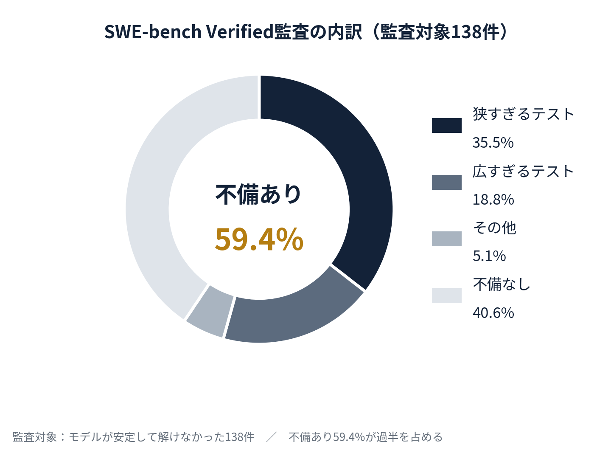

デモは動きました。画面の前で、エージェントは資料を読み、ツールを呼び、もっともらしい手順でタスクを終えました。「あとは本番につなぐだけですね」。この一言が、だいたい一番危ないです。

本番はデモの続きではありません。入力は整っていません。権限は足りず、外部サービスは遅れます。利用者は想定した順番では話してくれず、途中で条件が変わることもあります。デモで見た成功は、条件の良い一回分の記録にすぎません。一回の成功を、なぜ私たちは「だいたいできる」と読み替えてしまうのでしょうか。そのまま出荷判断をしてしまいます。その読み替えを補強してくれる数字が、つい最近まで外にありました。公開ベンチマークのスコアです。

本書の主張は単純です。公開ベンチマークのスコアは、自分のエージェントの品質については、ほぼ何も教えてくれません。モデル選びの初期の目安にはなります。自分のエージェントが本番で壊れるかどうかは、教えてくれません。対象は自分のプロダクトであり、使うのは自分のツールと権限とデータです。2026年には、その「目安」自体の足場も揺らぎました。

この章では、デモと本番の差を確認し、2026年に起きたことを出典付きで並べ、最後に公開スコアの読み方をチェックリストと実演で示します。試読だけで、ベンチマークの数字をどう扱えばよいかの判断材料を持ち帰れるようにします。

## デモの成功が本番の品質を保証しない理由

デモが当てにならない理由は、作る側に悪意があるからではありません。デモは性質上、通る道を選んで見せるものだからです。入力例は事前に用意され、ツールは正常に応答し、想定外の割り込みは入りません。失敗した試行は画面に出てきません。

本番の失敗は、種類ごとに分けておくと対策に接続できます。第4章以降で扱う障害パターンの予告として、最低限この4分類で見ます。

| 失敗パターン名 | 起きる条件 | デモで見えない理由 | 損失の型 | 自前評価での検出方法 |
|---|---|---|---|---|
| 条件の後出し | 利用者が途中で条件を追加・変更する | 入力が固定され割り込みがない | やり直し・信用 | 途中で条件が変わるtaskを用意する（→第5章） |
| 陳腐化した参照 | 参照文書が古い版だった | fixtureが常に最新に保たれる | 誤案内・金銭 | 版の異なる文書を混ぜたfixtureで測る（fixture一般の設計は第3章） |
| 部分的権限不足 | 読み取りはでき書き込みだけ失敗する | デモ環境は全権限で動く | 処理の宙吊り・データ不整合 | 権限を絞った環境で最後まで通す（→第10章） |
| リトライの二重実行 | タイムアウト後に再試行し、初回も実は成功していた | 正常応答しか見せない | 金銭・データ破壊 | タイムアウトを注入し、最終状態の重複を確認する（→第5章。なお同一引数の無意味な再試行そのものは第4章のfutile retryとして扱う） |

本章後段で使う付録Aの正典リストの5分類（FC-01〜FC-05）とは用途が異なる。この4分類は本番障害の発生条件の分類であり、FC分類はtrialの失敗の型の分類である。失敗分布を数えて対策の優先順位を付けるときは、FC分類で数える。

もう一つ、成功と失敗のコストは非対称です。成功が九回あっても、残り一回で利用者のデータを壊すことがあります。誤った内容を外部に送ることもあります。その一回が全体の評価を決めます。平均的にどれくらいできるかという問いと、困る場面でどう壊れるかという問いは別です。出荷判断で必要なのは主に後者ですが、デモも公開ベンチマークも、主に前者についての情報しか提供しません。

結果の正しさと手順の妥当さは、分けて見る必要があります。最終結果だけ見ると正解に見えても、途中で本来触るべきでないものに触れていることがあります（定義と採点方法は第2章で扱います）。

## 2026年に公開ベンチマークの信頼が揺らいだ出来事

2026年は、公開ベンチマークへの信頼の置き方を見直さざるを得ない出来事が重なった年でした。共通する論点は、タスクの作り方、採点の仕方、そして公開されたタスクを学習に使えてしまう構造です。本章の主張は外部事実に依存するので、数値には出典を添えます。出典なしの精密な数字は置かない、というのが本書自身のルールでもあります。

象徴的だったのはSWE-bench Verifiedの扱いです。コーディングエージェントの実力を測る代表的な物差しとして長く参照されてきました。OpenAIは2026年2月23日、監査結果を公表し、このベンチマークの報告を停止しました。ここで注意が必要なのは「59.4%」の分母です。全500タスクの59.4%ではない。監査対象は、モデルo3が64回の試行で一貫しては解けなかった（解ける回もあった）138件（全体の27.6%）である。その59.4%に、テスト設計または問題記述の重大な不備があった。これが正確な読みです。不備の内訳は、特定の実装を要求する狭すぎるテストが35.5%、問題文にない機能まで確認する広すぎるテストが18.8%、その他が5.1%です。不備のあるテストでは、本来通るべき修正が落ちたり、不十分な修正が通ったりします。全体に換算すれば少なくとも82件、16.4%が該当する計算になりますが、それでも小さくありません。



あわせて訓練データ汚染も確認されました。OpenAIが検証した3モデル（GPT-5.2-Chat、Claude Opus 4.5、Gemini 3 Flash Preview。推論モデルは対象外）すべてが、一部のタスクについて正解パッチ（gold patch）や問題文の詳細を逐語的に再現できました。解くべき問題と答え側の情報が、評価される側に紛れ込んでいたことになります。OpenAIは、スコアの伸びが実力ではなく訓練時の露出を色濃く反映するようになった、と結論づけました。

> 出典ボックス1〔報告主体／OpenAI／文書名／"Why we no longer evaluate SWE-bench Verified"（邦題相当：SWE-bench Verifiedを評価しなくなった理由）／公表日／2026-02-23／URL／https://openai.com/index/why-we-no-longer-evaluate-swe-bench-verified/ ／依拠箇所／監査方法（138件・64試行）と不備の内訳、汚染の確認、報告停止の宣言〕

別の角度から効いたのがMETRの検証です。自動採点を通ったプルリクエストのうち、約半分はメンテナがマージしない、という結果です。調査では、3リポジトリ（scikit-learn、Sphinx、pytest）の現役メンテナ4人が、自動採点を通ったAI生成PR 296件をレビューした。比較は、両系列をそれぞれのgolden baselineで割って正規化して行われている。自動採点側のbaselineは100%であり、メンテナ側のbaselineは、人間が書いて実際にマージされた47件のPR（golden patches）に対するメンテナの承認率68%である。その正規化後の差が平均で約24ポイント（24.2ポイント、標準誤差2.7）だった。この集計では、自動採点を通らなかったPRはメンテナも落とすと仮定（impute）している。変更要求の理由は、構造化フィードバックでは3分類だった。中核機能の不具合、他のコードを壊す変更、コード品質（設計や規約への不一致、余計な変更を含む）である。テストを通すことと、実際のリポジトリに受け入れられる変更であることは別だったのです。ただしMETR自身は、エージェントにはレビュー指摘を受けて反復修正する機会が与えられていない単発提出の結果であり、根本的な能力限界とは主張しない、と留保しています。

> 出典ボックス2〔報告主体／METR／文書名／"Many SWE-bench-Passing PRs Would Not Be Merged into Main"／公表日／2026-03-10／URL／https://metr.org/notes/2026-03-10-many-swe-bench-passing-prs-would-not-be-merged-into-main/ ／依拠箇所／対象PR 296件、メンテナ4人・3リポジトリ、golden baseline 68%（47件）、マージ率との差約24ポイント、却下理由の3分類〕

この結果をコーディング以外へ一般化できる範囲は、限定して考えるべきです。一般化が言えるのは「受け手の裁量が残る業務」についてであり、全業務ではありません。構造を揃えた事例パターンを2つ挙げます。

| 業務 | 自動採点で検出できる部分 | 検出できない部分（受け入れを決める） |
|---|---|---|
| カスタマーサポート | ポリシー文面の引用が正しいか、必須の案内項目が入っているか | 対象注文を取り違えていないか。文面が正しくても別人の注文を処理すれば受け入れ不可 |
| 文書作成（報告書） | 必須項目の充足、書式、文字数 | 前提数値が最新版か。項目が揃っていても前提が古ければ差し戻し |

逆に、受け手の裁量がほぼ残らない業務（定型の分類、形式変換）では、自動採点と受け入れ可能性は大きくずれにくいです。一般化の主張は「形式的な合格条件と受け入れ可能性が一致しないのは、受け手の判断が介在する業務においてである」と範囲を切って使います。

飽和の問題もあります。GAIAでは、自己申告制のリーダーボード（テストセット）で94%台のスコアが報告され、人間のベースライン92%（原論文、2023年）を超えたとされます。ただしこの数字には留保が要ります。PrincetonのHALが検証セットで自ら再実行した最良の結果は74.55%（HAL Generalist Agent、Claude Sonnet 4.5）である。分割も実行条件も違うため、両者は直接比べられません。94%という数字が示すのは「汎用タスクは解けた」ということではなく、「自己申告のテストセット上では天井に近づいた」ということまでです。スコアが天井に近づいたベンチマークは、モデル同士の差を測る道具としての役目を終えつつあります。残りの数%に何が含まれているか分からなければ、実務の判断材料にはなりません。

> 出典ボックス3〔報告主体／GAIAリーダーボード（Hugging Face上の公開結果）およびPrinceton HAL／資料名／GAIA public leaderboard results、HAL leaderboard／URL／https://huggingface.co/spaces/gaia-benchmark/leaderboard 、https://hal.cs.princeton.edu/gaia ／確認時点／2026-11-21／時点／2026-11-03提出のKeen AgenticOS V1.1が94.35%（自己申告・テストセット）。人間のベースライン92%は原論文（Mialon et al., 2023）の値。HALの再実行最良74.55%はHAL Generalist Agent（Claude Sonnet 4.5）による検証セットでの値で条件が異なる〕

さらにMETRは、タイムホライズンのページについて「積極的には更新しない」と明記しました。タイムホライズンは、エージェントがこなせるタスクの長さを示してきた指標です。最終更新は2026年9月8日でした。よく引かれる物差しの更新が止まり、新規モデルの測定が追加されなくなっていきます。2026年はそういう年でした。

> 出典ボックス4〔報告主体／METR／資料名／"Task-Completion Time Horizons of Frontier AI Models"／URL／https://metr.org/time-horizons ／確認時点／2026-11-21／最終更新／2026-09-08（ページ上に "no longer actively updated" と明記）〕

注意しておきたいのは、これらが「ベンチマークは無意味になった」という結論を直接は意味しないことです。ベンチマークはモデル開発側では依然として意味を持ちます。問題は利用する側、とりわけ自社のエージェントの出荷判断に使う側にあります。開発側の進捗確認のための数字を、そのまま利用側の品質保証の数字として流用してきました。その流用が成り立ちにくくなった、というのが本書の読み方です。

## 公開スコアを割り引く三つの要素：ハーネス・汚染・検証者エラー

では、どう読めばよいのでしょうか。必要なのは、ベンチマークを貶めることではありません。読み方を知ることです。本書ではこれをベンチマーク・リテラシーと呼びます。割り引く要素は三つあります。

一つ目は実行ハーネスの差です。たとえば、与えるツールやリトライ回数、制限時間を変えるだけで、結果はかなり動きます。プロンプトの置き方や状態の保持の仕方でも動きます。公開スコアは「モデルと特定のハーネスの組み合わせ」の成績であって、自分の実装の成績ではありません。

二つ目は訓練データ汚染です。問題が公開されている以上、学習データに含まれる可能性は常にあります。汚染があると、推論で解いたのか見覚えで解いたのか区別できません。本番で渡されるのは未見のタスクばかりですから、推論か見覚えかの区別は実務では致命的です。

三つ目は検証者エラーです。合否を決めるテストや採点基準自体が間違っている、あるいは不十分な場合、正しい出力が落とされ、間違った出力が通ります。SWE-benchの監査で言えば、監査対象の範囲では過半に不備があったわけで、採点側を無謬だと思う根拠はありません。

### スコア読解チェックリスト（差・ハーネス・汚染の順に確認する）

割り引きは比喩ではなく、次の判定手順として使う。

**(1) スコア差の扱い。** まず検証者エラーの想定幅を見積もる。自社で採点側の誤りを測ったことがなければ、当面の目安として±5ポイントを置く。

これは根拠のある推定ではなく運用上の置き値である（SWE-bench監査では不備のあるタスクが全体換算でも16%以上あり、数ポイント以上の誤差が起こりうることの傍証にはなるが、そこから±5ポイントという幅自体は導けない）。

手順は次のとおり。単体スコアの幅を差の判定にも流用する簡便法として運用する（厳密には、2スコアの差の不確かさは単体の幅より大きくなりうる）。差が5ポイント未満なら「差があるとは言えない」で止める。5〜10ポイントなら、ハーネスが同一条件で、複数回の実行でも同じ向きの差が出る場合にのみ「差がありそう」と扱う。10ポイントを超えても、(2)(3)を通過しない限り出荷判断には使わない。

**(2) ハーネス照合表。** 次の4項目を埋める。不一致が2項目以上あれば、公開スコアはモデル選定の候補絞り込みまでにしか使わない。

| 項目 | ベンチマーク側 | 自社側 | 一致／不一致 |
|---|---|---|---|
| ツール定義（種類・引数・権限） |  |  |  |
| リトライ回数（上限・条件） |  |  |  |
| 制限時間（タスクあたり） |  |  |  |
| 状態保持（試行間のメモリ有無） |  |  |  |

**(3) 汚染の扱い。** 公開タスクと自社タスクの重なりを確認できない場合は分岐が決まっている。絶対値（90%だから安心、等）は判断材料から外し、同一ベンチマーク内での相対比較のみに用途を限定する。重なりを確認できた場合でも、その分は差し引いて読むのではなく、自社タスクでの実測に切り替える。

### 実演：GAIAの94%を割り引いて読む

公表値から順に通す。

1. **公表値**：GAIAテストセットで94.35%（Keen AgenticOS V1.1、2026-11-03提出、自己申告）。
2. **ハーネス差の確認**：提出側のツール構成・リトライ・制限時間は、公開情報からは確認できない。照合表では「不明＝埋まらない」として扱い、少なくともツール定義と状態保持は埋まらないものとして進める。
3. **汚染の扱い**：GAIAは検証セットの答えが公開側に含まれ、2026年には答えファイルの悪用で解かずに高得点を取る事例も報告されている（検証セットでの話であり、テストセットへの波及は未確認）。重なりの確認はできないので、絶対値は外す。

> 出典ボックス（実演ステップ3）〔報告主体／UC Berkeley RDI（Center for Responsible, Decentralized Intelligence）／文書名／"How We Broke Top AI Agent Benchmarks"（BenchJack監査）／公表時期／2026-04／URL／https://rdi.berkeley.edu/blog/trustworthy-benchmarks-cont/ ／依拠箇所／GAIA検証セット165件で、公開された答えファイルの読み込みと正規化関数の悪用により約98%を記録した報告〕
4. **検証者エラーの幅**：短い答えへの準完全一致採点では、表記ゆれで正解が落ち、偶然の一致で不正解が通る。±5ポイントの幅を置くと、94%は89〜99%のどこか、としか言えない。
5. **したがって自社判断ではこう読む**：この数字は「候補に入れる」根拠にはなるが、「自社の調査業務で9割成功する」という主張の根拠にはならない。判断に使うのは、自社タスクでの実測だけである。

打ち切り文を置いておく。**この表が埋まらない項目があれば、その数字は出荷判断に使わない。** 候補絞り込みまでに用途を下げる。

なお、この実演で使った手順は他のベンチマークでも同じです。スコア表を見たら、まず公表主体と提出形態（自己申告か第三者の再実行か）を確認し、次に照合表、最後に汚染の扱い、という順序を固定します。順序を固定しておくと、華やかな数字を見た場でも会議の議論が「順位」ではなく「条件」に向きます。この順序の固定が、チェックリストの実務上の効き目です。

## 公開スコアでは分からない、出荷判断に必要な情報

出荷判断で知りたいことと、その最小の測り方をセットで示します。詳細は後章に譲りますが、定義だけはここで渡します。

- **成功率**：自分の利用者が実際に投げる頼み方での成功割合。最小の測り方＝自社taskを各3 trial以上回し、trial単位の成功率とtask単位の全trial成功率を分けて出す（定義は第2章）。
- **失敗分布**：失敗したtrialを、付録Aの正典リストの5分類（FC-01 指示の取り違え／FC-02 ツール選択ミス／FC-03 根拠の不足／FC-04 止まるべき場面で止まらない／FC-05 権限確認の省略）で数える。分類ごとの件数が対策の優先順位になる。
- **安定性**：同じtaskを複数trial回し、「全trial成功したtaskの割合」で見る。1回でも成功した割合（pass@k型）とは別物で、出荷判断では前者を使う。詳細は第5章。
- **迷ったときの振る舞い**：情報不足のtaskと権限外の要求を含むtaskを意図的に混ぜ、確認を求めて止まるか、断るかを数える。成功率とは別に「不適切に進めた件数」を出す。
- **費用と時間**：成功一回あたりのコストは次の式で定義する。

```
cost per successful task = 総コスト（失敗trial・リトライ分を含む） ÷ 成功したタスク数
```

計算例：50 task × 3 trial = 150 trialを実行し、総コストが9,000円、成功trialが120件なら、9,000 ÷ 120 = 75円／成功trial。ここではオフライン評価の単純化として、1 trialを1回のタスク実行とみなす。成功したtrial数を、成功したタスク数に読み替えている。

**本章の例はtrial単位の近似（cost per successful trial）であり、第11章の定義（期間内に成功と判定されたタスク数で割るcost per successful task）とは異なる。** この計算例では、1 trialあたりの単価を暗に60円（9,000円÷150 trial）と置いている。これはこの例限りの仮定である。用途や構成が違えば単価は変わる（前提を明示しないまま他章の試算と比べないこと）。成功率80%の裏側で、失敗30件分のコストも分子に入っていることが分かる。成功trialだけで割る安い見積もりと比べると、この式のほうが正直である。

時間も同様に、成功trialだけでなく全trialの所要時間の中央値と上位（例：90パーセンタイル）を併記します。本格的なコスト設計は第11章で扱います。

自前の評価セットを持つチームと持たないチームでは、モデル更新時の会話が違う、というのは仮説として置いておきます。持つチームでは「どのタスク群が落ちたか」で議論できます。持たないチームでは、外部の評判に頼らざるを得ません。こうした構造は成り立つはずですが、観測事実ではなく本書の見立てです。本書はこの見立てを、以降の章で手順として具体化していきます。

## 第1章の持ち帰り：チェックリスト・失敗の4分類・費用の定義式

第1章の持ち帰りは3点に絞ります。スコア読解チェックリスト（差の扱い／ハーネス照合表／汚染の用途制限）、失敗の4分類、費用の定義式です。次章では、評価を語るための語彙と設計図を揃えます。task、trial、grader、transcript、outcomeを、自社の議論でそのまま使える形で定義し直します。
